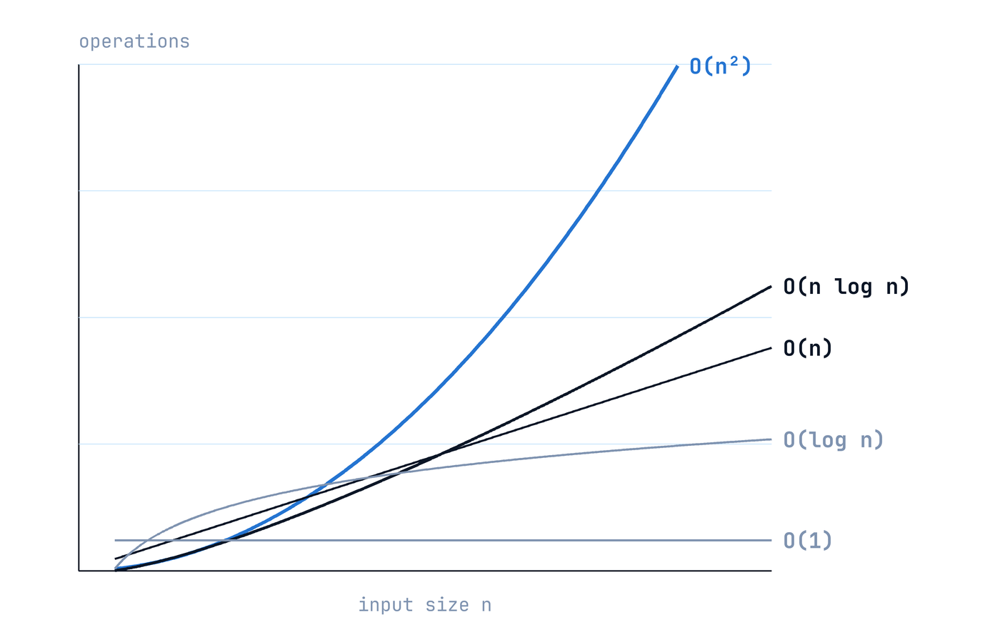
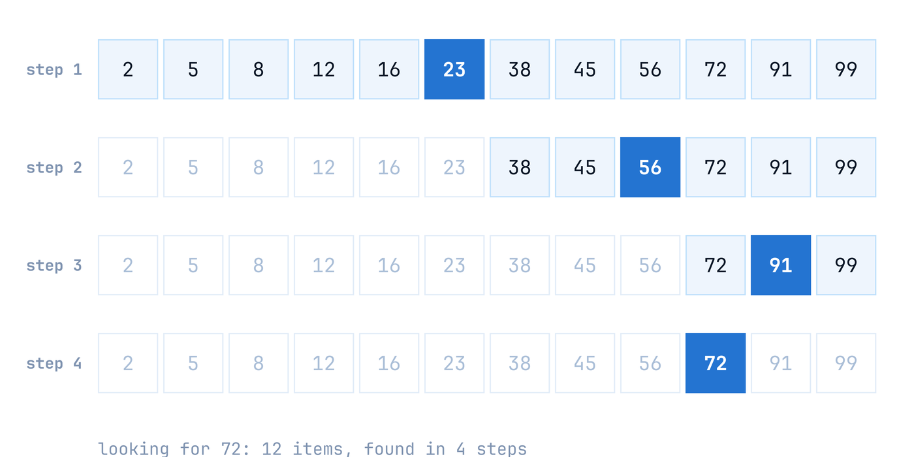

# Why Complexity Matters
Running time on one laptop tells you little. We want a way to compare algorithms that does not depend on the machine.

## The problem with timing code
- The same code runs faster on a faster CPU
- Timing changes with the input you happen to test
- What we really care about: **how cost grows as the input grows**
> Big-O describes the **growth rate** of an algorithm, not its exact speed.
Note: Start with a story — two programs, same task, one is fine at 100 items and dies at 1 million.

## Input size n
- `n` is the size of the input: items in a list, nodes in a graph, characters in a string
- We count **basic operations** (comparisons, assignments) as a function of `n`
- Then we keep only the part that dominates when `n` gets large

# Definition
What the notation actually says, and the rules for simplifying it.

## Formal definition
> f(n) = O(g(n)) if there exist constants **c > 0** and **n₀** such that f(n) ≤ c · g(n) for all n ≥ n₀.

## Simplification rules
1. Drop constant factors: 3n → **O(n)**
2. Drop lower-order terms: n² + n → **O(n²)**
3. Sequential steps add: O(n) + O(n²) → **O(n²)**
4. Nested loops multiply: n × n → **O(n²)**

## Big-O, Big-Ω, Big-Θ
- **Big-O**: an upper bound — the algorithm grows at most this fast
- **Big-Ω (Omega)**: a lower bound — it grows at least this fast
- **Big-Θ (Theta)**: a tight bound — both at once
- **In practice**: people say "Big-O" and usually mean the tight bound

# Common Complexities

## The usual suspects
| Complexity | Name | Example |
|---|---|---|
| O(1) | Constant | Access `arr[i]` |
| O(log n) | Logarithmic | Binary search |
| O(n) | Linear | Scan a list |
| O(n log n) | Linearithmic | Merge sort |
| O(n²) | Quadratic | Two nested loops |
| O(2ⁿ) | Exponential | All subsets of a set |

## How they grow
- For small `n`, every algorithm looks fast
- As `n` grows, the curves separate
- **O(n²)** leaves the others behind quickly
- **O(log n)** barely moves


## Reading a loop
- One loop over `n` items → O(n)
- A loop inside it over `n` items → O(n²)
- The inner work is constant → it does not change the class
```python
def has_duplicate(arr):
    for i in range(len(arr)):  # n times
        for j in range(i + 1, len(arr)):  # up to n
            if arr[i] == arr[j]:  # O(1)
                return True
    return False
# Total: O(n²)
```

## Halving means log n
```python
def binary_search(arr, target):
    lo, hi = 0, len(arr) - 1
    while lo <= hi:
        mid = (lo + hi) // 2
        if arr[mid] == target:
            return mid
        if arr[mid] < target:
            lo = mid + 1
        else:
            hi = mid - 1
    return -1
```
> Each step halves the search space, so it takes about **log₂ n** steps: 1,000,000 items → ~20 steps.

## Binary search, step by step


## ? What is the complexity of a loop that runs n times and calls binary search inside each iteration?
- The outer loop runs **n** times
- Each binary search costs **O(log n)**
- Nested work multiplies → **O(n log n)**

## Key takeaways
- Big-O is about **growth**, not seconds
- Keep the dominant term, drop constants
- Nested loops multiply, sequential steps add
- Halving the problem each step gives **log n**
