# What is a network

## A network
- **A network**: a set of devices connected to each other to provide a service
- **Packets = traffic = information**

## Characteristics of a network
- **Speed**
- **Cost**
- **Security**
- **Availability**: the possibility to access it
- **Reliability** (after the installation of the network): the information goes from A to B **without interruption**
- **QoS**: traffic is prioritized by importance
- **Virtualization**: a router has software to work
  - A router without software: we add a licence so that it can work (multitasking)

# Topologies

## Physical and logical topologies
- There are two kinds of topologies:
| | Physical topology | Logical topology |
|---|---|---|
| What it describes | the real layout of the devices and the cables | the way the data flows between the devices |
| Depends on | where the devices are and how they are cabled | the protocols and the access method |
| Seen as | what you see when you look at the equipment | what the traffic does on the network |
| Example | PCs all cabled to one switch: a **star** | the data moves as on a **bus**, or ring by ring |
- Two networks with the same cabling (physical topology) can behave differently (logical topology)

## Bus topology
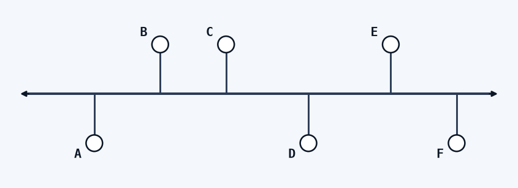
- **Problems**: security, collision, a single link
- Disturbance of the whole network (**single point of failure**)
  - e.g. with a single firewall: if it goes down or is hacked, the whole network is affected

## Star topology
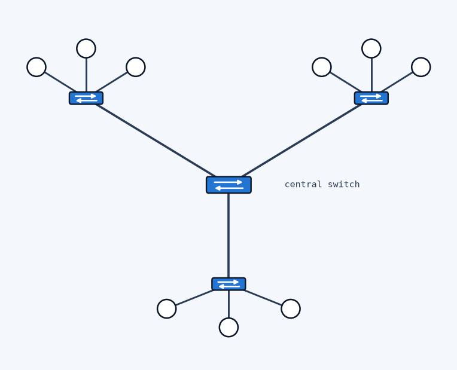
- Every device is connected to a central device (a switch)
- **Extended star**: several stars connected together

## Mesh topology
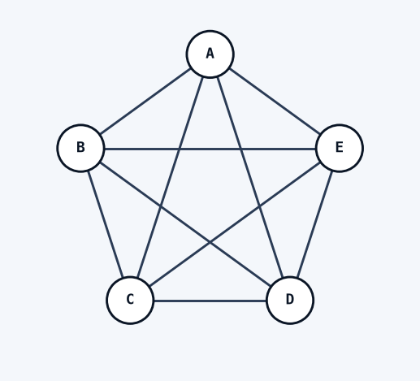
- **Mesh**: every component is connected directly to **all the other** components
- With 5 nodes: 10 links

## Partial mesh topology
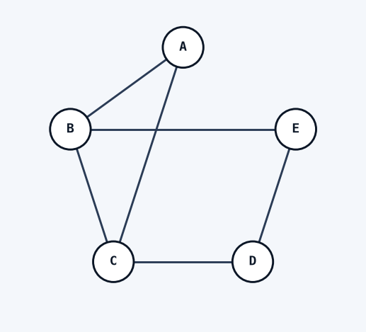
- **Partial mesh**: not all the components are connected to each other
- Here with the same 5 nodes: only 6 links

## The network card
- Every company has its own, specific network card
- So there can be a connection problem between components that contain different network cards

# Local area networks

## Local Area Networks
- A LAN is a network of computers and other components that are located relatively close together in a limited area
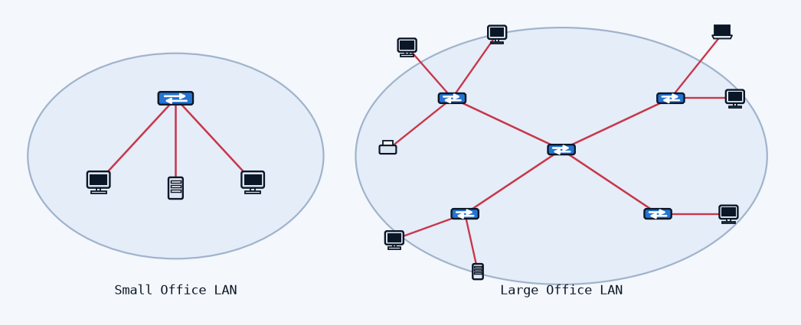

## LAN components
- **Computers**:
  - PCs
  - Servers
- **Interconnections**:
  - NICs
  - Media
- **Network devices**:
  - Switches
  - Routers
- **Protocols**:
  - Ethernet
  - IP
  - ARP
  - DHCP
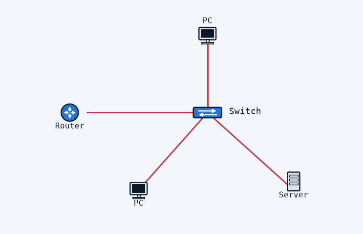

# The OSI and TCP/IP models

## The OSI model
- **Steps (layers)** before sending the data and after receiving it
| Layer | Name | What it does |
|---|---|---|
| 7 | Application | communication protocol, data format (img, text, png...), the interface |
| 6 | Presentation | compression and encryption (optional) |
| 5 | Session | a logical session that gives us control to carry out the transmission |
| 4 | Transport | the way to send the message: TCP / UDP |
| 3 | Network | IP address (logical) |
| 2 | Data link | MAC address (physical) |
| 1 | Physical | converts the bits into signals: electric current, radio waves or light |

## Layers 7, 6 and 5
1. **Application layer**: communication protocols (http, pop3, ftp...) + the format of the data (img, text, png...) + the interface
2. **Presentation layer** (data representation): format (img, pdf), compression and encryption: optional
3. **Session layer**: a logical session that gives us control to carry out the transmission of the data
- **Layers 7, 6 and 5 are software layers**: the network engineer does not deal with them, they concern the developers
- I can have a single session

## Layer 4: Transport
- **The way to send the message**
  - **TCP** (connected)
  - **UDP** (not connected)

## TCP
- **TCP** assures the **reception** of the message
- Three-way handshake and acknowledgement of reception
- Retransmission in case of error
- **Sequence numbers**: the packets are numbered (like numbered envelopes)
- **Window size**: how much data can be sent before an acknowledgement is received

## TCP: the three-way handshake
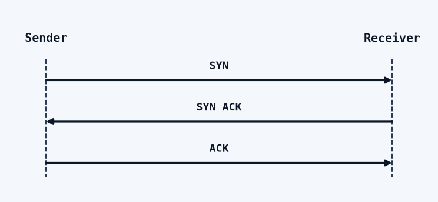
- **Three-way handshake**: assure the availability before sending
  1. The sender sends **SYN**
  2. The receiver answers **SYN ACK**
  3. The sender answers **ACK**

## UDP
- **UDP** sends the message **without assuring** that it arrives (if it does not arrive, too bad)
- Connectionless: no handshake, no acknowledgement, no retransmission
- **Fast** and light
- Generally used for **live streaming** and **real-time applications** (video, voice, online games)
- Also used by short request/response protocols, such as DNS and DHCP
> UDP is a speed choice: a late packet is worth less than a lost one.

## Port numbers
- Each protocol has a **transport port number**
- A server (FTP, ...) offers several services: each one has its own port number
- **Well-known ports: 1 → 1024**
- Above 1024: random ports (the client side)

## Well-known ports
| Service | Port | Transport |
|---|---|---|
| FTP (data / control) | 20 / 21 | TCP |
| SSH | 22 | TCP |
| Telnet | 23 | TCP |
| SMTP | 25 | TCP |
| DNS | 53 | UDP and TCP |
| DHCP | 67 / 68 | UDP |
| TFTP | 69 | UDP |
| HTTP | 80 | TCP |
| POP3 | 110 | TCP |
| NTP | 123 | UDP |
| SNMP | 161 | UDP |
| HTTPS | 443 | TCP |
| Syslog | 514 | UDP |

## DNS: UDP and TCP
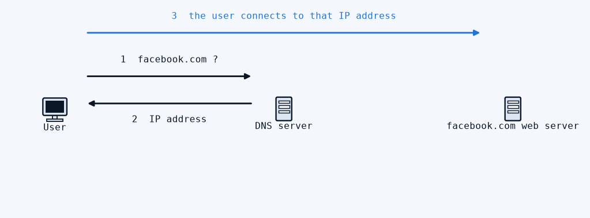
- The **DNS** translates a name (facebook.com) into an **IP address**
- It uses **UDP and TCP** (UDP port 53 for the usual short queries)

## Layer 3: Network (IP address)
- The network layer uses the **IP address**: a **logical** address
- **Logical**: it is not built into the device. It is **assigned by configuration** (by hand or by DHCP) and it **changes** when the device moves to another network
- The IP address (IPv4) has **32 bits**: **4 groups of 8 bits (4 bytes)**, written in decimal and **separated by dots**: `192.168.1.10`
- Each group (byte) goes **from 0 to 255** (8 bits give 256 values): `192.168.1.256` is not valid
- It identifies the **network** and the **host**: this is what the routers use to send a packet from one network to another
- A packet carries the **source IP** and the **destination IP**

## Layer 2: Data link (MAC address)
- The data link layer uses the **MAC address**: a **physical** address
- **Physical**: it is **burned into the network card** (NIC) by the manufacturer and it does not change when the device moves
- The MAC address has **48 bits** (6 bytes), written in hexadecimal, for example `00:00:0c:43:2e:08`
- It is used **inside a LAN**: the switches deliver the frames with it
- A frame carries the **source MAC** and the **destination MAC**, and the **FCS**

## Layer 2: the MAC address
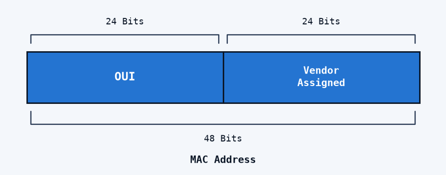
- **OUI** = **Organizationally Unique Identifier**: the first 24 bits identify the **manufacturer**, the second half is assigned by the vendor
| Vendor | OUI example |
|---|---|
| Cisco | `00:00:0C` |
| HP | `00:02:A5` |
| Dell | `00:14:22` |
| Apple | `00:03:93` |
- A big vendor owns many OUIs: these are examples
- Different display formats:
  - `0000.0c43.2e08`
  - `00:00:0c:43:2e:08`
  - `00-00-0C-43-2E-08`

## Layer 2: the frame
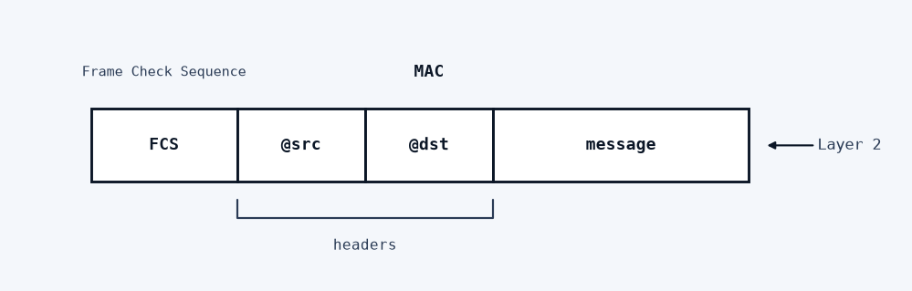
- **FCS** (frame check sequence): calculated to verify whether there are transmission errors
- The **headers**: source MAC and destination MAC

## Unicast, multicast and broadcast
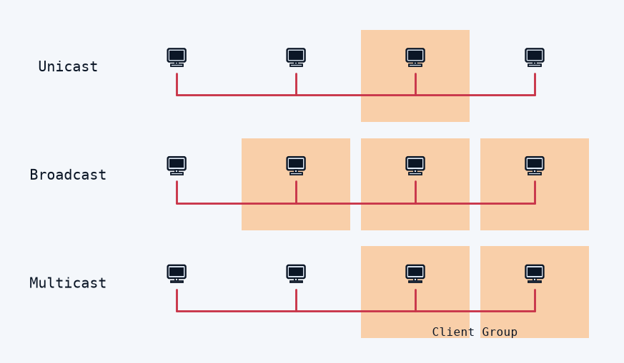
- **Unicast**: one to one (one sender, one receiver)
- **Multicast**: one to many (one sender, a group of receivers)
- **Broadcast**: one to all (every device of the network); the destination MAC is `FF:FF:FF:FF:FF:FF`

## Layer 1: Physical
- The physical layer **converts the data from bits into signals**:
  - **electric current** on a wired network (Ethernet cable)
  - **radio waves** on a WLAN (Wi-Fi)
  - **light** when we work with **fiber optic**
- At the other end, the signal is converted back into bits

## The TCP/IP model
- OSI model: **theory**
- TCP/IP model: **practice**
- **Segment**: the protocol (FTP / HTTPS...)
- **Packet**: the header contains the sender IP and the destination IP
- **Frame**: the header contains the sender MAC and the destination MAC

## OSI model and TCP/IP model
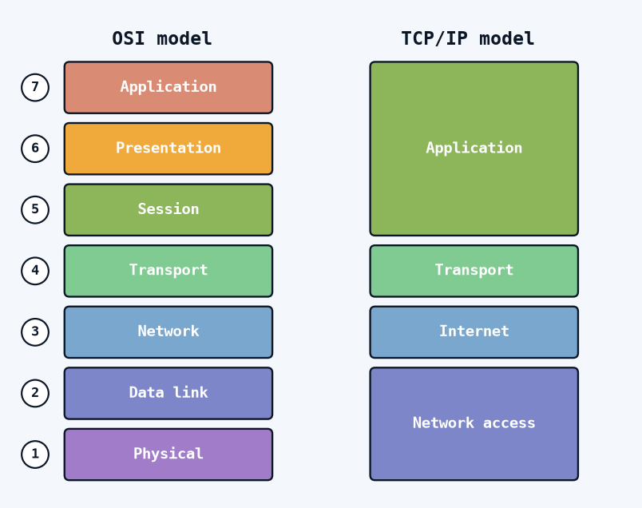
- **Application** (TCP/IP) = application + presentation + session (OSI)
- **Transport** = transport
- **Internet** = network
- **Network access** = data link + physical

## Data encapsulation
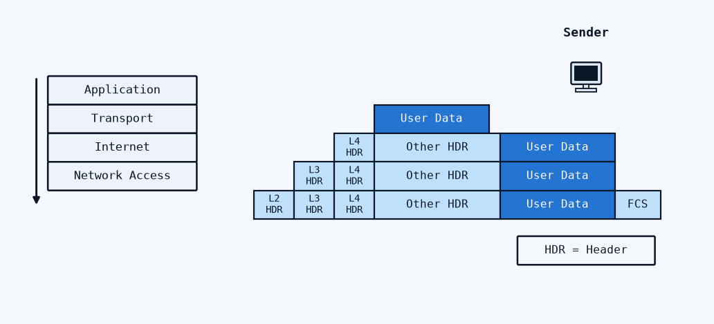

## Data de-encapsulation


## Peer-to-peer communications
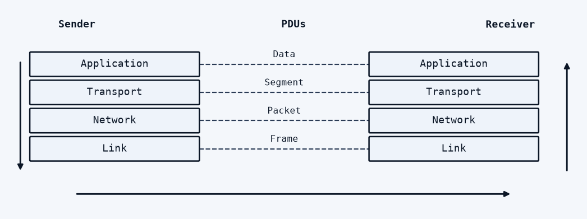

## IPv4 and TTL
- **TTL**: Time To Live
- A counter in the IPv4 header that limits the life of a packet in the network

# Switches and Ethernet

## Need for switches
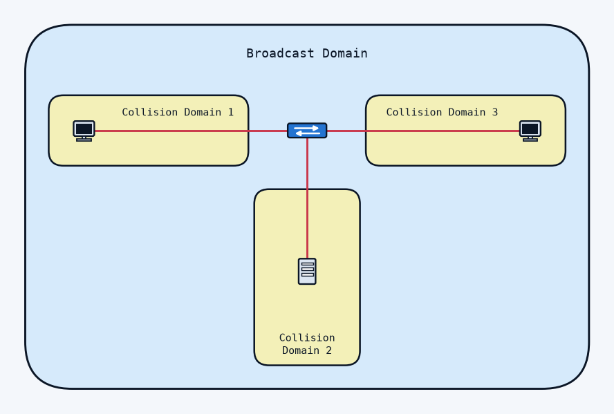
- Each **switch interface (port)** is a **collision domain**

## Switch functions
- Switches have these functions:
  - Operate at the link layer of the TCP/IP protocol suite
  - Forward, filter, or flood frames based on MAC table entries
  - Have many full-duplex ports to segment a large LAN into many smaller segments
  - Are fast and support various port speeds
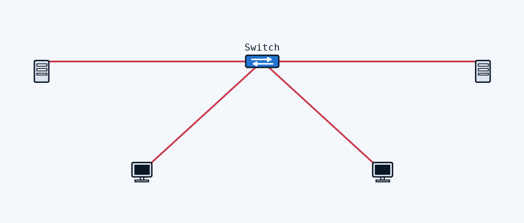

## Switch characteristics
- LAN switch characteristics:
  - High port density
  - Large frame buffers
  - Mixture of port speeds
  - Fast internal switching
  - Low per-port cost

## The hub
- A **hub** works at layer 1 (the physical layer): it only repeats the electrical signal
- Every frame received on one port is **repeated out of all the other ports**
- All the devices connected to a hub share the **same collision domain** and the **same bandwidth**
- The devices must listen before they send (**CSMA/CD**) and work in **half duplex**
- The more devices, the more collisions, so the slower the network
- No security: every device receives everything
- A hub does not read the MAC addresses: it cannot choose a destination
> The switch fixes this: it reads the MAC address and sends the frame only where it has to go.

## The MAC address table
- The switch keeps what it learns in the **MAC address table** (also called the **CAM table** or the switching table)
- Each line has two pieces of information:
  - the **port** (the physical interface of the switch)
  - the **MAC** address of the device that is reachable through that port
| Port | MAC address |
|---|---|
| Fa0/1 | AA:AA:AA:AA:AA:AA |
| Fa0/2 | BB:BB:BB:BB:BB:BB |
| Fa0/3 | CC:CC:CC:CC:CC:CC |
- Meaning: "to reach AA:AA..., send the frame out of port Fa0/1"
- At startup the table is **empty**: the switch knows nothing about the network
- On real switches the table also shows the VLAN and the type (dynamic or static)

## Learning: the source MAC address
- A switch is a layer 2 device: it works with MAC addresses and learns **by itself**, by looking at the frames that pass through it (**MAC learning**)
- Every Ethernet frame contains a **destination MAC** (used to forward) and a **source MAC** (used to learn)
- When a frame enters, the switch looks at the **source MAC** and the **port** on which the frame arrived:
  - source MAC **not in the table**: write (incoming port → source MAC)
  - source MAC **already there, same port**: nothing new, the timer is refreshed
  - source MAC there but on **another port**: the device has moved, the entry is updated
> The switch learns ONLY from the source address, never from the destination: the source tells the truth about which port the device is behind.

## Forwarding: the destination MAC address
- After learning, the switch looks for the **destination MAC** in its table:
  - destination **known**: the frame is sent **only** out of the port in the table (forwarding, or filtering: the other ports do not receive it)
  - destination known on the **same port** as the incoming one: the frame is dropped
  - destination **unknown**: **flooding**
  - destination **broadcast** (`FF:FF:FF:FF:FF:FF`): always flooded (for example ARP requests)
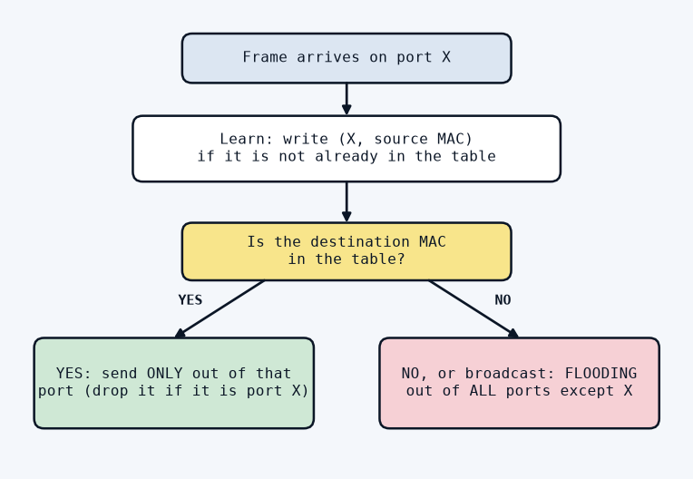

## Flooding
- **Flooding**: when the switch does not know where the destination is, it sends a copy of the frame out of **every port except the port where the frame came in**
- It "asks everyone": the right device accepts the frame, all the others see that the destination MAC is not theirs and ignore it
- When the destination replies, the switch learns its MAC from the **source** of the reply: no more flooding for that device
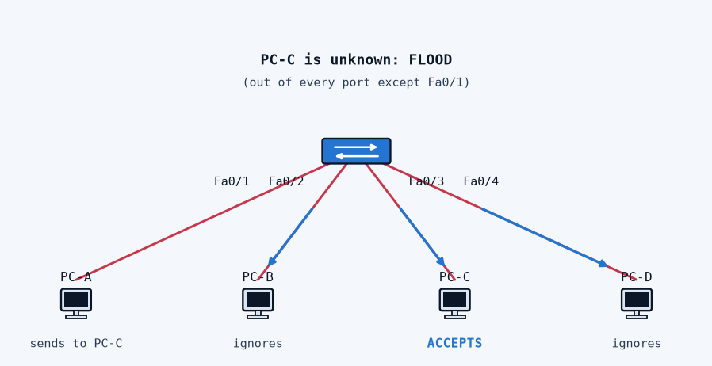

## Switching operation (1/2)
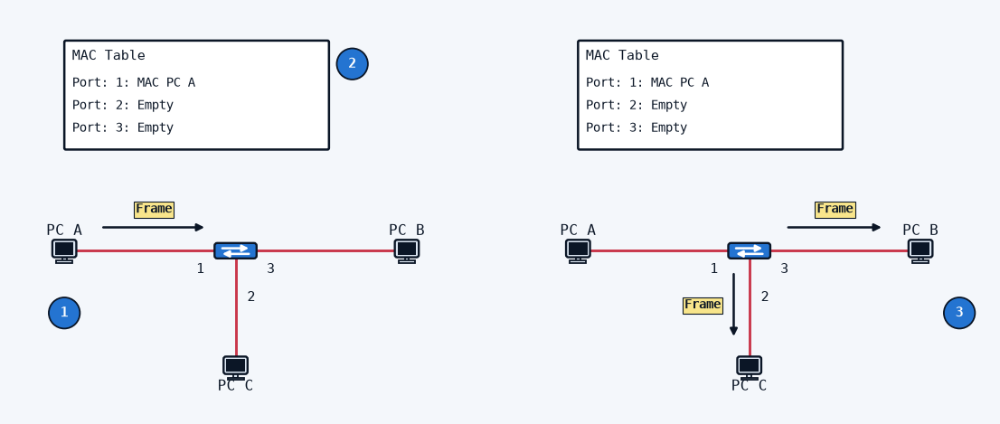

## Switching operation (2/2)
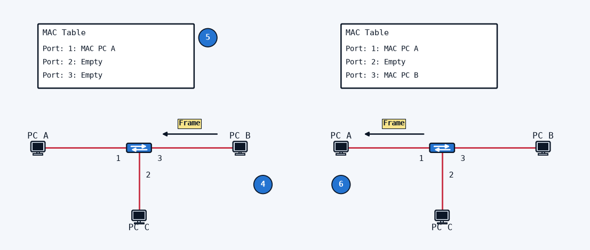

## One MAC, one port: the rules
- Two rules about the MAC table (inside the same VLAN):
  - **Rule 1: one MAC address appears on only one port.** A device is in one place only, so the switch has one way to reach it. When a MAC is seen on a new port, the old entry is **replaced**, not duplicated
  - **Rule 2: one port can have many MAC addresses.** It happens when several devices are reachable through the same port
| Port | MAC address | |
|---|---|---|
| Fa0/1 | AA:AA:AA:AA:AA:AA | allowed |
| Fa0/1 | DD:DD:DD:DD:DD:DD | allowed (rule 2) |
| Fa0/5 | AA:AA:AA:AA:AA:AA | impossible (rule 1) |

## One port, many MAC addresses
- **A port connected to another switch**: all the PCs behind SWITCH-2 enter SWITCH-1 through the same port
| Port of SWITCH-1 | MAC address | Device |
|---|---|---|
| Fa0/1 | AA:AA:AA:AA:AA:AA | PC-A |
| Fa0/2 | BB:BB:BB:BB:BB:BB | PC-B |
| Fa0/24 | CC:CC:CC:CC:CC:CC | PC-C (behind SWITCH-2) |
| Fa0/24 | DD:DD:DD:DD:DD:DD | PC-D (behind SWITCH-2) |
| Fa0/24 | EE:EE:EE:EE:EE:EE | PC-E (behind SWITCH-2) |
- **A port connected to a PC that runs VMs**: each VM has its own virtual network card and its own MAC, but all go out through the same cable: the switch sees the host MAC and the MAC of each VM on the same port
- **Other cases**: a hub, a wireless access point, an IP phone with a PC behind it

## Moving and aging
- **A MAC moves to another port**: if PC-A is unplugged from Fa0/1 and plugged into Fa0/6, its next frame enters on Fa0/6. The switch replaces the old entry: the MAC is never kept on two ports
  - A MAC that keeps jumping between two ports very quickly usually means a **loop** in the network (**MAC flapping**): one of the reasons why Spanning Tree (STP) exists
- **Aging**: a dynamic entry has a timer. If the switch sees no frame from that MAC for a certain time (**300 seconds = 5 minutes** by default on Cisco switches), the entry is deleted
  - The table stays clean: the devices that are turned off or removed disappear. If the device comes back, the switch learns it again from its next frame
  - Each time a frame from that MAC is seen, the timer is reset

# Duplex and speed

## Duplex types
- **Duplex** describes the direction in which the data can flow on a link
| Type | Direction | Example | Collisions |
|---|---|---|---|
| **Simplex** | one direction only: the receiver cannot answer | TV or radio broadcast, a keyboard to its PC | none |
| **Half-duplex** | both directions, but **one at a time** | a walkie-talkie, a hub, Wi-Fi | possible: CSMA/CD or CSMA/CA is needed |
| **Full-duplex** | both directions **at the same time** | a phone call, a switch port connected to a host | none: no CSMA/CD needed |
- **Auto**: the two ends negotiate the best duplex and speed

## Half-duplex
- Half-duplex operation:
  - Unidirectional data flow
  - Higher potential for collision
  - Legacy connectivity
  - Collisions are handled by **CSMA/CD** (Ethernet) or **CSMA/CA** (Wi-Fi), explained next
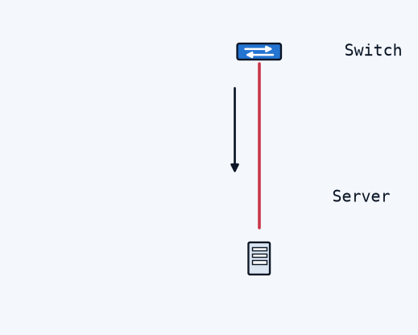

## CSMA/CD
- **CSMA/CD** = Carrier Sense Multiple Access with **Collision Detection**
- An algorithm that **detects a collision**; used on shared Ethernet (bus, hub)
1. **Listen** to the cable (carrier sense)
2. If it is **empty** ⇒ access: send the data
3. If it is **busy** ⇒ stop and wait
4. While sending, keep listening
5. If a **collision** is detected ⇒ stop, send a jam signal
6. Wait a **random time**, then try again from step 1

## CSMA/CA
- **CSMA/CA** = Carrier Sense Multiple Access with **Collision Avoidance**
- Used on **Wi-Fi (WLAN)**: a radio device cannot listen while it transmits, so it **avoids** collisions instead of detecting them
1. **Listen** to the channel
2. If it is **busy** ⇒ wait
3. If it is **free** ⇒ wait a **random time**, then send
4. The receiver answers with an **acknowledgement (ACK)**
5. No ACK ⇒ the frame is considered lost (collision) ⇒ wait a random time and send again

## Collision
- A collision happens in a **half-duplex** environment
- It depends on calculations: an Ethernet cable cannot exceed **100 m** (because of the resistance of the copper)
- At 100 m maximum, the sender transmits **at least 64 bytes** (the minimum size): this makes sure that the **first bit** has reached the other end
- A collision happens when the first bit has **not arrived yet**: the other device does not know that someone is talking, so it thinks it can talk, it sends its bits and the **collision** happens

## Late collision
- A **late collision** is a collision that happens **after more than 64 bytes** have been sent
- Example 1: **duplex mismatch**. SW1 is half-duplex and SW2 is full-duplex. When SW1 sends, it expects the other side to be silenced, but it is not (TX and RX at the same time)
- Example 2: a **cable longer than 100 m**
> Collision: during the first 64 bytes. Late collision: after the 64 bytes.

## ? Late collisions
What are two reasons that cause late collisions to increment on an Ethernet interface? (choose two)
- [ ] A. when the sending device waits 15 seconds before sending the frame again
- [x] B. when the cable length limits are exceeded
- [x] C. when one side of the connection is configured for half-duplex
- [ ] D. when Carrier Sense Multiple Access/Collision Detection is used
- [ ] E. when a collision occurs after the 32nd byte of a frame has been transmitted

## Full-duplex
- Data is sent and received **at the same time**: separate paths for each direction
- Used between a **switch port** and a host (or another switch): each link is its own collision domain
- **No collisions**, so **CSMA/CD is not needed**
- The full bandwidth is available in each direction (a 100 Mb/s link carries 100 Mb/s each way)
- Both ends must be set to full duplex: a **mismatch** (one side half, the other full) causes collisions and errors

## Configuring duplex and speed
- Setting full duplex and 100-Mb/s speed settings on the FastEthernet0/1
- Setting auto-duplex and auto-speed settings on the FastEthernet0/5
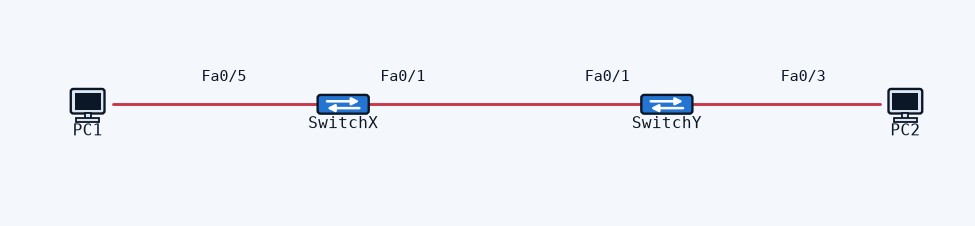
```ios
SwitchX(config)#interface FastEthernet0/1
SwitchX(config-if)#duplex full
SwitchX(config-if)#speed 100
SwitchX(config-if)#interface FastEthernet0/5
SwitchX(config-if)#duplex auto
SwitchX(config-if)#speed auto
```

## Duplex settings overview
- Overview of duplex settings and the resulting operation
| Duplex settings | Half | Full | Auto |
|---|---|---|---|
| Half | Half | Mismatch | Half |
| Full | Mismatch | Full | Full |
| Auto | Half | Full | Full |
- General recommendation:
  - Use manual settings on infrastructure links
  - Use auto settings on ports toward end devices

## Verifying duplex and speed
- Verify the duplex and speed settings on the FastEthernet0/5 interface
```ios
SwitchX#show interfaces FastEthernet0/5
FastEthernet0/5 is up, line protocol is up (connected)
  Hardware is Fast Ethernet, address is 0022.91c4.0e01 (bia 0022.91c4.0e01)
  MTU 1500 bytes, BW 100000 Kbit, DLY 100 usec,
     reliability 255/255, txload 1/255, rxload 1/255
  Encapsulation ARPA, loopback not set
  Keepalive set (10 sec)
  Full-duplex, 100Mb/s, media type is 10/100BaseTX
  input flow-control is off, output flow-control is unsupported
  <output omitted>
  5 minute input rate 0 bits/sec, 0 packets/sec
  5 minute output rate 0 bits/sec, 0 packets/sec
     7289 packets input, 927927 bytes, 0 no buffer
     Received 184 broadcasts (1380 multicasts)
     0 runts, 0 giants, 0 throttles
     0 input errors, 0 CRC, 0 frame, 0 overrun, 0 ignored
     0 watchdog, 1380 multicast, 0 pause input
     0 input packets with dribble condition detected
     39965 packets output, 7985339 bytes, 0 underruns
     0 output errors, 0 collisions, 1 interface resets
     0 babbles, 0 late collision, 0 deferred
     0 lost carrier, 0 no carrier, 0 PAUSE output
     0 output buffer failures, 0 output buffers swapped out
```

# The Cisco IOS CLI

## Cisco IOS CLI functions
- The CLI is used to enter commands
  - Operations vary on different internetworking devices
  - Users type or copy-and-paste entries in the console command modes
  - Command modes have distinctive prompts
  - Pressing **Enter** instructs the device to parse (translate) and execute the command
  - The two primary EXEC modes are user mode and privileged mode
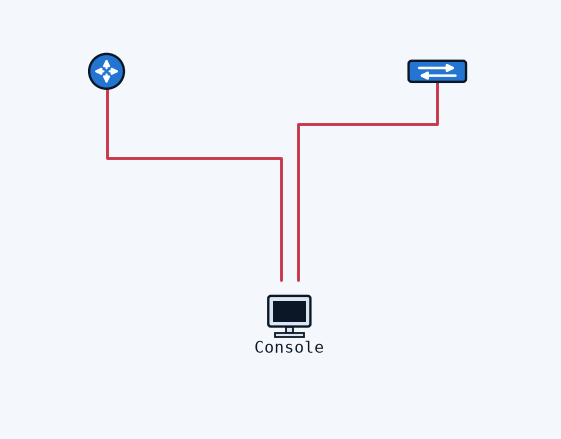

## The command modes
- **User mode**: prompt `>`
- `>enable`: goes to the privileged mode
- **Privileged mode**: prompt `#`
- Commands in privileged mode:
  - `# show version`
  - `# show clock`
  - `# show ip int br`
  - `# show mac-add`

## User EXEC mode
- User EXEC mode allows limited examination of a switch or a router
- Command prompt: **hostname>**
```ios
Switch>?
Exec commands:
  access-enable    Create a temporary Access-List entry
  access-profile   Apply user-profile to interface
  clear            Reset functions
  connect          Open a terminal connection
  crypto           Encryption related commands
  disable          Turn off privileged commands
  disconnect       Disconnect an existing network connection
  enable           Turn on privileged commands
  exit             Exit from the EXEC
  <output omitted>
```

## Privileged EXEC mode
- Command prompt: **hostname#**
```ios
Switch>enable
Switch#?
Exec commands:
  access-enable    Create a temporary Access-List entry
  access-profile   Apply user-profile to interface
  access-template  Create a temporary Access-List entry
  archive          Manage archive files
  beep             Blocks Extensible Exchange Protocol commands
  call-home        Call-Home commands
  cd               Change current directory
  clear            Reset functions
  clock            Manage the system clock
  cns              CNS agents
  <output omitted>
```

## Help functions in the CLI
- This sequence of commands shows how CLI context-sensitive help can be used:
```ios
SwitchX#cl?
clear clock
SwitchX#clock ?
  set  Set the time and date
SwitchX#clock set ?
  hh:mm:ss  Current time
SwitchX#clock set 19:50:00 ?
  <1-31>  Day of the month
  MONTH   Month of the year
SwitchX#clock set 19:50:00 25 June ?
  <1993-2035>  Year
SwitchX#clock set 19:50:00 25 June 2012
SwitchX#
```

## Ping and traceroute
- **ping** is a connectivity test (it uses **ICMP**)
- **ping** and **traceroute** both use ICMP (`tracert` on Windows)

## Configuration modes
- Configuration modes:
- Global configuration mode
```ios
Switch#configure terminal
Switch(config)#
```
- Interface configuration mode
```ios
Switch(config)#interface FastEthernet0/1
Switch(config-if)#
```

## Switch commands
```ios
Switch> enable                  // user mode to privileged mode
Switch# conf t                  // config mode
Switch(config)# int f0/1        // config-if mode: inside the interface
Switch(config-if)# shutdown
Switch(config-if)# no shutdown  // turn the interface on
```
- `shutdown` / `no shutdown`
- `show` works in privileged mode, so not in config mode: use **`do show ...`** instead

## Setting the hostname
- Set the local identity for the switch
```ios
Switch(config)#hostname SwitchX
SwitchX(config)#
```

## Assigning an IP address to the switch
- Assign the IP address and subnet mask for the switch
```ios
SwitchX(config)#interface vlan 1
SwitchX(config-if)#ip address 172.20.137.5 255.255.255.0
SwitchX(config-if)#no shutdown
```
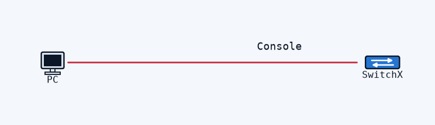
> Note: Most software versions require use of the no shutdown command to make the interface operational.

## Verifying the switch startup status
```ios
SwitchX#show version
Cisco IOS Software, C2960 Software (C2960-LANBASEK9-M), Version 15.0(1)SE3,
RELEASE SOFTWARE (fc1)
<output omitted>
SwitchX uptime is 15 hours, 30 minutes
System returned to ROM by power-on
System restarted at 15:06:49 UTC Tue Aug 21 2012
System image file is "flash:/c2960-lanbasek9-mz.150-1.SE3/c2960-lanbasek9-
mz.150-1.SE3.bin"
<output omitted>
cisco WS-C2960-24TT-L (PowerPC405) processor (revision D0) with
65536K bytes of memory.
Processor board ID FOC1141Z8YW
<output omitted>
```
- Displays the configuration of the system hardware, software version, and boot images

## The memory of the switch
- The switch has a **CPU**, **RAM**, **NVRAM** and **flash**
  - The NVRAM is like a hard disk
- The **startup configuration** is in the NVRAM
- When I change something, I am working in the **running configuration** (in the RAM)

## The running configuration (RAM)
- This is how you investigate the current running configuration (RAM):
```ios
Switch#show running-config
Building configuration...

Current configuration : 1707 bytes
!
! Last configuration change at 04:45:43 UTC Fri Aug 17 2012
! NVRAM config last updated at 04:45:43 UTC Fri Aug 17 2012
!
version 15.0
no service pad
service timestamps debug datetime msec
<output omitted>
```

## The saved configuration (NVRAM)
- This is how you investigate the saved configuration (NVRAM):
```ios
Switch#show startup-config
Using 1707 out of 65536 bytes
!
! Last configuration change at 04:45:43 UTC Fri Aug 17 2012
! NVRAM config last updated at 04:45:43 UTC Fri Aug 17 2012
!
version 15.0
no service pad
service timestamps debug datetime msec
<output omitted>
```

## Backing up a configuration
- A configuration can be backed up to an external server:
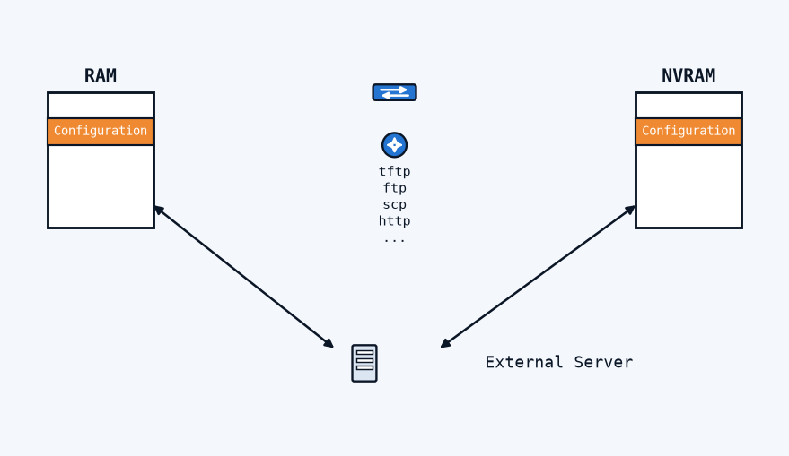

## The copy commands
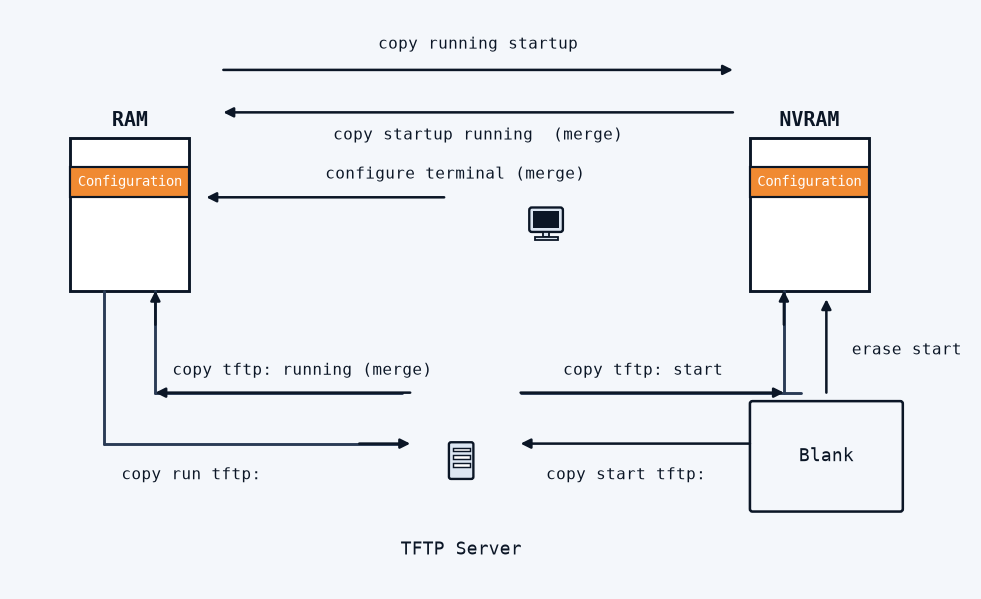

## Saving a configuration
- This is how you can save a device configuration:
```ios
Switch#copy running-config startup-config
Destination filename [startup-config]?
Building configuration...
[OK]
```
- This is how you back up a configuration to the TFTP server:
```ios
Switch#copy running-config tftp:
Address or name of remote host []? 10.1.1.1
Destination filename [running-config]? config.cfg
!!!
1684 bytes copied in 13.300 secs (129 bytes/sec)
```

## Saving, restoring and erasing
- To save in the startup config:
```ios
Switch# write
Switch# copy run start
```
- `copy start run`: rollback
- `erase startup-config`: format
  - **Careful!!** then do `reload`
- `clock set ?`

## Improving the user experience in the CLI
```ios
Switch#show running-config
Building configuration...

Current configuration : 1707 bytes
!
! Last configuration change at 11:46:10 UTC Fri Aug 17 2012
! NVRAM config last updated at 04:45:43 UTC Fri Aug 17 2012
!
<output omitted>
!
 --More--
```

## Terminal length
- The Cisco IOS CLI pauses after a specific number of lines is displayed
```ios
Switch#terminal length 100
```
- Sets the number of lines on the current terminal screen
