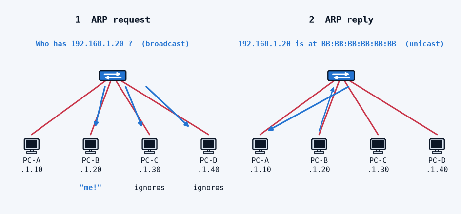
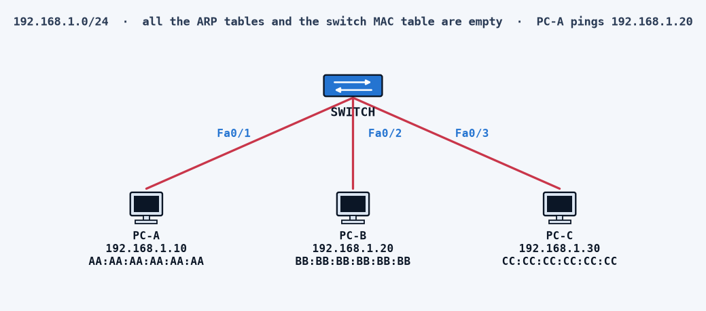
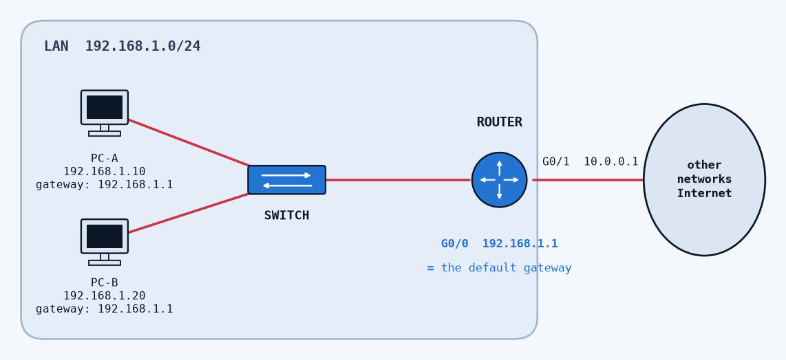
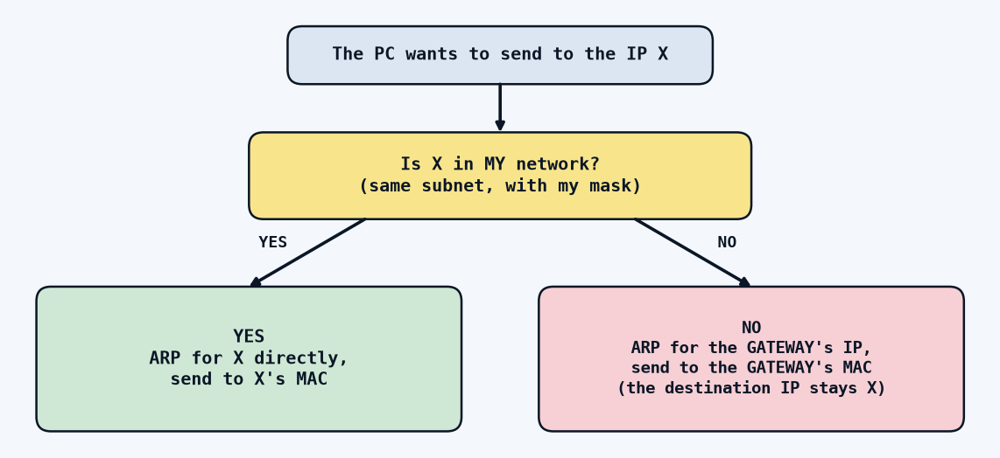

# The ARP protocol

## Why do we need ARP?
- When a PC wants to talk to another device, it usually knows the destination's **IP address** (layer 3), for example `192.168.1.20`
- But on a local network (Ethernet), the frames are delivered with **MAC addresses** (layer 2): a switch does not look at IP addresses, it only looks at MAC addresses
- So before sending, the PC must answer: "I know the IP 192.168.1.20 ... but what is its MAC address?"
- **ARP** is the protocol that answers it: **IP address (known) → MAC address (to find)**
> ARP works only **inside the local network** (the same subnet, the same broadcast domain). It is not routed.

## IP address vs MAC address
| | IP address | MAC address |
|---|---|---|
| Layer | 3 (Network) | 2 (Data link) |
| Example | `192.168.1.20` | `BB:BB:BB:BB:BB:BB` |
| Size | 32 bits (IPv4) | 48 bits |
| Given by | the admin or DHCP (logical, can change) | the manufacturer (burned on the network card) |
| Used for | end-to-end delivery (across networks) | delivery on the local link (hop by hop) |
| Used by | routers | switches |
- Analogy: the IP address is the person's **name and city** (where they are, logically). The MAC address is the exact **door of the house** (physical delivery)
- ARP is shouting in the street "Who is Ahmed? Tell me your door!" and Ahmed answers "I'm Ahmed, my door is number 5"

## How ARP works
- Before sending a packet to an IP, the PC checks its ARP table:
  - IP **found** in the ARP table: use that MAC, send the frame now
  - IP **not found**: do ARP
- ARP happens in **2 messages**:
  1. **ARP request** (**broadcast**): "Who has 192.168.1.20? Tell 192.168.1.10". It is sent to the broadcast MAC `FF:FF:FF:FF:FF:FF`, so the switch **floods** it to all the ports: everyone receives it
  2. **ARP reply** (**unicast**): "192.168.1.20 is at BB:BB:BB:BB:BB:BB". It is sent **only** to the PC that asked (its MAC is known from the request)
> Note: a broadcast happens in **one broadcast domain**, which is **one network**. A broadcast **cannot be forwarded between different networks**: a router does not forward it.

## ARP request and reply

- PC-A writes the answer in its ARP table and sends the real data
- Bonus: when PC-B receives the request, it also learns PC-A's IP and MAC (they are written inside the request), so PC-B adds PC-A to its own ARP table: no need for PC-B to do ARP back

## The ARP messages: the request
- ARP is carried directly inside an Ethernet frame (EtherType `0x0806`), **not inside IP**
- ARP request from PC-A (192.168.1.10, AA:AA...) looking for 192.168.1.20:
| Field | Value |
|---|---|
| Ethernet: destination MAC | `FF:FF:FF:FF:FF:FF` |
| Ethernet: source MAC | `AA:AA:AA:AA:AA:AA` |
| Ethernet: type | `0x0806` |
| ARP: operation | 1 = REQUEST |
| ARP: sender MAC | `AA:AA:AA:AA:AA:AA` |
| ARP: sender IP | `192.168.1.10` |
| ARP: target MAC | `00:00:00:00:00:00` (unknown) |
| ARP: target IP | `192.168.1.20` |

## The ARP messages: the reply
- ARP reply from PC-B:
| Field | Value |
|---|---|
| Ethernet: destination MAC | `AA:AA:AA:AA:AA:AA` |
| Ethernet: source MAC | `BB:BB:BB:BB:BB:BB` |
| Ethernet: type | `0x0806` |
| ARP: operation | 2 = REPLY |
| ARP: sender MAC | `BB:BB:BB:BB:BB:BB` (the answer!) |
| ARP: sender IP | `192.168.1.20` |
| ARP: target MAC | `AA:AA:AA:AA:AA:AA` |
| ARP: target IP | `192.168.1.10` |

## ARP with a switch: the setup


## ARP with a switch: the steps
| Step | What happens |
|---|---|
| 1 | PC-A checks: "Is 192.168.1.20 in my subnet?" YES. "Do I know its MAC?" NO (the ARP table is empty): it sends an ARP request |
| 2 | ARP request (SRC AA:AA..., DST FF:FF...) enters on Fa0/1. The switch learns (Fa0/1, AA:AA...) and **floods** to Fa0/2 and Fa0/3. PC-C: "target IP is .1.20, not me": ignores. PC-B: "that's me!": adds (192.168.1.10 → AA:AA...) to its ARP table |
| 3 | ARP reply (SRC BB:BB..., DST AA:AA...) enters on Fa0/2. The switch learns (Fa0/2, BB:BB...) and AA:AA... is known on Fa0/1: sends **only** to Fa0/1. PC-A adds (192.168.1.20 → BB:BB...) to its ARP table |
| 4 | The real data (ping) is sent: SRC AA:AA..., DST BB:BB..., IP .1.10 → .1.20. The switch forwards it directly to Fa0/2 |

## ARP with a switch: the tables after
- The tables after the exchange:
| Device | Table | Content |
|---|---|---|
| PC-A | ARP table | 192.168.1.20 → BB:BB:BB:BB:BB:BB |
| PC-B | ARP table | 192.168.1.10 → AA:AA:AA:AA:AA:AA |
| Switch | MAC address table | Fa0/1 → AA:AA... · Fa0/2 → BB:BB... |
- This is why the first ping sometimes times out: the first packet waits for ARP to finish

# The default gateway

## The default gateway
- A PC can only talk **directly** (with ARP and the switch) to the devices in its **own network**
- To reach any other network (another subnet, the Internet), it needs a **router**
- The **default gateway** is the IP address of the router interface that is in the PC's own network: the "exit door" of the local network
- "If the destination is not in my network, I give the packet to my gateway, and the router takes care of the rest"

## The default gateway: the exit door


## How the PC decides


## The default gateway: key points
- The gateway must be in the **same subnet** as the PC
- Without a gateway (or with a wrong one), the PC can talk inside its LAN but **not** to other networks or the Internet
- It is usually given by DHCP, or set manually

## The ARP table (ARP cache)
- Every device (PC, router, server) keeps an **ARP table** (ARP cache) in memory
- It stores the IP → MAC matches it already found, so it does not need to ask again for every packet
| IP address | MAC address | Type |
|---|---|---|
| 192.168.1.1 | 11:11:11:11:11:11 | dynamic (the gateway) |
| 192.168.1.20 | BB:BB:BB:BB:BB:BB | dynamic |
- **dynamic**: learned by ARP, deleted after some time (a few minutes on PCs, 4 hours by default on Cisco routers)
- **static**: added manually by the admin, never expires

## ARP when the destination is on another network
- This is where ARP and the gateway work together. **The PC never does ARP for a remote IP. It does ARP for its gateway.**
- Example: PC-A (192.168.1.10) pings a server at 10.0.0.50 (router: G0/0 192.168.1.1, MAC 11:11..., and G0/1 10.0.0.1, MAC 22:22...; server MAC 55:55...)
  1. PC-A: "10.0.0.50 is NOT in my network: send to my gateway 192.168.1.1"
  2. PC-A does ARP: "Who has 192.168.1.1?" and the router replies "11:11..."
  3. PC-A sends the frame to the router's MAC
  4. The router sees that the destination IP 10.0.0.50 is on its G0/1 network, does ARP there: "Who has 10.0.0.50?" and gets "55:55..."
  5. The router sends a **new** frame on the other side

## The two frames
| Frame | Destination MAC | Source MAC | Source IP | Destination IP |
|---|---|---|---|---|
| PC-A → router | `11:11:..` (the router) | `AA:AA:..` | 192.168.1.10 | 10.0.0.50 (the server) |
| router → server | `55:55:..` | `22:22:..` | 192.168.1.10 | 10.0.0.50 |
> The golden rule: **MAC addresses change at every hop** (each link has its own layer 2 delivery). **IP addresses stay the same** from end to end (without NAT).
- The ARP table of PC-A will contain 192.168.1.1 → 11:11:.. but **not** 10.0.0.50 (it is remote)

# Special ARP and commands

## Gratuitous ARP
- An ARP that nobody asked for: a device announces its own IP and MAC to everyone (broadcast), for example "192.168.1.10 is at AA:AA:.."
- It is used to:
  - detect **duplicate IPs** when a device starts (if someone answers, the IP is already used: "IP address conflict")
  - update everyone's ARP tables when a MAC changes (new network card, failover between two routers like HSRP)

## Proxy ARP
- A router answers an ARP request **on behalf of** a device that is on another network, giving its own MAC
- Useful when a PC has a wrong mask or no gateway, but it is often disabled today
- Example: the PC asks "Who has 10.0.0.50?" (it thinks it is local, wrong configuration) and the router answers "That's me: 11:11:.." (it will forward the traffic)

## Useful commands
- Windows:
```cmd
arp -a            show the ARP table
arp -d *          clear the ARP table (as administrator)
ipconfig          see your IP, mask and default gateway
```
- Linux:
```bash
ip neigh          # show the ARP table
ip route          # see the default gateway ("default via ...")
```

## Useful commands: Cisco
- Cisco router / switch:
```ios
show ip arp               show the ARP table
clear arp-cache           clear the ARP table
show mac address-table    the switch MAC table, for comparison
```

## Example: arp -a on Windows
```cmd
Interface: 192.168.1.10 --- 0x5
  Internet Address      Physical Address      Type
  192.168.1.1           11-11-11-11-11-11     dynamic
  192.168.1.20          bb-bb-bb-bb-bb-bb     dynamic
  192.168.1.255         ff-ff-ff-ff-ff-ff     static
```

## ARP summary
- ARP finds the **MAC address** that matches a known **IP address**, inside the local network
- The **ARP table** stores IP ↔ MAC (on PCs and routers)
- **ARP request** = broadcast (`FF:FF:FF:FF:FF:FF`), so the switch floods it: "Who has this IP?". **ARP reply** = unicast, only to the one who asked: "This IP is at this MAC"
- The device that receives the request also learns the asker's IP and MAC
- **Default gateway** = the router's IP in my own network, the exit door to the other networks
- Destination in **my** network: ARP for the destination itself. Destination in **another** network: ARP for the **gateway**, and send the frame to the gateway's MAC (the destination IP does not change)
- MAC addresses change at every hop, IP addresses stay the same end to end
- **Gratuitous ARP** announces yourself, **Proxy ARP** is a router answering for others
