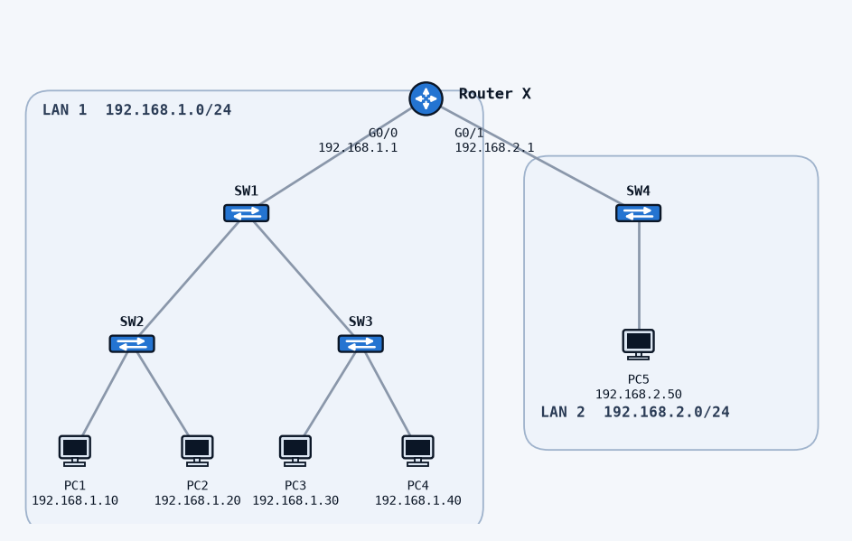
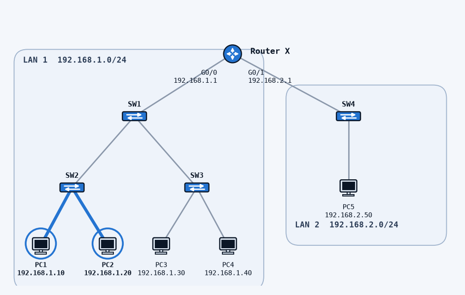
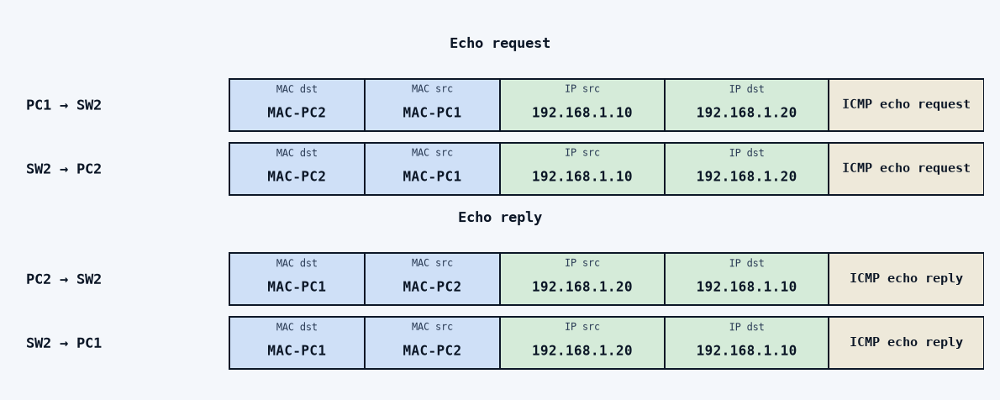
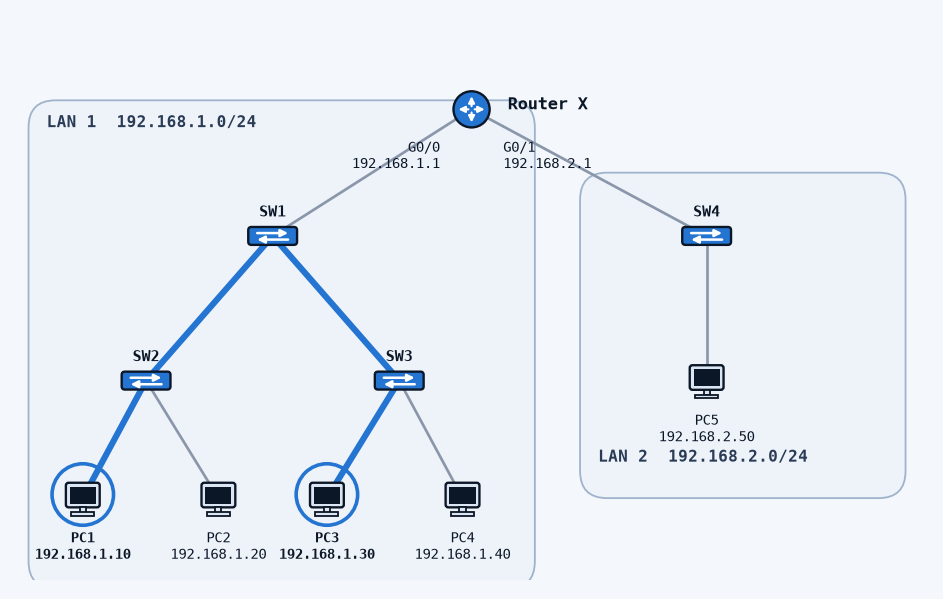
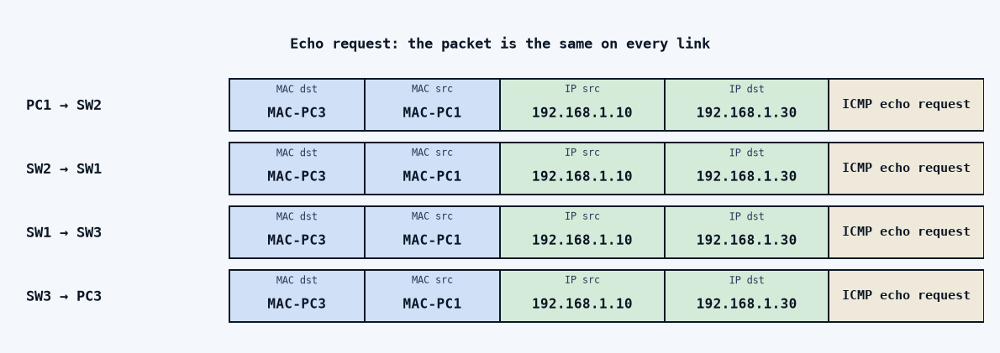
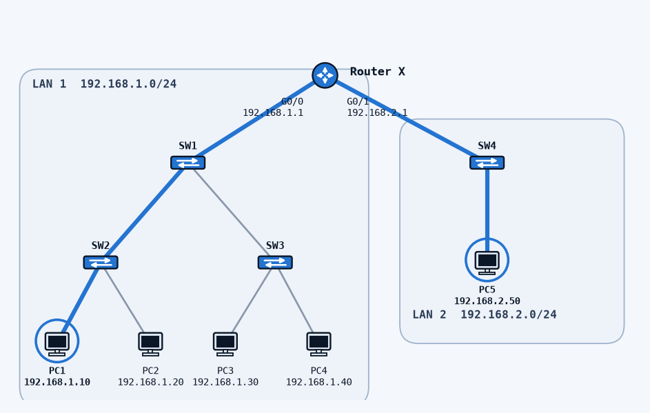
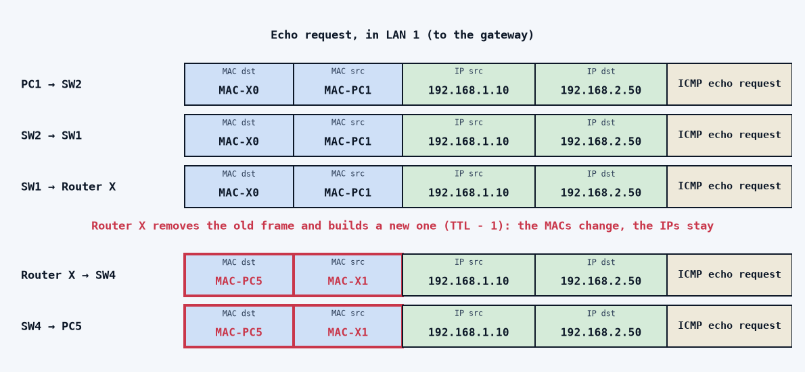
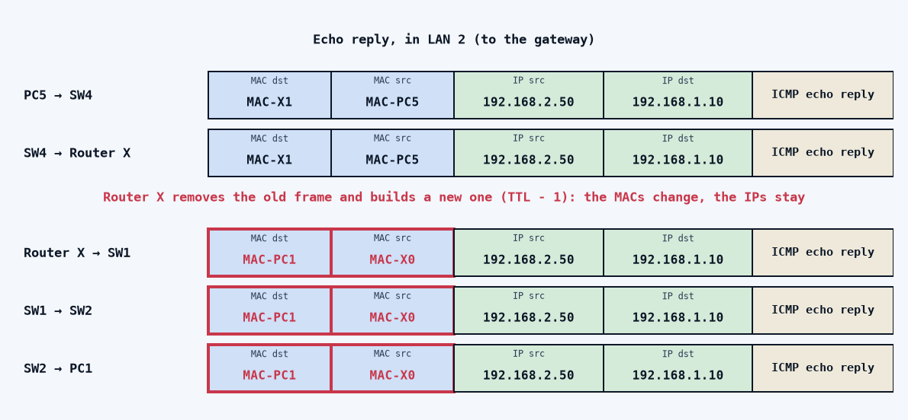

# The rules and the topology

## IP and MAC along the path
- **IP addresses do not change on the way**: the source IP and the destination IP stay the same from the sender to the receiver (without NAT). Only the TTL decreases at each router
- **MAC addresses are the ones that change**: each link has its own layer 2 delivery. A router removes the old frame and builds a **new** one, with a new source MAC and a new destination MAC
- **Switches change nothing**: they forward the frame as it is. The MAC addresses change only when the packet crosses a **router**
- A PC puts in the frame:
  - the MAC of the **destination**, if the destination is in its own network
  - the MAC of its **default gateway**, if the destination is in another network
- If the PC does not know that MAC address, it does **ARP** first
> We follow three pings in one topology and look, on every link, at: MAC source, MAC destination, IP source, IP destination.

## The topology

- **LAN 1** (192.168.1.0/24): SW1 is connected to Router X (G0/0). SW1 connects SW2 (PC1, PC2) and SW3 (PC3, PC4)
- **LAN 2** (192.168.2.0/24): SW4 is connected to Router X (G0/1) and to PC5
- The drawing gives the names only: the IP and MAC addresses of the example are chosen for the demonstration

## The addresses
| Device | IP address | MAC address | Short name |
|---|---|---|---|
| PC1 | 192.168.1.10 | `AA:AA:AA:AA:AA:01` | MAC-PC1 |
| PC2 | 192.168.1.20 | `BB:BB:BB:BB:BB:02` | MAC-PC2 |
| PC3 | 192.168.1.30 | `CC:CC:CC:CC:CC:03` | MAC-PC3 |
| PC4 | 192.168.1.40 | `DD:DD:DD:DD:DD:04` | MAC-PC4 |
| PC5 | 192.168.2.50 | `EE:EE:EE:EE:EE:05` | MAC-PC5 |
| Router X G0/0 | 192.168.1.1 | `11:11:11:11:11:11` | MAC-X0 |
| Router X G0/1 | 192.168.2.1 | `22:22:22:22:22:22` | MAC-X1 |
- The default gateway of PC1 to PC4 is 192.168.1.1, the one of PC5 is 192.168.2.1

# The three pings

## Ping PC1 → PC2

- Path: PC1 → SW2 → PC2
- Same network: PC1 sends directly to the MAC of PC2

## PC1 → PC2: the packets

## Ping PC1 → PC3

- Path: PC1 → SW2 → SW1 → SW3 → PC3
- Same network: PC1 sends directly to the MAC of PC3

## PC1 → PC3: the echo request

## PC1 → PC3: the echo reply

## Ping PC1 → PC5

- Path: PC1 → SW2 → SW1 → Router X → SW4 → PC5
- Another network: PC1 sends to its default gateway (Router X)

## PC1 → PC5: the echo request

## PC1 → PC5: the echo reply

## The three pings, compared
| Ping | Same network? | MAC dst used by PC1 | Do the MAC addresses change on the way? |
|---|---|---|---|
| PC1 → PC2 | yes | MAC-PC2 | no: only one switch, no router |
| PC1 → PC3 | yes | MAC-PC3 | no: three switches, no router |
| PC1 → PC5 | no | MAC-X0 (the gateway) | yes, at Router X: MAC-PC1 → MAC-X0, then MAC-X1 → MAC-PC5 |
- In the three cases, the **IP addresses stay the same** from the source to the destination
