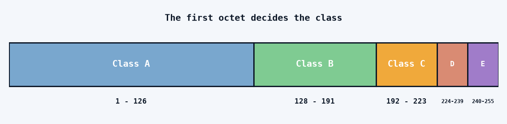
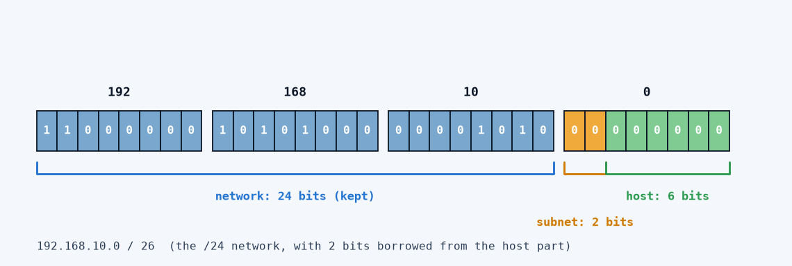
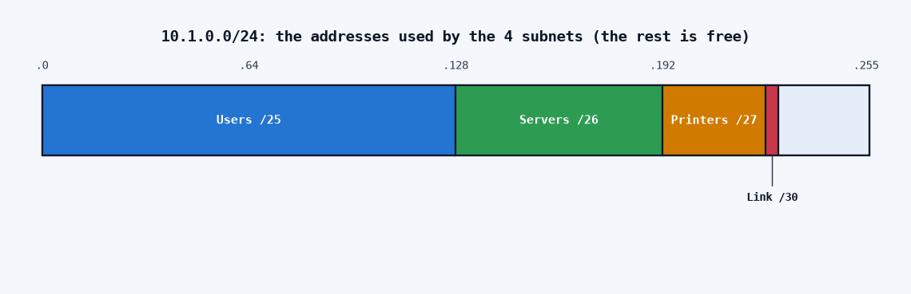
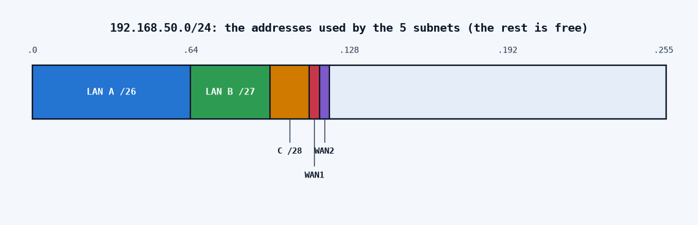

# IPv4 addresses
What an address is made of, how to read it in binary, and the old address classes.

## What is an IPv4 address?
- An **IPv4 address** identifies a device on a network (a PC, a server, a router interface)
- It has **32 bits**, written as **four octets** (groups of 8 bits) in decimal, separated by dots: `192.168.10.25`
- Each octet goes **from 0 to 255** (8 bits give 2⁸ = 256 values)
- In total there are 2³² = about **4.3 billion** addresses
- Every address has a **network part** and a **host part**
> Same network part = same network = the devices can talk directly, without a router.
Note: Write 192.168.10.25 in binary on the board once, octet by octet. It makes everything after this easier.

## Binary: the place values
- An octet is 8 bits. Each bit is **0 (off)** or **1 (on)** and has a value:
| Bit position | 8th | 7th | 6th | 5th | 4th | 3rd | 2nd | 1st |
|---|---|---|---|---|---|---|---|---|
| Value | 128 | 64 | 32 | 16 | 8 | 4 | 2 | 1 |
- To get the decimal number, **add the values of the bits that are 1**
- Examples: `11000000` = 128 + 64 = **192** and `00001010` = 8 + 2 = **10**

## Decimal to binary
- Go from left to right: if the value fits in what is left, write **1** and subtract it, otherwise write **0**
- Example: **172**
  - 128 fits → 1 (44 left) · 64 no → 0 · 32 fits → 1 (12 left) · 16 no → 0 · 8 fits → 1 (4 left) · 4 fits → 1 (0 left) · 2 → 0 · 1 → 0
  - **172 = 10101100**
- A whole address: `192.168.10.25` = `11000000.10101000.00001010.00011001`

## The octet values to know by heart
- Masks only use these octets (the 1s are always on the left):
| Binary | Decimal | Bits on |
|---|---|---|
| 10000000 | 128 | 1 |
| 11000000 | 192 | 2 |
| 11100000 | 224 | 3 |
| 11110000 | 240 | 4 |
| 11111000 | 248 | 5 |
| 11111100 | 252 | 6 |
| 11111110 | 254 | 7 |
| 11111111 | 255 | 8 |

## Network part and host part
- The address is cut in two: the **network part** (the street) and the **host part** (the house number)
- All the devices of the same network share the **same network part**
- Each device has a **different host part**
- Example: `192.168.10.25` with the mask `255.255.255.0`
  - network part: `192.168.10` · host part: `25`
- The **subnet mask** says where the network part ends

## IP address classes
- In the beginning, the Internet defined **5 classes**. The class is found with the **first byte** (the first octet):
| Class | First octet (decimal) | First byte (binary) | Default mask | Networks | Hosts per network |
|---|---|---|---|---|---|
| **A** | 1 – 126 | `0xxxxxxx` | /8 (255.0.0.0) | 126 | 16,777,214 |
| **B** | 128 – 191 | `10xxxxxx` | /16 (255.255.0.0) | 16,384 | 65,534 |
| **C** | 192 – 223 | `110xxxxx` | /24 (255.255.255.0) | 2,097,152 | 254 |
| **D** | 224 – 239 | `1110xxxx` | none | none | multicast |
| **E** | 240 – 255 | `1111xxxx` | none | none | reserved, experimental |
- In the binary byte, **x means any bit** (0 or 1, whatever you like): `0xxxxxxx` is every byte that starts with 0

## How to recognise the class

- The first byte starts with: Class A `0xxxxxxx` · Class B `10xxxxxx` · Class C `110xxxxx` · Class D `1110xxxx` · Class E `1111xxxx` (x = any bit)
- Example: `150.25.10.1` → 150 is between 128 and 191 → **class B**, default mask /16
- `127.x.x.x` is not used for a class A network: it is reserved for the loopback

## Class A, B and C: what they mean
- **Class A**: few networks, **huge** (16 million hosts each): for very large organisations
- **Class B**: medium networks (65,534 hosts each)
- **Class C**: **small** networks (254 hosts each): offices, homes
- **Class D** is for **multicast** (one sender, a group of receivers), for example `224.0.0.5` used by OSPF
- **Class E** is reserved for experiments: it is not used on normal networks

## Special addresses
| Address | Meaning |
|---|---|
| `127.0.0.0/8` (usually `127.0.0.1`) | **loopback**: my own machine, used to test the TCP/IP stack |
| `0.0.0.0` | "this host" or "unknown"; `0.0.0.0/0` is the **default route** |
| `255.255.255.255` | **limited broadcast**: every device of my own network |
| `169.254.0.0/16` | **link-local (APIPA)**: the PC gives itself an address when no DHCP server answers |

## Classful and classless
- The classes were the first way to give addresses: **classful** addressing
- Problem: a company that needed 300 hosts could not use a class C (254), so it took a **class B** (65,534): more than 65,000 addresses were **wasted**
- Since 1993, **CIDR** (classless) is used: the mask can have **any length** (`/22`, `/27` ...), whatever the class
- Today the classes are only useful to know the **default masks** and the **private ranges**; the real size of a network is given by its **mask**

## Public and private addresses (RFC 1918)
| Range | CIDR | Class of the range | Typical use |
|---|---|---|---|
| 10.0.0.0 – 10.255.255.255 | 10.0.0.0/8 | A | Large enterprises |
| 172.16.0.0 – 172.31.255.255 | 172.16.0.0/12 | B | Medium networks |
| 192.168.0.0 – 192.168.255.255 | 192.168.0.0/16 | C | Homes, small offices |
- **Private** addresses are not routed on the Internet: everybody can reuse them
- **NAT** translates them to a **public** address to go out

## The subnet mask
- The mask has 32 bits too: **1s for the network part, 0s for the host part**, always in one block
- `255.255.255.0` = `11111111.11111111.11111111.00000000` = **/24** (24 ones)
- `255.255.255.192` = `11111111.11111111.11111111.11000000` = **/26** (26 ones)
- The **prefix** `/n` (CIDR notation) is just the number of 1s
- A device finds its network with the **AND** of the address and the mask (see later)

## Common masks: the last octet
| Prefix | Mask | Host bits | Block size | Usable hosts |
|---|---|---|---|---|
| /24 | 255.255.255.0 | 8 | 256 | 254 |
| /25 | 255.255.255.128 | 7 | 128 | 126 |
| /26 | 255.255.255.192 | 6 | 64 | 62 |
| /27 | 255.255.255.224 | 5 | 32 | 30 |
| /28 | 255.255.255.240 | 4 | 16 | 14 |
| /29 | 255.255.255.248 | 3 | 8 | 6 |
| /30 | 255.255.255.252 | 2 | 4 | 2 |

## Common masks: the third octet
- Same pattern, one octet to the left:
| Prefix | Mask | Block size (3rd octet) | Usable hosts |
|---|---|---|---|
| /16 | 255.255.0.0 | 256 | 65,534 |
| /17 | 255.255.128.0 | 128 | 32,766 |
| /18 | 255.255.192.0 | 64 | 16,382 |
| /19 | 255.255.224.0 | 32 | 8,190 |
| /20 | 255.255.240.0 | 16 | 4,094 |
| /21 | 255.255.248.0 | 8 | 2,046 |
| /22 | 255.255.252.0 | 4 | 1,022 |
| /23 | 255.255.254.0 | 2 | 510 |

## Key terms
- **Network address**: the first address of a subnet, all host bits 0: it identifies the subnet itself
- **Broadcast address**: the last address, all host bits 1: it reaches every host of the subnet
- **Usable hosts**: 2ʰ − 2 (h = host bits)
- **CIDR**: the /n notation: how many bits belong to the network
- **Block size**: the number of addresses of a subnet: 2ʰ

# Subnetting
Borrowing host bits to make more, smaller networks.

## Why subnet at all
- Smaller **broadcast domains**: less noise on each segment
- **Security**: put servers, users and guests in separate subnets with rules between them
- **Organisation**: one subnet per floor, department or VLAN
- **Address efficiency**: give each link only the addresses it needs

## Borrowing bits

- The network part (24 bits) stays the same
- We **borrow bits** from the host part to count the subnets
- 2 bits borrowed → 2² = **4 subnets**. The host part keeps 6 bits → 2⁶ = 64 addresses per subnet

## The two formulas
- **Subnets**: 2ˢ, where s = the number of borrowed bits
- **Hosts per subnet**: 2ʰ − 2, where h = the number of host bits left
- s + h = the number of host bits of the original network (8 for a /24)
- Example with a /24 and 3 borrowed bits: 2³ = **8 subnets**, 5 host bits left: 2⁵ − 2 = **30 hosts** each

## Is this host in the subnet?
- AND the address with the mask, bit by bit
- The result is the **network address**
- Two hosts are on the same subnet if they give the same result
```binary
Host   192.168.10.77   = 11000000.10101000.00001010.01001101
Mask   255.255.255.192 = 11111111.11111111.11111111.11000000
AND    192.168.10.64   = 11000000.10101000.00001010.01000000
```
- → host .77 lives in subnet **192.168.10.64/26**

## The quick way with the block size
- **Block size** = 256 − the **interesting octet** of the mask (the octet that is not 255 and not 0): /26 → 256 − 192 = **64**
- The subnets start at multiples of the block size: 0, 64, 128, 192. The broadcast of a subnet = the next subnet − 1
- Host `.77`: which multiple of 64 is just below 77? **64** → subnet `192.168.10.64/26`, broadcast `.127`
- Host `.200`: just below 200 is **192** → subnet `192.168.10.192/26`, broadcast `.255`
- No binary needed: this is the method used in exams

# FLSM
Fixed Length Subnet Masking: all the subnets have the same size.

## What is FLSM?
- **FLSM** = Fixed Length Subnet Masking
- One mask for **all** the subnets: they all have the **same number of addresses**
- You are given either the **number of subnets** or the **number of hosts per subnet**
- Simple to design and to read, but it can **waste** a lot of addresses

## The FLSM method
1. Count the **subnets needed** (or the hosts per subnet)
2. Find the borrowed bits s: 2ˢ ≥ subnets (check the hosts: **hosts + 2** ≤ 2ʰ, the 2 are the network and the broadcast)
3. New prefix = old prefix + s. New mask = from the prefix
4. Block size = 2ʰ. List the subnets: start, start + block, start + 2 × block ...
5. For each: network, first host, last host, broadcast (= next network − 1)

## FLSM example 1: 192.168.10.0/24 into 4 subnets
- 4 subnets → borrow **2 bits** (2² = 4) → new prefix **/26**
- Host bits left: 6 → block size **64**, usable hosts **62**
| Subnet | Network | First host | Last host | Broadcast |
|---|---|---|---|---|
| 1 | 192.168.10.0/26 | 192.168.10.1 | 192.168.10.62 | 192.168.10.63 |
| 2 | 192.168.10.64/26 | 192.168.10.65 | 192.168.10.126 | 192.168.10.127 |
| 3 | 192.168.10.128/26 | 192.168.10.129 | 192.168.10.190 | 192.168.10.191 |
| 4 | 192.168.10.192/26 | 192.168.10.193 | 192.168.10.254 | 192.168.10.255 |

## FLSM example 2: 172.16.0.0/16 into 8 subnets
- 8 subnets → borrow **3 bits** (2³ = 8) → new prefix **/19**, mask `255.255.224.0`
- The interesting octet is now the **third**: block size 256 − 224 = **32**
- Hosts per subnet: 2¹³ − 2 = **8,190**
| Subnet | Network | First host | Last host | Broadcast |
|---|---|---|---|---|
| 1 | 172.16.0.0/19 | 172.16.0.1 | 172.16.31.254 | 172.16.31.255 |
| 2 | 172.16.32.0/19 | 172.16.32.1 | 172.16.63.254 | 172.16.63.255 |
| 3 | 172.16.64.0/19 | 172.16.64.1 | 172.16.95.254 | 172.16.95.255 |
| 4 | 172.16.96.0/19 | 172.16.96.1 | 172.16.127.254 | 172.16.127.255 |
| 5 | 172.16.128.0/19 | 172.16.128.1 | 172.16.159.254 | 172.16.159.255 |
| 6 | 172.16.160.0/19 | 172.16.160.1 | 172.16.191.254 | 172.16.191.255 |
| 7 | 172.16.192.0/19 | 172.16.192.1 | 172.16.223.254 | 172.16.223.255 |
| 8 | 172.16.224.0/19 | 172.16.224.1 | 172.16.255.254 | 172.16.255.255 |

## FLSM example 3: 6 subnets of 25 hosts from 192.168.1.0/24
- 6 subnets → 3 bits are needed (2³ = 8 ≥ 6) → **/27**
- Check the hosts: **25 + 2 = 27** addresses needed → 2⁵ = 32 ≥ 27 ✓ (5 host bits, 30 usable hosts)
- 8 subnets exist, we use 6 and keep 2 for the future
| Subnet | Network | First host | Last host | Broadcast |
|---|---|---|---|---|
| 1 | 192.168.1.0/27 | 192.168.1.1 | 192.168.1.30 | 192.168.1.31 |
| 2 | 192.168.1.32/27 | 192.168.1.33 | 192.168.1.62 | 192.168.1.63 |
| 3 | 192.168.1.64/27 | 192.168.1.65 | 192.168.1.94 | 192.168.1.95 |
| 4 | 192.168.1.96/27 | 192.168.1.97 | 192.168.1.126 | 192.168.1.127 |
| 5 | 192.168.1.128/27 | 192.168.1.129 | 192.168.1.158 | 192.168.1.159 |
| 6 | 192.168.1.160/27 | 192.168.1.161 | 192.168.1.190 | 192.168.1.191 |
| 7 | 192.168.1.192/27 | 192.168.1.193 | 192.168.1.222 | 192.168.1.223 |
| 8 | 192.168.1.224/27 | 192.168.1.225 | 192.168.1.254 | 192.168.1.255 |

## FLSM: the problem
- Needs: **100**, **50**, **20** and **2** hosts, in 192.168.10.0/24
- With FLSM, all the subnets must hold the biggest need (100 hosts): **/25** (126 hosts)
- 4 subnets of /25 = 4 × 128 = **512 addresses**: it does **not fit** in a /24 (256 addresses)
- And the subnet of 2 hosts (a router link) would waste 124 addresses
> FLSM is simple, but it wastes addresses when the needs are different. VLSM solves this.

# VLSM
Variable Length Subnet Masking: each subnet gets the size it needs.

## VLSM: different sizes for different needs
- **VLSM** = Variable Length Subnet Masking
- Each subnet has **its own mask**, adapted to its number of hosts
- Point-to-point router links only need **/30** (2 hosts)
- You can subnet a subnet again, as many times as needed
> Sort the requirements from biggest to smallest before you allocate, or the blocks won't line up.

## The VLSM method
1. **Sort** the needs from the biggest to the smallest
2. For each need, **add 2** (network and broadcast), then take the smallest power of 2 that is enough: 2ʰ ≥ need + 2 → prefix = 32 − h
3. Give the **first** block to the biggest need, at the start of the address space
4. The next subnet starts **right after** the broadcast of the previous one
5. Check that every subnet is inside the network and that **nothing overlaps**

## VLSM example 1: from 10.1.0.0/24
- Needs: Users 100, Servers 50, Printers 20, one link R1–R2 (2)
| Subnet | Hosts needed | Prefix | Network | Usable range | Broadcast |
|---|---|---|---|---|---|
| Users | 100 | /25 | 10.1.0.0 | 10.1.0.1 – .126 | 10.1.0.127 |
| Servers | 50 | /26 | 10.1.0.128 | 10.1.0.129 – .190 | 10.1.0.191 |
| Printers | 20 | /27 | 10.1.0.192 | 10.1.0.193 – .222 | 10.1.0.223 |
| Link R1–R2 | 2 | /30 | 10.1.0.224 | 10.1.0.225 – .226 | 10.1.0.227 |
- With the **+2**: 100 + 2 = 102 → 128 (**/25**) · 50 + 2 = 52 → 64 (**/26**) · 20 + 2 = 22 → 32 (**/27**) · 2 + 2 = 4 (**/30**)
- The next free address is **10.1.0.228**: .228 to .255 are free for the future

## VLSM example 1: in the address space


## VLSM example 2: from 192.168.50.0/24
- Needs (not sorted): LAN B 28, WAN 2 (2), LAN A 60, LAN C 12, WAN 1 (2)
- Sorted: **60, 28, 12, 2, 2**. With the **+2**: 62 → 64 (**/26**) · 30 → 32 (**/27**) · 14 → 16 (**/28**) · 4 → **/30**
| Subnet | Hosts needed | Prefix | Network | Usable range | Broadcast |
|---|---|---|---|---|---|
| LAN A | 60 | /26 | 192.168.50.0 | 192.168.50.1 – .62 | 192.168.50.63 |
| LAN B | 28 | /27 | 192.168.50.64 | 192.168.50.65 – .94 | 192.168.50.95 |
| LAN C | 12 | /28 | 192.168.50.96 | 192.168.50.97 – .110 | 192.168.50.111 |
| WAN 2 | 2 | /30 | 192.168.50.112 | 192.168.50.113 – .114 | 192.168.50.115 |
| WAN 1 | 2 | /30 | 192.168.50.116 | 192.168.50.117 – .118 | 192.168.50.119 |
- The free addresses start at **192.168.50.120**

## VLSM example 2: in the address space


## FLSM or VLSM?
| | FLSM | VLSM |
|---|---|---|
| Subnet sizes | all the same | different |
| Masks | one mask | several masks |
| Wasted addresses | many, if the needs differ | very few |
| Design | simple | more careful (sort first) |
| Routing protocol | any | must send the mask: classless (RIPv2, OSPF, EIGRP, BGP) |

## Common mistakes
- Forgetting that **2 addresses are lost** in each subnet (network and broadcast)
- Allocating the small subnets **first**: the blocks no longer line up
- Not sorting the needs from the biggest to the smallest
- Giving a /30 to a LAN that needs 2 hosts **plus** the gateway: count the router interface too
- **Overlapping** subnets: the next network must start after the previous broadcast

# Exercises
FLSM and VLSM, from easy to hard. Try each one before looking at the solution.

## FLSM easy 1: statement
- Divide **192.168.1.0/24** into **4 equal subnets**
- Give the new prefix and mask, the block size and the number of hosts per subnet
- For each subnet: the network address, the usable range and the broadcast address

## FLSM easy 1: solution
- 4 subnets → 2 bits (2² = 4) → **/26**, mask `255.255.255.192`
- Block size 256 − 192 = **64**, addresses per subnet 2⁶ = 64, hosts **64 − 2 = 62** (the network and the broadcast are not usable)
| Subnet | Network | First host | Last host | Broadcast |
|---|---|---|---|---|
| 1 | 192.168.1.0/26 | 192.168.1.1 | 192.168.1.62 | 192.168.1.63 |
| 2 | 192.168.1.64/26 | 192.168.1.65 | 192.168.1.126 | 192.168.1.127 |
| 3 | 192.168.1.128/26 | 192.168.1.129 | 192.168.1.190 | 192.168.1.191 |
| 4 | 192.168.1.192/26 | 192.168.1.193 | 192.168.1.254 | 192.168.1.255 |

## FLSM easy 2: statement
- Divide **192.168.20.0/24** into **5 equal subnets**
- Give the prefix, the mask, the block size and the number of hosts per subnet
- List the 5 subnets (network, usable range, broadcast). How many subnets are left unused?

## FLSM easy 2: solution
- 5 subnets → 3 bits (2² = 4 is not enough, 2³ = 8 ≥ 5) → **/27**, mask `255.255.255.224`
- Block size 256 − 224 = **32**, addresses per subnet 2⁵ = 32, hosts **32 − 2 = 30**
- 8 subnets exist: **3 are unused** (subnets 6, 7 and 8)
| Subnet | Network | First host | Last host | Broadcast |
|---|---|---|---|---|
| 1 | 192.168.20.0/27 | 192.168.20.1 | 192.168.20.30 | 192.168.20.31 |
| 2 | 192.168.20.32/27 | 192.168.20.33 | 192.168.20.62 | 192.168.20.63 |
| 3 | 192.168.20.64/27 | 192.168.20.65 | 192.168.20.94 | 192.168.20.95 |
| 4 | 192.168.20.96/27 | 192.168.20.97 | 192.168.20.126 | 192.168.20.127 |
| 5 | 192.168.20.128/27 | 192.168.20.129 | 192.168.20.158 | 192.168.20.159 |

## FLSM hard 1: statement
- The network **172.16.0.0/16** must be divided into **at least 50 subnets**, each one able to hold **at least 1,000 hosts**
- (a) Which prefix and which mask do you choose? Check both conditions
- (b) What is the block size, in which octet? How many subnets and how many hosts per subnet do you get?
- (c) Give the network, the usable range and the broadcast of subnets **1, 2, 17** and of the **last** subnet
- (d) Which subnet does the host **172.16.37.200** belong to?

## FLSM hard 1: solution (a) and (b)
- Subnets: 2⁶ = 64 ≥ 50 → **6 bits borrowed** → prefix 16 + 6 = **/22**
- Hosts: **1,000 + 2 = 1,002** addresses needed → 2¹⁰ = 1,024 ≥ 1,002 ✓ → 10 host bits (with 9 bits: 512 < 1,002, too small)
- Mask: `255.255.252.0`. The interesting octet is the **third**: block size 256 − 252 = **4**
- **64 subnets**, **1,022 hosts** each; the subnets start at 172.16.**0**.0, 172.16.**4**.0, 172.16.**8**.0 ...

## FLSM hard 1: solution (c) and (d)
| Subnet | Network | First host | Last host | Broadcast |
|---|---|---|---|---|
| 1 | 172.16.0.0/22 | 172.16.0.1 | 172.16.3.254 | 172.16.3.255 |
| 2 | 172.16.4.0/22 | 172.16.4.1 | 172.16.7.254 | 172.16.7.255 |
| 17 | 172.16.64.0/22 | 172.16.64.1 | 172.16.67.254 | 172.16.67.255 |
| 64 | 172.16.252.0/22 | 172.16.252.1 | 172.16.255.254 | 172.16.255.255 |
- (d) The third octet is **37**: the subnets start at multiples of 4 → 36 is just below → **172.16.36.0/22** (range 172.16.36.1 – 172.16.39.254, broadcast 172.16.39.255)

## FLSM hard 2: statement
- The network **192.168.0.0/22** (it covers 192.168.0.0 to 192.168.3.255) must be divided into **16 equal subnets**
- (a) Prefix, mask, block size and number of hosts per subnet?
- (b) Give the network, the usable range and the broadcast of subnets **1, 2, 5, 9 and 16**
- (c) Which subnet does the host **192.168.2.77** belong to? What is its number?
- (d) Are **192.168.1.200** and **192.168.1.250** on the same subnet?

## FLSM hard 2: solution (a)
- 16 subnets → 4 bits (2⁴ = 16) → prefix 22 + 4 = **/26**, mask `255.255.255.192`
- Block size 256 − 192 = **64** in the **last** octet; addresses 2⁶ = 64, hosts **64 − 2 = 62**
- The subnets go through the third octet: 192.168.0.0, 192.168.0.64, 192.168.0.128, 192.168.0.192, then **192.168.1.0** ... up to 192.168.3.192

## FLSM hard 2: solution (b)
| Subnet | Network | First host | Last host | Broadcast |
|---|---|---|---|---|
| 1 | 192.168.0.0/26 | 192.168.0.1 | 192.168.0.62 | 192.168.0.63 |
| 2 | 192.168.0.64/26 | 192.168.0.65 | 192.168.0.126 | 192.168.0.127 |
| 5 | 192.168.1.0/26 | 192.168.1.1 | 192.168.1.62 | 192.168.1.63 |
| 9 | 192.168.2.0/26 | 192.168.2.1 | 192.168.2.62 | 192.168.2.63 |
| 16 | 192.168.3.192/26 | 192.168.3.193 | 192.168.3.254 | 192.168.3.255 |

## FLSM hard 2: solution (c) and (d)
- (c) 192.168.**2**.77: the third octet 2 starts the 9th subnet (2.0, 2.64, ...). In the last octet, 77 is just above 64 → **192.168.2.64/26** (range 192.168.2.65 – .126, broadcast 192.168.2.127): this is the **subnet number 10**
- (d) The block of 192.168.1.200 is **192.168.1.192/26** (range 192.168.1.193 – .254, broadcast 192.168.1.255). 192.168.1.250 is in the same block → **yes, same subnet**

## VLSM easy 1: statement
- Network: **192.168.5.0/24**
- Needs: **LAN 2: 50 hosts**, **a WAN link** between 2 routers, **LAN 1: 100 hosts**
- Design the addressing with VLSM: for each subnet give the prefix, the network, the usable range and the broadcast

## VLSM easy 1: solution
- Sort: LAN 1 (100) → LAN 2 (50) → WAN link (2)
- **100 + 2 = 102** → 2⁷ = 128 → **/25** · **50 + 2 = 52** → 2⁶ = 64 → **/26** · **2 + 2 = 4** → 2² = 4 → **/30**
| Subnet | Hosts needed | Prefix | Network | Usable range | Broadcast |
|---|---|---|---|---|---|
| LAN 1 | 100 | /25 | 192.168.5.0 | 192.168.5.1 – .126 | 192.168.5.127 |
| LAN 2 | 50 | /26 | 192.168.5.128 | 192.168.5.129 – .190 | 192.168.5.191 |
| WAN link | 2 | /30 | 192.168.5.192 | 192.168.5.193 – .194 | 192.168.5.195 |
- Free from **192.168.5.196** to 192.168.5.255

## VLSM easy 2: statement
- Network: **192.168.30.0/24**
- Needs (in this order): **LAN C: 10 hosts**, **LAN A: 60 hosts**, **WAN: 2 hosts**, **LAN B: 30 hosts**
- Design the addressing with VLSM (prefix, network, usable range, broadcast). Where does the free space start?

## VLSM easy 2: solution
- Sort: LAN A (60) → LAN B (30) → LAN C (10) → WAN (2)
- **60 + 2 = 62** → 64 → **/26** · **30 + 2 = 32** → 32 → **/27** (exactly full) · **10 + 2 = 12** → 16 → **/28** · **2 + 2 = 4** → **/30**
| Subnet | Hosts needed | Prefix | Network | Usable range | Broadcast |
|---|---|---|---|---|---|
| LAN A | 60 | /26 | 192.168.30.0 | 192.168.30.1 – .62 | 192.168.30.63 |
| LAN B | 30 | /27 | 192.168.30.64 | 192.168.30.65 – .94 | 192.168.30.95 |
| LAN C | 10 | /28 | 192.168.30.96 | 192.168.30.97 – .110 | 192.168.30.111 |
| WAN | 2 | /30 | 192.168.30.112 | 192.168.30.113 – .114 | 192.168.30.115 |
- The free space starts at **192.168.30.116**

## VLSM hard 1: statement
- Network: **172.16.10.0/23** (172.16.10.0 to 172.16.11.255: 512 addresses)
- Needs: **Servers 12**, **Sales 200**, **WAN 1 (2)**, **Guests 30**, **HR 100**, **WAN 2 (2)**, **IT 60**, **WAN 3 (2)**
- (a) Sort the needs and find the prefix of each subnet
- (b) Give the network, the usable range and the broadcast of each subnet
- (c) How many addresses are left at the end? Where do they start?

## VLSM hard 1: solution (a)
- Sorted: Sales 200 → HR 100 → IT 60 → Guests 30 → Servers 12 → WAN 1, 2, 3 (2 each)
- **200 + 2 = 202** → 2⁸ = 256 → **/24** · **100 + 2 = 102** → 128 → **/25** · **60 + 2 = 62** → 64 → **/26**
- **30 + 2 = 32** → 32 → **/27** · **12 + 2 = 14** → 16 → **/28** · **2 + 2 = 4** → 4 → **/30**
- The /23 is cut in 2 /24: the first (172.16.10.0/24) goes to Sales, the second (172.16.11.0/24) is shared by the others

## VLSM hard 1: solution (b) and (c)
| Subnet | Hosts needed | Prefix | Network | Usable range | Broadcast |
|---|---|---|---|---|---|
| Sales | 200 | /24 | 172.16.10.0 | 172.16.10.1 – .254 | 172.16.10.255 |
| HR | 100 | /25 | 172.16.11.0 | 172.16.11.1 – .126 | 172.16.11.127 |
| IT | 60 | /26 | 172.16.11.128 | 172.16.11.129 – .190 | 172.16.11.191 |
| Guests | 30 | /27 | 172.16.11.192 | 172.16.11.193 – .222 | 172.16.11.223 |
| Servers | 12 | /28 | 172.16.11.224 | 172.16.11.225 – .238 | 172.16.11.239 |
| WAN 1 | 2 | /30 | 172.16.11.240 | 172.16.11.241 – .242 | 172.16.11.243 |
| WAN 2 | 2 | /30 | 172.16.11.244 | 172.16.11.245 – .246 | 172.16.11.247 |
| WAN 3 | 2 | /30 | 172.16.11.248 | 172.16.11.249 – .250 | 172.16.11.251 |
- (c) The last subnet ends at 172.16.11.251: **4 addresses are left**, from **172.16.11.252** to 172.16.11.255

## VLSM hard 2: statement
- Network: **10.20.0.0/21** (10.20.0.0 to 10.20.7.255: 2,048 addresses)
- Needs: **Branch B 250**, **Link 1 (2)**, **HQ 900**, **Link 2 (2)**, **Branch D 60**, **Link 3 (2)**, **Branch A 400**, **Link 4 (2)**, **Branch C 120**
- (a) Sort the needs and give the prefix of each subnet
- (b) Give the network, the usable range and the broadcast of each subnet
- (c) Where does the free space start? Does the design fit in the /21?

## VLSM hard 2: solution (a)
- Sorted: HQ 900 → Branch A 400 → Branch B 250 → Branch C 120 → Branch D 60 → Links (2 each)
- **900 + 2 = 902** → 2¹⁰ = 1,024 → **/22** · **400 + 2 = 402** → 2⁹ = 512 → **/23** · **250 + 2 = 252** → 256 → **/24**
- **120 + 2 = 122** → 128 → **/25** · **60 + 2 = 62** → 64 → **/26** · links: **2 + 2 = 4** → **/30**
- Careful: the subnets go through the **third octet** (10.20.0.0, 10.20.4.0, 10.20.6.0 ...)

## VLSM hard 2: solution (b) and (c)
| Subnet | Hosts needed | Prefix | Network | Usable range | Broadcast |
|---|---|---|---|---|---|
| HQ | 900 | /22 | 10.20.0.0 | 10.20.0.1 – 10.20.3.254 | 10.20.3.255 |
| Branch A | 400 | /23 | 10.20.4.0 | 10.20.4.1 – 10.20.5.254 | 10.20.5.255 |
| Branch B | 250 | /24 | 10.20.6.0 | 10.20.6.1 – .254 | 10.20.6.255 |
| Branch C | 120 | /25 | 10.20.7.0 | 10.20.7.1 – .126 | 10.20.7.127 |
| Branch D | 60 | /26 | 10.20.7.128 | 10.20.7.129 – .190 | 10.20.7.191 |
| Link 1 | 2 | /30 | 10.20.7.192 | 10.20.7.193 – .194 | 10.20.7.195 |
| Link 2 | 2 | /30 | 10.20.7.196 | 10.20.7.197 – .198 | 10.20.7.199 |
| Link 3 | 2 | /30 | 10.20.7.200 | 10.20.7.201 – .202 | 10.20.7.203 |
| Link 4 | 2 | /30 | 10.20.7.204 | 10.20.7.205 – .206 | 10.20.7.207 |
- (c) The free space starts at **10.20.7.208** (up to 10.20.7.255). The design **fits** in the /21: the last used address is 10.20.7.207

## ? How many usable hosts does a /27 give you, and what is its block size?
- 32 − 27 = **5 host bits**
- Block size: 2⁵ = **32**
- Usable hosts: 32 − 2 = **30**

## ? Are 172.16.5.130/25 and 172.16.5.100/25 on the same subnet?
- /25 → block size **128** in the last octet
- .130 is in **172.16.5.128/25**, .100 is in **172.16.5.0/25**
- Different networks → **no**, they need a router

## ? What is the class of 150.25.10.1 and its default mask?
- The first octet is **150**, between 128 and 191
- It is a **class B** address: the default mask is **/16** (255.255.0.0)

## ? How many bits do you borrow to make 20 subnets, and how many subnets do you get?
- 2⁴ = 16 is not enough, 2⁵ = 32 ≥ 20 → **5 bits**
- You get **32 subnets** (20 used, 12 spare)

## Key takeaways
- Mask = where the network part ends; the prefix /n is the number of 1s
- Classes A, B, C: first octet 1–126, 128–191, 192–223 (default masks /8, /16, /24): today the mask is what counts
- Usable hosts = 2ʰ − 2, subnets = 2ˢ
- Block size tells you where every subnet starts
- When you size a subnet, **add 2** to the hosts (network + broadcast)
- FLSM: one mask, same size subnets (can waste addresses)
- VLSM: allocate the **biggest first**, each subnet starts after the previous broadcast
