# How a router works
What a router does with a packet, and where its routes come from.

## The router
- A **router** forwards the traffic **between networks**, based on the **IP address** (layer 3)
- Each interface of the router is in a **different network**

## The router: an example
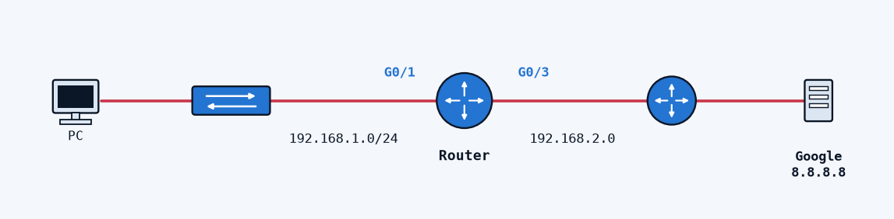

## The routing table
- The router decides with its **routing table**: for each destination network, the **exit interface**
| Destination | Exit interface |
|---|---|
| 8.8.8.8 | G0/3 |
- A packet for 8.8.8.8 leaves by **G0/3**
- If the router does **not find** the destination in the routing table, it **drops** the packet

## What a router does with a packet
1. It receives the frame and checks that the destination **MAC** is its own
2. It removes the layer 2 header and reads the **destination IP**
3. It looks for the destination in the **routing table** and chooses the best route
4. It decreases the **TTL** by 1
5. It finds the MAC of the next device (**ARP**) and builds a **new frame**
6. It sends the frame out of the **exit interface**

## Connected routes
- The networks **directly connected** to the router appear **automatically** in the routing table
- But the interfaces of a router are **down by default**: we have to bring them up:
  1. choose the interface
  2. give it an **IP address and a mask**
  3. `no shutdown`
```ios
Router(config)#interface G0/0
Router(config-if)#ip address 192.168.1.1 255.255.255.0
Router(config-if)#no shutdown
```

## The client and the gateway
- How can a client reach the router, to access the other networks? With the **gateway** (the default gateway)
- The client sends to its gateway every packet whose destination is not in its own network
- Example: a client sends a packet to Google (8.8.8.8)
  - **IP source**: the client's IP
  - **IP destination**: 8.8.8.8
  - **MAC source**: the client's MAC
  - **MAC destination**: the MAC of the **router** (the gateway)

## The frame sent to Google
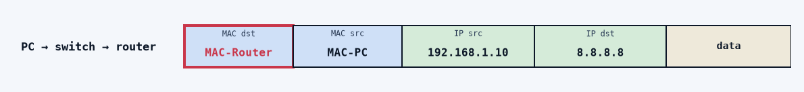
- The two destinations are **different**: the MAC is only for the next hop, the IP is for the final destination

# Static and dynamic routing
How a router learns the networks that are not directly connected.

## Two ways to learn the routes
| | Static routing | Dynamic routing |
|---|---|---|
| Who writes the routes | the administrator, with **commands** | the routers, with **routing protocols** |
| How | "this network is there, that network is here" | the routers talk to each other |
| Good for | small networks, a single exit | big networks that change |
- To tell the router about the **remote** networks, the routes must be learned in one of these two ways

## Dynamic routing: IGP and EGP
- **Dynamic**: routing protocols. There are two families:
  - **IGP** (Interior Gateway Protocol): inside an **autonomous system**, for example inside my company (RIP, OSPF, EIGRP)
  - **EGP** (Exterior Gateway Protocol): between **different autonomous systems**
- **BGP** is the **EGP** protocol: it is used between the **ISPs** (Internet Service Providers) and the big networks of the Internet

# Static routing
Writing the routes by hand, on a small lab.

## The lab
- R1: LAN **192.168.1.0/24** behind SW1. R2: LAN **172.16.1.0/24** behind SW2
- The link between the routers: **10.10.10.0/30** (R1 Se0/0 and R2 Se0/1)

## The lab: the topology
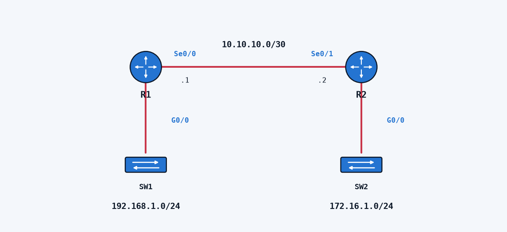

## Step 1: the interfaces of R1
- On each router: change the name with `hostname`, then bring up the interfaces (IP, mask, `no shutdown`)
```ios
Router(config)#hostname R1
R1(config)#interface Se0/0
R1(config-if)#ip address 10.10.10.1 255.255.255.252
R1(config-if)#no shutdown
R1(config-if)#interface G0/0
R1(config-if)#ip address 192.168.1.1 255.255.255.0
R1(config-if)#no shutdown
```

## Step 1: the interfaces of R2
```ios
Router(config)#hostname R2
R2(config)#interface Se0/1
R2(config-if)#ip address 10.10.10.2 255.255.255.252
R2(config-if)#no shutdown
R2(config-if)#interface G0/0
R2(config-if)#ip address 172.16.1.1 255.255.255.0
R2(config-if)#no shutdown
```

## The tables after the interfaces are up
- Result after bringing up the interfaces (IP, mask, `no shutdown`):
| Router | Routes in the table (connected) |
|---|---|
| R1 | 192.168.1.0/24 · 10.10.10.0/30 |
| R2 | 172.16.1.0/24 · 10.10.10.0/30 |
- R1 does not know 172.16.1.0/24 and R2 does not know 192.168.1.0/24
- We must **complete the table** so that there is a route: R1 to 172.16.1.0 and R2 to 192.168.1.0/24

## The ip route command
- Syntax: `ip route` **destination network** **mask** then the **exit interface** or the **next hop**
- The **next hop** is the IP address of the neighbour router
```ios
R1(config)#ip route 172.16.1.0 255.255.255.0 Se0/0
R1(config)#ip route 172.16.1.0 255.255.255.0 10.10.10.2
```
- On R1: the destination 172.16.1.0 is reached through the **exit interface** Se0/0, or through the **next hop** 10.10.10.2

## Exit interface or next hop?
- **Exit interface**: the interface where the packet leaves the router
- **Next hop**: the IP address of the next router on the way
- In real life, we should give **both** the exit interface and the next hop
```ios
R1(config)#ip route 172.16.1.0 255.255.255.0 Se0/0 10.10.10.2
R2(config)#ip route 192.168.1.0 255.255.255.0 Se0/1 10.10.10.1
```

## The routing table of R1
```ios
R1#show ip route
      10.0.0.0/8 is variably subnetted, 2 subnets, 2 masks
C        10.10.10.0/30 is directly connected, Serial0/0
L        10.10.10.1/32 is directly connected, Serial0/0
      172.16.0.0/24 is subnetted, 1 subnets
S        172.16.1.0 [1/0] via 10.10.10.2, Serial0/0
      192.168.1.0/24 is variably subnetted, 2 subnets, 2 masks
C        192.168.1.0/24 is directly connected, GigabitEthernet0/0
L        192.168.1.1/32 is directly connected, GigabitEthernet0/0
```
- **C**: connected · **L**: local address of the interface · **S**: static route
- `[1/0]` = administrative distance 1, metric 0

## The configuration steps
1. **Hostname**: `hostname R1`, `hostname R2` (change the name)
2. **The interfaces of the router**: IP address + mask, `no shutdown`
3. **Static routing**: one `ip route` for every remote network

# Choosing the best route
What the router does when several routes of the table match the destination.

## Several routes match: which one?
- A routing table can contain **several routes** that match the same destination
- The router follows **rules in a fixed order** to choose **one**:
  1. the **longest prefix** (the most specific route)
  2. the lowest **administrative distance** (the most trusted source)
  3. the lowest **metric** (the best path of one protocol)
  4. if everything is equal: **load balancing**

## The running example
- A packet for **172.16.1.7** arrives. The router knows these routes that match it:
| # | Network | Learned from | AD | Metric | Next hop |
|---|---|---|---|---|---|
| 1 | 0.0.0.0/0 | Static | 1 | 0 | 10.0.9.2 (ISP) |
| 2 | 172.16.0.0/16 | RIP | 120 | 2 | 10.0.0.2 |
| 3 | 172.16.1.0/24 | RIP | 120 | 3 | 10.0.1.2 |
| 4 | 172.16.1.0/24 | OSPF | 110 | 20 | 10.0.2.2 |
| 5 | 172.16.1.0/24 | OSPF | 110 | 20 | 10.0.3.2 |
| 6 | 172.16.1.0/24 | OSPF | 110 | 30 | 10.0.4.2 |
- We apply the rules **one after the other**: at each rule, the routes that lose are removed

## Rule 1: the longest prefix match
- A route **matches** a destination when the first bits of the destination are the same as the network of the route
- The router chooses the route with the **longest prefix** (the biggest /n): it is the **most specific**
- The prefix is compared **first**: a /24 wins over a /16 even if the /16 has a better administrative distance
- The **default route 0.0.0.0/0** matches everything, but it is always the **last choice**

## Rule 1 on the example
| # | Network | Prefix | Result |
|---|---|---|---|
| 1 | 0.0.0.0/0 | /0 | **removed**: the shortest prefix, even with the best AD (1) |
| 2 | 172.16.0.0/16 | /16 | **removed**: shorter than /24 |
| 3 | 172.16.1.0/24 | /24 | kept |
| 4 | 172.16.1.0/24 | /24 | kept |
| 5 | 172.16.1.0/24 | /24 | kept |
| 6 | 172.16.1.0/24 | /24 | kept |
- **4 routes left**: 3, 4, 5 and 6 (all /24)

## Rule 2: the administrative distance (AD)
- The **AD** tells how much a **source of routes** is trusted: from **0 to 255**, the **lowest wins**
- It is used when **different sources** give a route to the **same network** (same prefix)
- The values are decided by the **vendor** (Cisco is not like Huawei). Routes of the **same protocol** can have different AD: **iBGP 200**, **eBGP 20**
| Source of the route | AD |
|---|---|
| Connected | 0 |
| Static | 1 |
| eBGP | 20 |
| EIGRP | 90 |
| OSPF | 110 |
| RIP | 120 |
| iBGP | 200 |
| Unusable | 255 |

## Rule 2 on the example
| # | Network | Learned from | AD | Result |
|---|---|---|---|---|
| 3 | 172.16.1.0/24 | RIP | 120 | **removed**: 120 is higher than 110 |
| 4 | 172.16.1.0/24 | OSPF | 110 | kept |
| 5 | 172.16.1.0/24 | OSPF | 110 | kept |
| 6 | 172.16.1.0/24 | OSPF | 110 | kept |
- **3 routes left**: 4, 5 and 6 (all OSPF)

## Rule 3: the metric
- The **metric** compares the routes of the **same routing protocol**: the **lowest** metric wins
- Each protocol has its own way to calculate it:
| Protocol | Metric |
|---|---|
| RIP | number of hops |
| OSPF | cost (based on the bandwidth) |
| EIGRP | bandwidth and delay |
| Static route | 0 |
- Metrics of different protocols are **not comparable**: this is why the AD comes first

## Rule 3 on the example
| # | Network | Learned from | Metric | Result |
|---|---|---|---|---|
| 4 | 172.16.1.0/24 | OSPF | 20 | kept |
| 5 | 172.16.1.0/24 | OSPF | 20 | kept |
| 6 | 172.16.1.0/24 | OSPF | 30 | **removed**: 30 is higher than 20 |
- **2 routes left**: 4 and 5, with the **same metric**

## Rule 4: equal routes, load balancing
- Routes 4 and 5 are **equal** in everything: same prefix (/24), same AD (110), same metric (20)
- The router **keeps both** in the routing table
- The packets for 172.16.1.7 are **shared** between the two next hops: **10.0.2.2** and **10.0.3.2**
- The number of equal paths is limited (**max paths**): for example **OSPF uses 4**. With 6 equal routes (a tie), only 4 are kept

## The decision in one picture
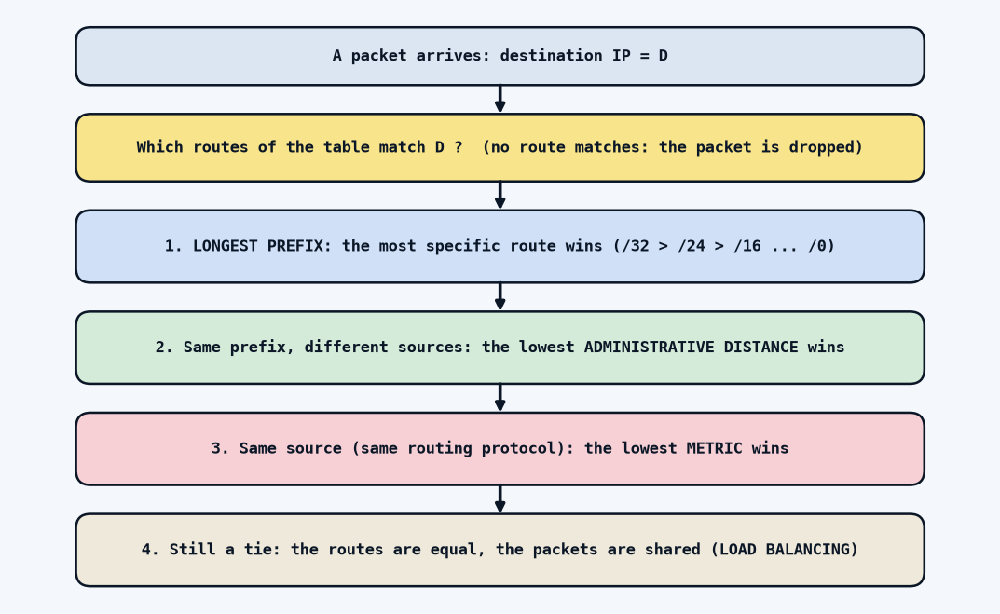

# Default route, load balancing and floating route
Three tools that use the rules of the previous section.

## The default route
- The Internet has **billions of routes**: the router cannot list them
- In the previous example, we have **one route** to the **ISP** (Internet Service Provider), for example **Algérie Télécom**, which manages the rest by itself
- This is the **default route**:
```ios
R1(config)#ip route 0.0.0.0 0.0.0.0 next-hop
R1(config)#ip route 0.0.0.0 0.0.0.0 exit-interface
```
- `0.0.0.0 0.0.0.0` is the network **0.0.0.0/0**: it matches **every** destination
- Its prefix is /0, the shortest: it is used **only when no other route matches** (rule 1)

## Load balancing
- To reach **10.10.10.0/24** there are **two paths**
- We put **both** in the routing table, and the router sends the packets over **both**: **load balancing**
- Example: 10 packets: **5 on the first path and 5 on the second**
- It works when the two routes are **equal** (same prefix, same AD, same metric)

## Load balancing: the two paths
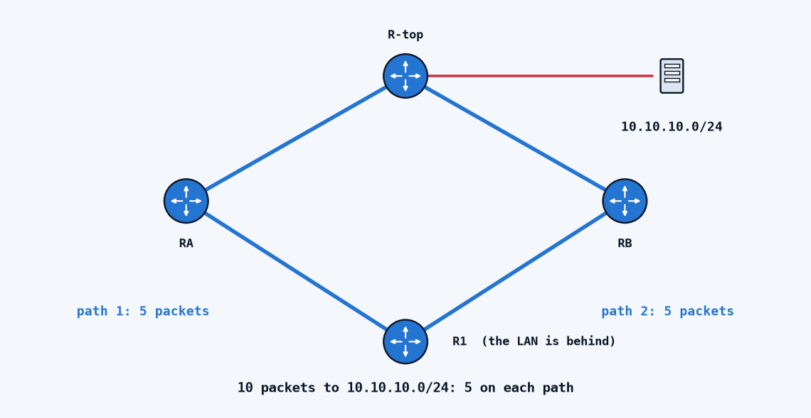

## Load balancing: the configuration
```ios
R1(config)#ip route 10.10.10.0 255.255.255.0 192.168.12.2
R1(config)#ip route 10.10.10.0 255.255.255.0 192.168.13.2
```
- Two static routes to the same network, with the **same AD** (1): both go in the table
- Load balancing is good if the two paths have the **same performance (speed)**
- Otherwise: use a **floating route**

## Floating static route
- When the two paths are **not equal**: we use the good one, and the other one is kept as a **backup**
- The backup route is a **floating route**: a static route with a **higher administrative distance**
- We add the **AD at the end** of the `ip route` command
```ios
R1(config)#ip route 10.10.10.0 255.255.255.0 192.168.12.2
R1(config)#ip route 10.10.10.0 255.255.255.0 192.168.13.2 5
```
- The first route has AD **1**, the second AD **5**: only the first one is in the table
- If the first path **fails**, the second one **appears** in the table
- We do not always add the AD: only when there are **several routes** to the same network

## ? Which route does the router choose for 10.1.1.25: 10.0.0.0/8 static, 10.1.1.0/24 RIP or 0.0.0.0/0?
- All three match
- The longest prefix wins: **10.1.1.0/24** (RIP)
- The AD is not used: the prefixes are different

## ? Two static routes to the same network, the first with AD 1 and the second with AD 5. Which one is used?
- Same prefix, different AD: the lowest AD wins
- The first route (AD 1) is used
- The second one is a **floating route**: it is a backup

## Summary
- A router forwards the traffic between networks with its **routing table**; no match = the packet is dropped
- **Connected routes** appear alone, but the interfaces are down by default (`no shutdown`)
- **Static**: the administrator writes the routes (`ip route` network, mask, exit interface and/or next hop). **Dynamic**: routing protocols (IGP, BGP)
- When several routes match: **longest prefix**, then lowest **AD**, then lowest **metric**, then **load balancing**
- **Default route** `0.0.0.0 0.0.0.0`: the last choice, for all the unknown networks
- **Floating route**: a static route with a higher AD, used as a backup

# Lab 1: static routing with 6 routers
A first lab with the basics only: connected routes, static routes, load balancing, floating routes and default routes.

## The scenario
- A company has **6 routers**: R1 and R2 (the access routers, with the LAN-A and the LAN-B), R3 and R4 (the core routers), R5 (the router of the LAN-C and of the exit) and R6 (the **ISP**)
- R6 has a loopback **8.8.8.8** that stands for the Internet
- All the routing is **static**. Every link has two paths (through R3 or R4): we use load balancing, floating routes and default routes

## The topology
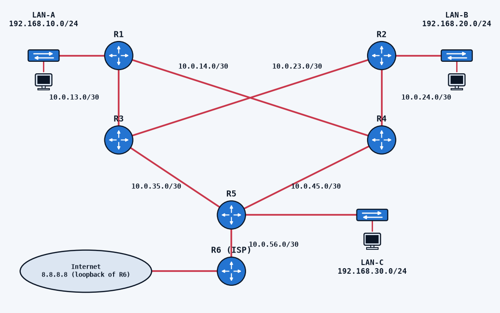

## The addresses (1/2)
| Router | Interface | Address | Connected to |
|---|---|---|---|
| R1 | Gi0/0 | 192.168.10.1/24 | LAN-A |
| R1 | Gi0/1 | 10.0.13.1/30 | to R3 |
| R1 | Gi0/2 | 10.0.14.1/30 | to R4 |
| R2 | Gi0/0 | 192.168.20.1/24 | LAN-B |
| R2 | Gi0/1 | 10.0.23.1/30 | to R3 |
| R2 | Gi0/2 | 10.0.24.1/30 | to R4 |
| R3 | Gi0/0 | 10.0.13.2/30 | to R1 |
| R3 | Gi0/1 | 10.0.23.2/30 | to R2 |
| R3 | Gi0/2 | 10.0.35.1/30 | to R5 |

## The addresses (2/2)
| Router | Interface | Address | Connected to |
|---|---|---|---|
| R4 | Gi0/0 | 10.0.14.2/30 | to R1 |
| R4 | Gi0/1 | 10.0.24.2/30 | to R2 |
| R4 | Gi0/2 | 10.0.45.1/30 | to R5 |
| R5 | Gi0/0 | 10.0.35.2/30 | to R3 |
| R5 | Gi0/1 | 10.0.45.2/30 | to R4 |
| R5 | Gi0/2 | 192.168.30.1/24 | LAN-C |
| R5 | Gi0/3 | 10.0.56.1/30 | to R6 |
| R6 | Gi0/0 | 10.0.56.2/30 | to R5 |
| R6 | Lo0 | 8.8.8.8/32 | Internet |

## The tasks
1. Configure the **interfaces** of the 6 routers
2. Write the **static routes** (complete routes: exit interface and next hop) so that the 3 LANs reach each other
3. **Load balancing**: R1 to the LAN-B and the LAN-C through R3 and R4, and R5 to the LAN-A and the LAN-B through R3 and R4
4. **Floating routes**: R2 uses R3, and R4 is the backup (AD 5). On R1, the default route uses R3 and the floating one uses R4
5. **Default routes** to the Internet: R3, R4 and R5 follow the path to R6. R6 has one route to 192.168.0.0/16 through R5
6. **Test** with pings, traceroute and `show ip route`

## Solution: R1
```ios
hostname R1
interface Gi0/0
 ip address 192.168.10.1 255.255.255.0
 no shutdown
interface Gi0/1
 ip address 10.0.13.1 255.255.255.252
 no shutdown
interface Gi0/2
 ip address 10.0.14.1 255.255.255.252
 no shutdown
!
ip route 192.168.20.0 255.255.255.0 Gi0/1 10.0.13.2
ip route 192.168.20.0 255.255.255.0 Gi0/2 10.0.14.2
ip route 192.168.30.0 255.255.255.0 Gi0/1 10.0.13.2
ip route 192.168.30.0 255.255.255.0 Gi0/2 10.0.14.2
ip route 0.0.0.0 0.0.0.0 Gi0/1 10.0.13.2
ip route 0.0.0.0 0.0.0.0 Gi0/2 10.0.14.2 5
```

## Solution: R2
```ios
hostname R2
interface Gi0/0
 ip address 192.168.20.1 255.255.255.0
 no shutdown
interface Gi0/1
 ip address 10.0.23.1 255.255.255.252
 no shutdown
interface Gi0/2
 ip address 10.0.24.1 255.255.255.252
 no shutdown
!
ip route 192.168.10.0 255.255.255.0 Gi0/1 10.0.23.2
ip route 192.168.10.0 255.255.255.0 Gi0/2 10.0.24.2 5
ip route 192.168.30.0 255.255.255.0 Gi0/1 10.0.23.2
ip route 192.168.30.0 255.255.255.0 Gi0/2 10.0.24.2 5
ip route 0.0.0.0 0.0.0.0 Gi0/1 10.0.23.2
ip route 0.0.0.0 0.0.0.0 Gi0/2 10.0.24.2 5
```

## Solution: R3
```ios
hostname R3
interface Gi0/0
 ip address 10.0.13.2 255.255.255.252
 no shutdown
interface Gi0/1
 ip address 10.0.23.2 255.255.255.252
 no shutdown
interface Gi0/2
 ip address 10.0.35.1 255.255.255.252
 no shutdown
!
ip route 192.168.10.0 255.255.255.0 Gi0/0 10.0.13.1
ip route 192.168.20.0 255.255.255.0 Gi0/1 10.0.23.1
ip route 192.168.30.0 255.255.255.0 Gi0/2 10.0.35.2
ip route 0.0.0.0 0.0.0.0 Gi0/2 10.0.35.2
```

## Solution: R4
```ios
hostname R4
interface Gi0/0
 ip address 10.0.14.2 255.255.255.252
 no shutdown
interface Gi0/1
 ip address 10.0.24.2 255.255.255.252
 no shutdown
interface Gi0/2
 ip address 10.0.45.1 255.255.255.252
 no shutdown
!
ip route 192.168.10.0 255.255.255.0 Gi0/0 10.0.14.1
ip route 192.168.20.0 255.255.255.0 Gi0/1 10.0.24.1
ip route 192.168.30.0 255.255.255.0 Gi0/2 10.0.45.2
ip route 0.0.0.0 0.0.0.0 Gi0/2 10.0.45.2
```

## Solution: R5
```ios
hostname R5
interface Gi0/0
 ip address 10.0.35.2 255.255.255.252
 no shutdown
interface Gi0/1
 ip address 10.0.45.2 255.255.255.252
 no shutdown
interface Gi0/2
 ip address 192.168.30.1 255.255.255.0
 no shutdown
interface Gi0/3
 ip address 10.0.56.1 255.255.255.252
 no shutdown
!
ip route 192.168.10.0 255.255.255.0 Gi0/0 10.0.35.1
ip route 192.168.10.0 255.255.255.0 Gi0/1 10.0.45.1
ip route 192.168.20.0 255.255.255.0 Gi0/0 10.0.35.1
ip route 192.168.20.0 255.255.255.0 Gi0/1 10.0.45.1
ip route 0.0.0.0 0.0.0.0 Gi0/3 10.0.56.2
```

## Solution: R6
```ios
hostname R6
interface Gi0/0
 ip address 10.0.56.2 255.255.255.252
 no shutdown
interface Lo0
 ip address 8.8.8.8 255.255.255.255
 no shutdown
!
ip route 192.168.0.0 255.255.0.0 Gi0/0 10.0.56.1
```

## What each router does
- **R1**: the same AD (1) to the LAN-B and the LAN-C through R3 and R4: **load balancing**. The default route through R3 has AD 1, the one through R4 is **floating** (AD 5)
- **R2**: R3 is the priority for every route, R4 is the **floating** backup (AD 5)
- **R3** and **R4**: a route to every LAN and a default route to R5
- **R5**: load balancing to the LAN-A and the LAN-B (R3 and R4) and the default route to the ISP
- **R6**: the ISP sends 192.168.0.0/16 back to R5. 8.8.8.8 is a loopback: it stands for the Internet

## Verification: the paths
| Flow | Path of the packets |
|---|---|
| LAN-A → LAN-B | R1 → R3 → R2  and  R1 → R4 → R2 |
| LAN-A → LAN-C | R1 → R3 → R5  and  R1 → R4 → R5 |
| LAN-A → Internet | R1 → R3 → R5 → R6 |
| LAN-B → LAN-A | R2 → R3 → R1 |
| LAN-B → LAN-C | R2 → R3 → R5 |
| LAN-B → Internet | R2 → R3 → R5 → R6 |
| LAN-C → LAN-A | R5 → R3 → R1  and  R5 → R4 → R1 |
| LAN-C → LAN-B | R5 → R3 → R2  and  R5 → R4 → R2 |
| LAN-C → Internet | R5 → R6 |
| Internet → LAN-A (the reply) | R6 → R5 → R3 → R1  and  R6 → R5 → R4 → R1 |
- "and" between two paths means they are used together: R1 and R5 use **R3 and R4** (load balancing). R2 uses only R3: R4 is its **floating** backup
- All the flows are delivered: the lab works

## Verification: the routing table of R1
```ios
R1#show ip route static
Gateway of last resort is 10.0.13.2 to network 0.0.0.0

S*    0.0.0.0/0 [1/0] via 10.0.13.2, GigabitEthernet0/1
S     192.168.20.0/24 [1/0] via 10.0.14.2, GigabitEthernet0/2
                      [1/0] via 10.0.13.2, GigabitEthernet0/1
S     192.168.30.0/24 [1/0] via 10.0.14.2, GigabitEthernet0/2
                      [1/0] via 10.0.13.2, GigabitEthernet0/1
```
- R1 shows **two routes** to the LAN-B and the LAN-C: load balancing

## Verification: the routing table of R2
```ios
R2#show ip route static
Gateway of last resort is 10.0.23.2 to network 0.0.0.0

S*    0.0.0.0/0 [1/0] via 10.0.23.2, GigabitEthernet0/1
S     192.168.10.0/24 [1/0] via 10.0.23.2, GigabitEthernet0/1
S     192.168.30.0/24 [1/0] via 10.0.23.2, GigabitEthernet0/1
```
- R2 shows **one route** only: the floating routes (AD 5) are **hidden** while the routes with AD 1 work

## Lab 1: what is next
- We used the **basics** of static routing: complete routes, load balancing, floating routes and default routes
- Try this: ping **192.168.99.9** (an address of 192.168.0.0/16 that nobody uses) from the LAN-A. The packet **loops** between R5 and R6 until the TTL is 0
- To solve it, and to react to a path that is broken beyond the interface, we need the **advanced tools** of the next sections: Null0 routes, track and IP SLA. They are used in **lab 2**


# The path of a packet in a router
What the router does to a packet, from the ingress to the egress.

## When a packet reaches the router
- When a packet reaches a router: **de-encapsulation**, then **routing**, then **encapsulation**
- The routing is a **local lookup** in the routing table
- Before the routing, there is the **input ACL** (an ACL applied in the inbound direction): it acts on the **ingress traffic**
- If the traffic is encrypted, the **decryption** comes first

## The steps in the router
1. **Ingress traffic**: the packet enters the router
2. **Decryption** (optional): if the packet is encrypted
3. **Input ACL**
4. **Routing lookup**
5. **NAT** (if configured)
6. **PBR** (policy-based routing), or a route-map
7. **Output ACL**
8. **Encryption** (optional)
9. **Egress traffic**: the packet leaves the router

## The steps: the picture
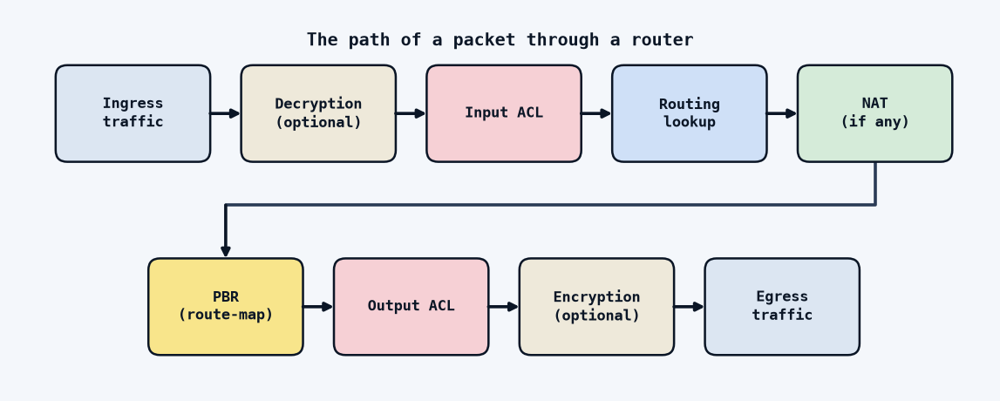

## Example: NAT and ACL
- A router does **NAT**: G0/1/0 is the **inside** (the PCs 10.0.0.x) and G0/1/1 the **outside** (the Internet)
- An **ACL** on G0/1/1 denies **10.0.0.2**, but it does **not** block it: the **NAT happens before the output ACL**, so the source is already **another IP address** and the traffic goes out normally
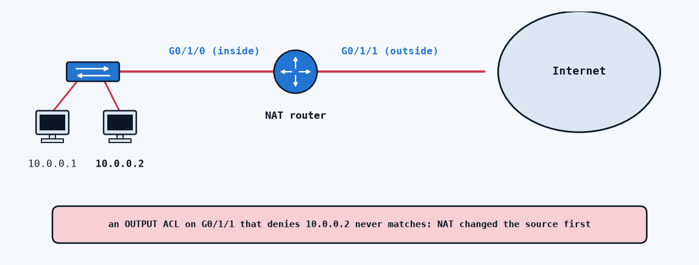

# The 5 types of static routes
How we write a static route changes how the router uses it.

## The 5 types
| Type | What we write in the command |
|---|---|
| **Direct route** | only the **exit interface** |
| **Recursive route** | only the **next hop** IP address |
| **Complete route** | the **exit interface and the next hop** |
| **Null route** | the exit is **Null0** |
| **Static with track** | a static route that depends on a **test** |
```ios
R1(config)#ip route 10.0.0.0 255.255.255.0 G0/0
R1(config)#ip route 10.0.0.0 255.255.255.0 20.0.0.2
R1(config)#ip route 10.0.0.0 255.255.255.0 G0/0 20.0.0.2
```

## Direct route on a multi-access network
- Users in 10.1.1.0/24 access the hosts 10.1.3.1 to 10.1.3.8. R1 looks in its routing table and finds the **longest match**:
```ios
S 10.1.3.0/24 is directly connected, GigabitEthernet1/0
```
- R1 **believes** that the network is directly connected: the destination IP address is on the network connected to Gig1/0
- In reality it is **not**: the hosts are behind R2

## Direct route: ARP for every destination
- Because the exit interface is an **Ethernet** interface, R1 uses **ARP** to find the MAC address of the **destination IP** of each packet (10.1.3.1, 10.1.3.2 ...): an ARP request (broadcast) with the MAC of its interface as the source
- This is **different from the next hop**: when the **next hop** is specified, the MAC address of the **next hop** is used
- R2 does not own the destination IP, but it knows a route to it: it answers with **its own MAC**. This is **proxy ARP** (enabled by default)
- The router then sends the frames to the MAC address of R2

## Proxy ARP: the ARP cache of R1
- Every destination IP has an entry in the ARP cache of R1. How can that be, if **routers do not forward ARP requests**?
- It is because of **proxy ARP**, **on by default** on the routers: a router responds to an ARP request with **its own MAC address** if it has a **route** in its routing table to the IP address of the request
- The MAC addresses of the entries are **all the same**, and they match the MAC of the entry 10.1.12.2: R2 has a route to the IP of the request, so it answers with its MAC
```ios
R1#show ip arp
Protocol  Address      Age (min)  Hardware Addr   Type  Interface
Internet  10.1.1.1             -  ca07.0568.0008  ARPA  GigabitEthernet0/0
Internet  10.1.3.1             0  ca08.0568.0008  ARPA  GigabitEthernet1/0
Internet  10.1.3.2             0  ca08.0568.0008  ARPA  GigabitEthernet1/0
Internet  10.1.3.3             3  ca08.0568.0008  ARPA  GigabitEthernet1/0
Internet  10.1.3.4             0  ca08.0568.0008  ARPA  GigabitEthernet1/0
Internet  10.1.3.5             1  ca08.0568.0008  ARPA  GigabitEthernet1/0
Internet  10.1.3.6             0  ca08.0568.0008  ARPA  GigabitEthernet1/0
Internet  10.1.3.7             0  ca08.0568.0008  ARPA  GigabitEthernet1/0
Internet  10.1.3.8             1  ca08.0568.0008  ARPA  GigabitEthernet1/0
Internet  10.1.12.1            -  ca07.0568.001c  ARPA  GigabitEthernet1/0
Internet  10.1.12.2          139  ca08.0568.0008  ARPA  GigabitEthernet1/0
```

## Proxy ARP: is it enabled?
- The command **`show ip interface`** shows whether proxy ARP is enabled. On R2: **Proxy ARP is enabled**, and **Local Proxy ARP is disabled**
```ios
R2#show ip interface gigabitEthernet 0/0
GigabitEthernet0/0 is up, line protocol is up
  Internet address is 10.1.12.2/24
  Broadcast address is 255.255.255.255
  Address determined by non-volatile memory
  MTU is 1500 bytes
  Helper address is not set
  Directed broadcast forwarding is disabled
  Multicast reserved groups joined: 224.0.0.5 224.0.0.6
  Outgoing access list is not set
  Inbound access list is not set
  Proxy ARP is enabled
  Local Proxy ARP is disabled
  Security level is default
  Split horizon is enabled
  ICMP redirects are always sent
```

## Proxy ARP disabled: encapsulation failure
- If proxy ARP is **not enabled**, the ARP cache of R1 looks like this
- R1 is still sending **ARP requests**, but it is **not getting any ARP replies** (the entries are **Incomplete**)
- So it cannot build the **layer 2 frame**: the result is an **encapsulation failure**
```ios
R1#show ip arp
Protocol  Address      Age (min)  Hardware Addr   Type  Interface
Internet  10.1.1.1             -  ca07.0568.0008  ARPA  GigabitEthernet0/0
Internet  10.1.3.1             0  Incomplete      ARPA
Internet  10.1.3.2             0  Incomplete      ARPA
Internet  10.1.3.3             0  Incomplete      ARPA
Internet  10.1.3.4             0  Incomplete      ARPA
Internet  10.1.3.5             0  Incomplete      ARPA
Internet  10.1.3.6             0  Incomplete      ARPA
Internet  10.1.3.7             0  Incomplete      ARPA
Internet  10.1.3.8             0  Incomplete      ARPA
Internet  10.1.12.1            -  ca07.0568.001c  ARPA  GigabitEthernet1/0
Internet  10.1.12.2          139  ca08.0568.0008  ARPA  GigabitEthernet1/0
```

## Never an Ethernet interface alone
- R1 uses ARP to find the MAC address of the **destination IP of every packet**: you should **never specify an Ethernet interface alone** in a static route
- It uses **too many router resources**, such as the processor and the memory: the **control plane** gets involved during the forwarding process, to find the right layer 2 MAC address with ARP
- Use the **next hop** (recursive route) or the **exit interface and the next hop** (complete route)

## Proxy ARP and security
- Proxy ARP is **enabled by default**, but it is **not good for security**
- **Reconnaissance attack**: for example next to an ISP (service provider, telecom operator), an attacker can learn which IP addresses and networks exist behind the router, because the router **answers for many networks** of its routing table
- A router answers the ARP request with its own MAC when it **knows a route** to the requested IP and the destination is **not behind the same interface**
- **Local proxy ARP**: for hosts that are on the same interface but isolated from each other (private): the router answers with its MAC, so they can talk. It is **disabled by default**

## Recursive route
- **Recursive route**: we write the **next hop**
- The next-hop IP address is a **very important parameter**: it tells the local router **where to send the packet**
- Example: `S 10.1.3.0/24 [8/0] via 10.1.12.2`. A packet for 10.1.3.0 has to go to **10.1.12.2** next
- R1 does a **recursive lookup** in the routing table for 10.1.12.2, to find **how to reach it**
- It needs **more than one lookup**

## Recursive route: the verification
```ios
R1#show ip route static
Codes: L - local, C - connected, S - static, R - RIP, M - mobile, B - BGP
...output omitted...

      10.0.0.0/8 is variably subnetted, 7 subnets, 2 masks
S        10.1.3.0/24 [8/0] via 10.1.12.2
```
```ios
R1#show ip route 10.1.12.2
Routing entry for 10.1.12.0/24
  Known via "connected", distance 0, metric 0 (connected, via interface)
  Routing Descriptor Blocks:
  * directly connected, via GigabitEthernet1/0
      Route metric is 0, traffic share count is 1
```
- `[8/0]` = administrative distance 8, metric 0. The next hop 10.1.12.2 is found in the **connected** route 10.1.12.0/24, out **GigabitEthernet1/0**

## Challenge: load balancing 80% / 20%
- Two paths to **8.8.8.8**: next hop **10.0.0.1** and next hop **20.0.0.1**
- Two static routes with the same AD share the packets **50% / 50%**
- **Challenge**: send **80%** of the packets through **20.0.0.1** and **20%** through **10.0.0.1**, with static routes only
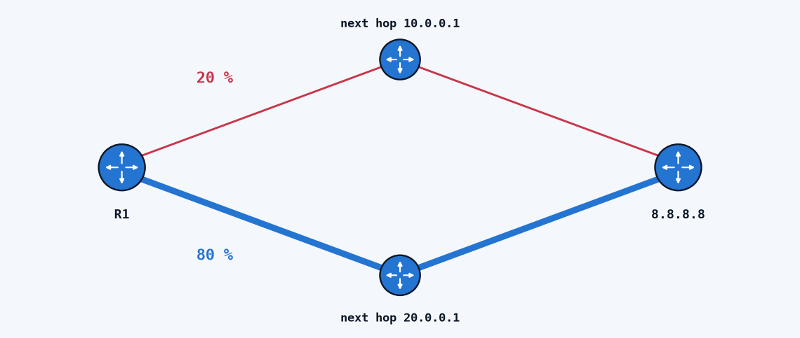

## Challenge: the idea
- The router shares the packets **equally between the paths** of the routing table
- 80% / 20% = **4 paths** through 20.0.0.1 and **1 path** through 10.0.0.1: **5 equal paths** for 8.8.8.8
- The trick: **recursive routes**. We create **5 virtual next hops** (1.1.1.1 to 5.5.5.5): each one is a different path to 8.8.8.8, and each one **resolves** (recursion) to a real next hop
  - 4 virtual next hops resolve to **20.0.0.1**
  - 1 virtual next hop resolves to **10.0.0.1**

## Challenge: the solution
```ios
R1(config)#ip route 8.8.8.8 255.255.255.255 1.1.1.1
R1(config)#ip route 8.8.8.8 255.255.255.255 2.2.2.2
R1(config)#ip route 8.8.8.8 255.255.255.255 3.3.3.3
R1(config)#ip route 8.8.8.8 255.255.255.255 4.4.4.4
R1(config)#ip route 8.8.8.8 255.255.255.255 5.5.5.5
R1(config)#ip route 1.1.1.1 255.255.255.255 20.0.0.1
R1(config)#ip route 2.2.2.2 255.255.255.255 20.0.0.1
R1(config)#ip route 3.3.3.3 255.255.255.255 20.0.0.1
R1(config)#ip route 4.4.4.4 255.255.255.255 20.0.0.1
R1(config)#ip route 5.5.5.5 255.255.255.255 10.0.0.1
```
- For one path: 8.8.8.8 → 1.1.1.1 → 20.0.0.1 → exit interface
- The ratio is **approximate**: the router shares the traffic **per flow**

## Challenge: the price of the recursion
- Each path needs **several lookups**: to reach 8.8.8.8 through 10.0.0.1 the router may follow a chain: 8.8.8.8 → 1.1.1.1 → 2.2.2.2 → 4.4.4.4 → 10.0.0.1
- That is **4 lookups** for one packet, while a direct next hop needs only one: the router **wastes time**
- So the recursive trick is a **solution for a special need** (unequal load balancing): for a normal route, the **complete route** is better

## Complete route: recommended
- **Complete**: the exit interface **and** the next hop
- It is **recommended**, because the router processes it **only once**: it sees the interface and the next hop **directly**, not several times like a recursive route
- If the **exit interface goes down**, the static route is **removed** from the routing table

## Two next hops: load balancing or backup
- Example: a source router and 8.8.8.8, with two paths: next hop **10.0.0.1** and next hop **20.0.0.1**
- Two routes with the same AD: **load balancing 50/50**
```ios
R1(config)#ip route 8.8.8.8 255.255.255.255 Gi0/0 10.0.0.1
R1(config)#ip route 8.8.8.8 255.255.255.255 Gi0/1 20.0.0.1
```
- To keep one route as a **backup** instead: a different AD (for example **15** and **20**): the route with the lowest AD is the **priority**
```ios
R1(config)#ip route 8.8.8.8 255.255.255.255 Gi0/0 10.0.0.1 15
R1(config)#ip route 8.8.8.8 255.255.255.255 Gi0/1 20.0.0.1 20
```

## Null route
- **Null0** is a virtual interface that **drops** everything: a black hole
```ios
R1(config)#ip route 20.0.0.0 255.255.255.248 Null0
```
- The router sends the matching traffic to Null0: it is **dropped**
- It is used to **eliminate loops**, and in other scenarios

## Null0 and the routing loops
- A client buys a **pool of public addresses** from its ISP, for example **20.0.0.1 to 20.0.0.6**
- The ISP has a route to the pool through the client. The client has a **default route** (0.0.0.0) to the ISP
- A packet from the Internet to **20.0.0.5** (not used by the client) goes to the client. The client does not have it: it uses its **default route** and sends it **back to the ISP**, which sends it to the client again: a **loop**, and the **saturation** of the link
- **Solution**: a **Null0** route on the client for the whole pool: the unused addresses are dropped

## The routing loop
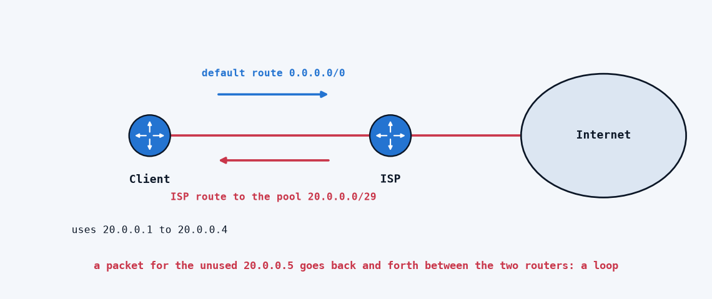

## Null0 with the longest prefix
```ios
Client(config)#ip route 20.0.0.0 255.255.255.248 Null0
```
- The addresses that the client **uses** have **more specific routes** (connected networks, /32 ...): by the rule of the **longest prefix**, they win over the Null0 route
- Only the **unused** addresses of the pool match the Null0 route: they are dropped and the loop disappears

## Static route with track
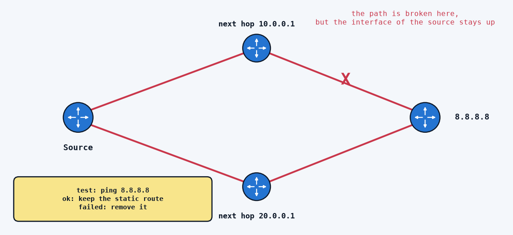

## Static route with track: the idea
- Problem: a static route stays in the routing table as long as its **exit interface is up**, even if the path **after** it is broken
- **Track**: the static route stays only if a **test** succeeds. Test: **ping 8.8.8.8**
  - the test is **OK**: the static route **exists**
  - the test **fails**: the router **removes** the static route (and the backup route can take over)

## Track and IP SLA
- The test is done **frequently**. The tool that runs it is **IP SLA** (Cisco), **NQA** on Huawei
- **Type of test**: ping, HTTP, DNS ...
- **Destination**: for example 8.8.8.8
- **Frequency**: for example 1 per second
- **Result**: OK or failed (**timeout**, for example 5000 ms: no answer after the timeout = failed)
- **Threshold** (seuil): the test can also fail when the quality is below a limit (for example the delay)
- Careful: a test that is too frequent on a lot of routers (for example **680,000 requests per second**) can look like a **DoS** for the destination

## Static route with track: the configuration
```ios
R1(config)#ip sla 1
R1(config-ip-sla)#icmp-echo 8.8.8.8
R1(config-ip-sla-echo)#frequency 10
R1(config-ip-sla-echo)#exit
R1(config)#ip sla schedule 1 life forever start-time now
R1(config)#track 1 ip sla 1 reachability
R1(config)#ip route 0.0.0.0 0.0.0.0 10.0.0.1 track 1
R1(config)#ip route 0.0.0.0 0.0.0.0 20.0.0.1 5
```
- The first route exists only while the track 1 is **up**; the second one is a **floating** backup (AD 5)

# Lab 2: static routing with the advanced tools
The same 6 routers as lab 1, with Null0 routes, a tracked default route and a link failure.

## The scenario
- The **same lab** as lab 1: the same topology and the same addresses. The routes of lab 1 stay as they are
- We add **three things**: Null0 routes against the loops, a **tracked** default route on R1, and a **link failure** to test everything
- All the routing is still static

## The topology


## The tasks
1. **Null0 routes** on R3, R4 and R5 for 192.168.0.0/16, to avoid the loops
2. On R1, a **tracked default route** through R3 (IP SLA, ping 8.8.8.8), with the floating one through R4
3. **Test** the unused address 192.168.99.9, then **break the link R1 - R3** and observe

## Solution: the Null0 routes
```ios
R3(config)#ip route 192.168.0.0 255.255.0.0 Null0
R4(config)#ip route 192.168.0.0 255.255.0.0 Null0
R5(config)#ip route 192.168.0.0 255.255.0.0 Null0
```
- On R3, R4 and R5: the traffic for the **unused** addresses of 192.168.0.0/16 is **dropped**
- The LANs have **more specific routes** (/24): by the rule of the **longest prefix**, they still work

## Solution: the tracked default route of R1
```ios
R1(config)#ip sla 1
R1(config-ip-sla)#icmp-echo 8.8.8.8 source-ip 192.168.10.1
R1(config-ip-sla-echo)#frequency 10
R1(config-ip-sla-echo)#exit
R1(config)#ip sla schedule 1 life forever start-time now
R1(config)#track 1 ip sla 1 reachability
R1(config)#no ip route 0.0.0.0 0.0.0.0 Gi0/1 10.0.13.2
R1(config)#ip route 0.0.0.0 0.0.0.0 Gi0/1 10.0.13.2 track 1
```
- The test starts from the address of the LAN-A (**source-ip 192.168.10.1**): R6 has a route back to 192.168.0.0/16, but not to the link 10.0.13.0/30
- If the test fails, `track 1` goes down and R1 removes the default route through R3: the **floating** route through R4 (AD 5) takes over

## Verification: the Null0 routes
- Destination **192.168.99.9**: an address of 192.168.0.0/16 that nobody uses. Ping from the LAN-A:
| Case | Path of the packet |
|---|---|
| Lab 1 (without Null0) | R1 → R3 → R5 → R6 → R5 → R6 → R5 → R6 → R5 ... (loop) |
| Lab 2 (with Null0) | R1 → R3 ✗ dropped (Null0) |
- Without Null0, the packet goes from R5 (default route) to R6, and R6 sends it back to R5 (192.168.0.0/16) ... until the **TTL** is 0
- With Null0, R3 drops it at once

## Break a link: R1 - R3
- We shut the link 10.0.13.0/30 (`shutdown` on R1 Gi0/1). The routes of R1 through Gi0/1 **disappear** from its table (exit interface down)
| Flow | Path of the packets |
|---|---|
| LAN-A → LAN-B | R1 → R4 → R2 |
| LAN-A → Internet | R1 → R4 → R5 → R6 |
| Internet → LAN-A (the reply) | R6 → R5 → R3 ✗ dropped (Null0)  and  R6 → R5 → R4 → R1 |
- LAN-A → LAN-B and → Internet: R1 uses the only route left: through R4. The **floating default route** (AD 5) appears
- The reply: R5 does **not know** that the link is down. Half of the replies go through R3, which has no route to the LAN-A: they match the **Null0** route and are **dropped**

## The limits of static routing
- A static route does **not adapt** by itself: R5 keeps sending half of the traffic to R3, even if the path is broken after R3
- The administrator must **think of every failure** and write the routes by hand: it is long and risky on a big network
- The static routes are good for **small networks**, for a **default route** to the ISP, and for **backup** routes
- On big networks the routers must **talk to each other** and update the routes alone: this is **dynamic routing** (OSPF, EIGRP, BGP), the next sections
