# The problem: large broadcast domains
Why a flat switched network does not scale.

## Issues in a poorly designed network
- These issues are often found in poorly designed networks:
  - **Large broadcast domains**
  - **Management and support challenges**
  - **Possible security vulnerabilities**

## Large broadcast domains
- By default, all the devices are members of the **same broadcast domain**
- A **broadcast domain** is the set of devices that receive a layer 2 broadcast frame
- Whenever a host transmits a broadcast frame, the switch **floods** it out of every port that belongs to the same VLAN, except the port on which the frame was received
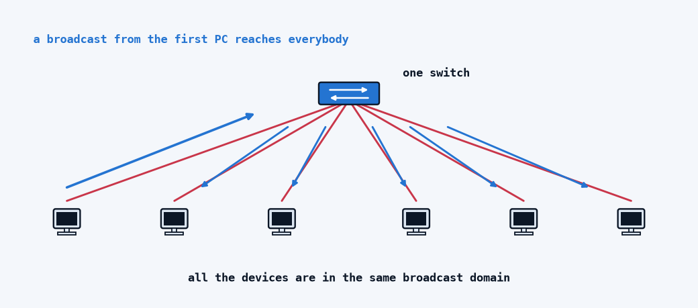

## Common broadcast traffic
- **ARP** requests
- **DHCP** Discover messages
- Certain **IPv4 routing protocol** updates
- Flooding of **unknown destination MAC** addresses

## Growth impact
- As the network grows, every additional device **increases the size of the broadcast domain**
- Every broadcast frame is delivered to every host, even when most devices have **no interest** in the information

## Disadvantages of a large broadcast domain
- Increased **bandwidth consumption** because of unnecessary broadcast traffic
- Higher **CPU utilization**: every host must process the broadcast frames
- Reduced **scalability**
- Poor **separation** between departments or user groups
- Increased **security risks**: all the hosts share the same layer 2 network
> Switches eliminate collisions (one collision domain per port), but they do **not** reduce the size of the broadcast domain. Without another mechanism (VLANs), every device of the switched network is still in the same logical LAN.

## The collision domain and the broadcast domain
- **Each router interface** is a **network** (a broadcast domain)
- **Each switch interface** is a **collision domain**
- A switch alone gives **one** broadcast domain; a router splits the broadcast domains
- The solution is to have **several broadcast domains**. But how?

## Example: switches and a router
- Several switches connected **to each other** are **one** broadcast domain: a broadcast crosses from one switch to the other
- A **router** does not forward the broadcasts: each router interface starts **another** broadcast domain
- Here: SW1 and SW2 (connected together) are on the interface 1 of the router: **one network**. SW3 is on the interface 2: **another network**. SW4 is on the interface 3: **a third network**
- So **a network = a broadcast domain**: a broadcast sent by a PC of the first network reaches all the PCs of SW1 and SW2, and **stops at the router**
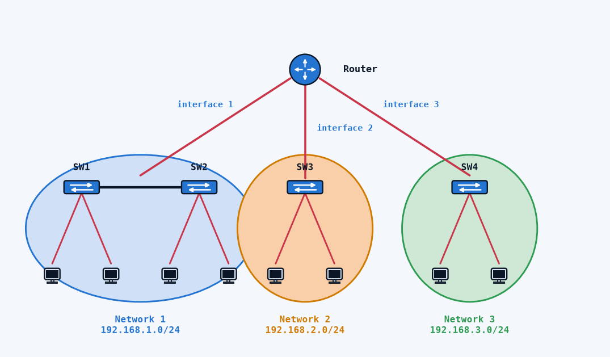

# Two solutions
Physical separation or logical separation.


## Solution 1: one switch per domain
- **Idea**: give each department or domain its own **dedicated switch**, and connect all the switches to a central router
- Example: IT on one switch, HR on another switch, Sales on a third one
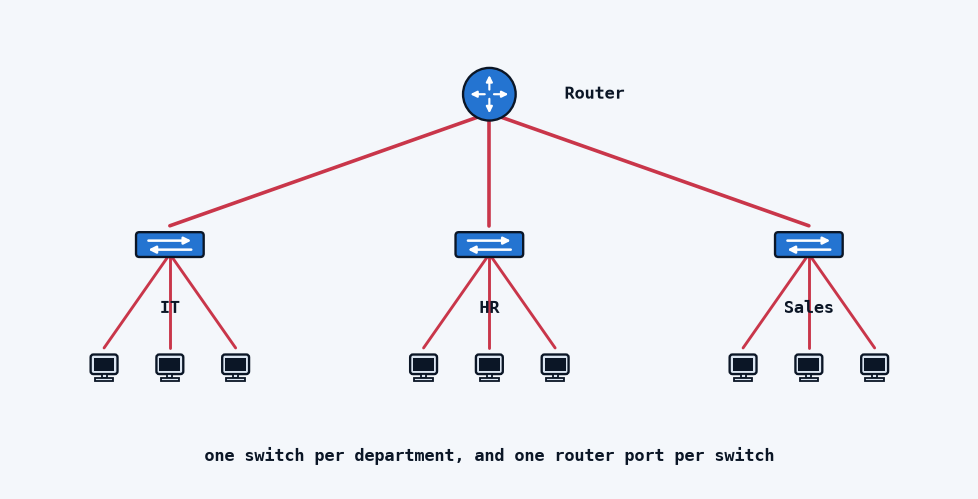

## Solution 1: why it is hard
- It is **not recommended**, for performance (broadcast) and for security reasons
- The router needs a **huge number of physical ports**: one per switch (the router does not have many ports)
- It **does not scale**: a new department = a new switch and a new router port
- **Expensive** hardware (switches, router interfaces, cabling)
- **Physically rigid**: moving a user to another department means re-cabling him to another switch
- It **wastes** switch capacity: a switch is under-used if its department is small

## Solution 2: VLANs, a logical separation
- **Idea**: instead of separating the domains physically, separate them **logically**, on the same physical switches
- In this case, the physical switch is divided into **several virtual switches**
- A **VLAN** (Virtual Local Area Network) = **one broadcast domain** = **one logical network** (a subnet), configured **in software** on the switch ports
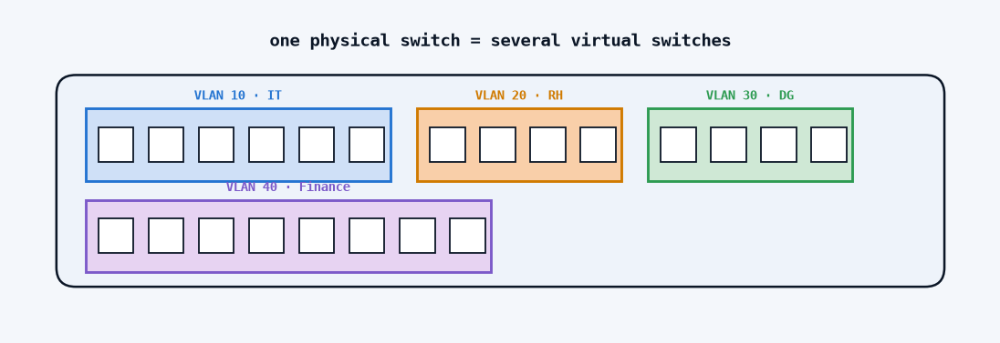

## VLAN introduction
- A VLAN is a **virtual LAN**
- VLAN = **broadcast domain**
- VLAN = **logical network** (**subnet**)
- Each VLAN is a subnet: the VLANs are in **different networks**
- When IT sends a broadcast, it reaches only the IT ports
- VLANs address these needs: **segmentation**, **security** and **network flexibility**
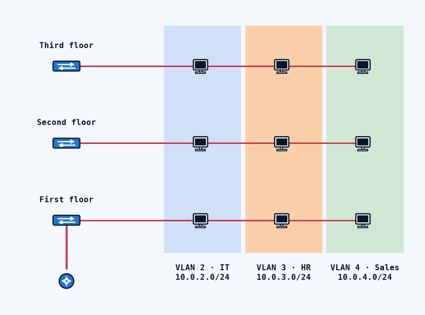

## Why VLANs solve the problem
- **Segmentation**: each VLAN is its own broadcast domain, whatever its physical location or physical switch
- **Security**: the traffic (broadcasts included) stays inside its VLAN. Traffic between VLANs must pass through a router (or a layer 3 switch), where it can be filtered
- **Network flexibility**: users are grouped by function or department, not by physical wiring. Moving a user to another VLAN is a configuration change, **not a cabling change**
- **Scalability**: one physical infrastructure supports many logical networks
> Key advantage over solution 1: the **same switches and the same cables**. The separation happens at layer 2, with the port assignment and the VLAN tagging, not with more devices.

# Configuring a VLAN
Create the VLANs, then assign the ports.

## The two steps
1. **VLAN creation** (VLAN IDs from 2 to 4094)
2. **Port assignment** (each access port goes in one VLAN)
- VLAN 1 exists **by default**. Some other VLAN numbers are reserved (1002 to 1005): do not touch them

## Step 1: VLAN creation
- In global configuration mode: `vlan` + the number, then `name` + the name
- The name is **not mandatory**, but it is good to memorize the VLAN by name
- We create **3 VLANs**: **10 (IT)**, **20 (HR)** and **30 (Sales)**. We will use them in all the next steps
```ios
Switch>enable
Switch#configure terminal
Switch(config)#vlan 10
Switch(config-vlan)#name IT
Switch(config-vlan)#vlan 20
Switch(config-vlan)#name HR
Switch(config-vlan)#vlan 30
Switch(config-vlan)#name Sales
Switch(config-vlan)#end
```

## Step 1: verification
```ios
Switch#show vlan brief
VLAN Name                             Status    Ports
---- -------------------------------- --------- -------------------------------
1    default                          active    Fa0/1, Fa0/2, Fa0/3, Fa0/4
10   IT                               active
20   HR                               active
30   Sales                            active
<output omitted>
```
- The 3 VLANs exist, but they have **no port yet**: all the ports are still in VLAN 1 (default)

## Step 1: one VLAN in detail
- `show vlan id 30` shows the details of one VLAN: its name, its status, its ports, its type (enet), its MTU (1500) ...
```ios
Switch#show vlan id 30
VLAN Name                             Status    Ports
---- -------------------------------- --------- -----------------------
30   Sales                            active    Fa0/3

VLAN Type  SAID       MTU   Parent RingNo BridgeNo Stp  BrdgMode Trans1 Trans2
---- ----- ---------- ----- ------ ------ -------- ---- -------- ------ ------
30   enet  100030     1500  -      -      -        -    -        0      0
<output omitted>
```

## VLAN ID ranges
- 802.1Q uses a **12-bit VLAN ID** field: values from 0 to 4095
| VLAN | Use |
|---|---|
| 0 | reserved, not usable (used for priority tagging) |
| 1 | the default VLAN |
| 2 – 1001 | normal range |
| 1002 – 1005 | reserved for the legacy FDDI / Token Ring |
| 1006 – 4094 | extended range |
| 4095 | reserved |

## VLAN 0 and VLAN 1
- **VLAN 0**: reserved. Used for **priority tagging**: it carries the CoS / 802.1p priority without putting the frame in a VLAN. It is not usable as a normal VLAN
- **VLAN 1**: the **default VLAN**
  - created automatically, and it **cannot be deleted** (or renamed)
  - the default VLAN of the access ports, and the default **native VLAN** on the trunks
  - it commonly carries the layer 2 **control traffic**
  - avoid using it for user data

## The other VLAN ranges
- **VLAN 2 – 1001**: normal range, for normal Ethernet VLANs. The configuration is stored in `vlan.dat`, and **VTP v1/v2** can propagate these VLANs
- **VLAN 1002 – 1005**: reserved for the legacy **FDDI / Token Ring**. Created automatically, cannot be deleted, normally unused on modern Ethernet networks
- **VLAN 1006 – 4094**: **extended range**, used for normal Ethernet VLANs when needed
  - with VTP v1/v2: must use `vtp mode transparent`, not stored in `vlan.dat`, not propagated
  - with **VTPv3**: the extended VLANs can be propagated

## Step 2: port assignment
- An **access port** belongs to **only one VLAN**. It is used between a switch and an **end device** (PC, printer ...): the end device does not understand the tagged frames
- Enter the interface (or a range of interfaces), choose the access mode, then the VLAN
- We put the PC of IT on Fa0/1 (VLAN 10), the PC of HR on Fa0/2 (VLAN 20) and the PC of Sales on Fa0/3 (VLAN 30)
```ios
Switch(config)#interface fastEthernet 0/1
Switch(config-if)#switchport mode access
Switch(config-if)#switchport access vlan 10
Switch(config-if)#interface fastEthernet 0/2
Switch(config-if)#switchport mode access
Switch(config-if)#switchport access vlan 20
Switch(config-if)#interface fastEthernet 0/3
Switch(config-if)#switchport mode access
Switch(config-if)#switchport access vlan 30
Switch(config-if)#end
```
- For several ports at once: `interface range fastEthernet 0/4 - 6`

## Step 2: verification
```ios
Switch#show vlan brief
VLAN Name                             Status    Ports
---- -------------------------------- --------- -------------------------------
1    default                          active    Fa0/4, Fa0/5, Fa0/6
10   IT                               active    Fa0/1
20   HR                               active    Fa0/2
30   Sales                            active    Fa0/3
<output omitted>
```
- Verifies that Fa0/1, Fa0/2 and Fa0/3 are in the VLANs 10, 20 and 30

## Step 2: verifying one interface
```ios
Switch#show interface FastEthernet0/3 switchport
Name: Fa0/3
Switchport: Enabled
Administrative Mode: static access
Operational Mode: static access
Administrative Trunking Encapsulation: dot1q
Operational Trunking Encapsulation: native
Negotiation of Trunking: Off
Access Mode VLAN: 30 (Sales)
<output omitted>
```
- Verifies the VLAN membership of the interface Fa0/3
- Access ports carry **untagged traffic only**: the VLAN membership is enforced **inside the switch** (from the access VLAN of the port), not by a tag in the frame

## Resetting a switch
- To delete the configuration of a **router**: `erase startup-config`, then `reload`
- For a **switch**, the VLANs are in a separate file: delete it too
```ios
Switch#erase startup-config
Switch#delete flash:vlan.dat
Switch#reload
```
- `vlan.dat` is the file where the VLANs are stored (it exists only if VLANs were created): deleting it removes them

# Trunks and 802.1Q
Carrying several VLANs on one link.

## The need for trunks
- Two switches, each with the PCs of the VLANs **10** and **20** (ports Fa0/1 and Fa0/2)
- For VLAN 10 to communicate with VLAN 10 on the other switch (the same VLAN), the link Fa0/3 between the switches must **carry the VLANs**
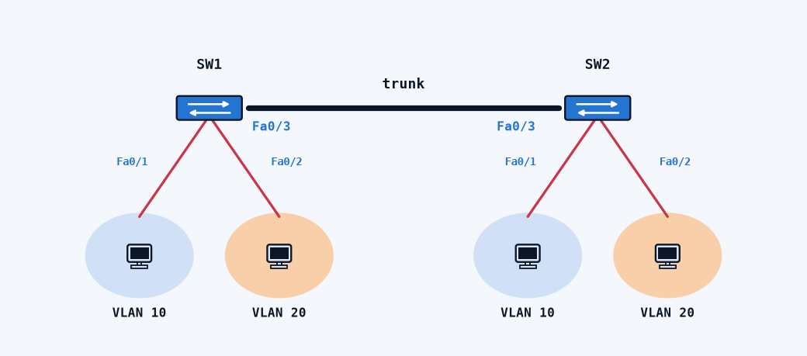
- The Fa0/3 ports are **trunk** interfaces: they carry **several VLANs**. The other ports are **access** ports: **one VLAN** only
- A trunk is used between **switch and switch**, **switch and router**, or switch and **server**

## Trunking with 802.1Q
- Running many VLANs between switches would require **the same number of interconnecting links**
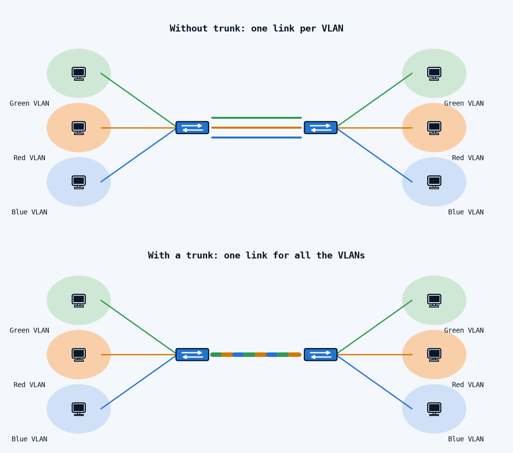

## Trunking with 802.1Q: the trunk
- Combining many VLANs on the same port is called **trunking**
- A trunk allows the transportation of the frames of **different VLANs**
- Each frame has a **tag** that specifies the VLAN it belongs to
- The frames are forwarded to the corresponding VLAN based on the **tag information**
- When a frame arrives on a trunk, the switch reads the tag to know **which VLAN** it is, and sends it to the ports of that VLAN

## The 802.1Q tag
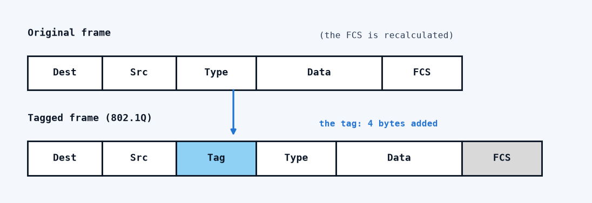
- **802.1Q** is the IEEE standard: it inserts a **4-byte tag** in the Ethernet header, with the **VLAN ID**
- The switch that receives the frame knows which VLAN it belongs to
- Every tagged frame crosses the trunk with its VLAN ID. The **native VLAN** is the one exception: it is **not tagged**

## Configuring a trunk
- Enter the interface, then put it in trunk mode
```ios
Switch(config)#interface gigabitEthernet 0/1
Switch(config-if)#switchport trunk encapsulation dot1q
Switch(config-if)#switchport mode trunk
Switch(config-if)#end
```
- The command `switchport trunk encapsulation dot1q` is needed on the switches that support also the old ISL; it does not exist on the others
- Example of the Cisco lab: Fa0/11 of Switch X, with Fa0/6 of Switch Y on the other side

## Verifying a trunk
```ios
Switch#show interfaces gigabitEthernet 0/1 trunk
Port        Mode         Encapsulation  Status        Native vlan
Gi0/1       on           802.1q         trunking      1

Port        Vlans allowed on trunk
Gi0/1       1-4094
```

## Verifying a trunk: the switchport
```ios
SwitchX#show interfaces FastEthernet0/11 switchport
Name: Fa0/11
Switchport: Enabled
Administrative Mode: trunk
Operational Mode: trunk
Administrative Trunking Encapsulation: dot1q
Negotiation of Trunking: On
Access Mode VLAN: 99
Trunking Native Mode VLAN: 99
<output omitted>
```

## Verifying a trunk: the trunk output
```ios
SwitchX#show interfaces FastEthernet0/11 trunk
Port     Mode  Encapsulation  Status    Native vlan
Fa0/11   on    802.1q         trunking  99

Port     Vlans allowed on trunk
Fa0/11   1-4094

Port     Vlans allowed and active in management domain
Fa0/11   1-13
<output omitted>
```

## Allowed VLANs on the trunk
- By default **all the VLANs (1 – 4094)** are allowed on a trunk. The list can be restricted:
| Command | Effect |
|---|---|
| `switchport trunk allowed vlan 10,20,30` | **replaces** the list: only 10, 20, 30 |
| `switchport trunk allowed vlan add 40` | adds VLAN 40 to the list |
| `switchport trunk allowed vlan remove 20` | removes VLAN 20 from the list |
| `switchport trunk allowed vlan none` | no VLAN allowed (an empty trunk) |
| `switchport trunk allowed vlan all` | allows all the VLANs again |
| `switchport trunk allowed vlan except 10` | all the VLANs except 10 |

## Allowed VLANs: example
```ios
Switch(config-if)#switchport trunk allowed vlan 10,20,30
Switch(config-if)#switchport trunk allowed vlan add 40
Switch#show interfaces gigabitEthernet 0/1 trunk
Port        Vlans allowed on trunk
Gi0/1       10,20,30,40
```
> Careful: if you use `add` or `remove` without first setting an explicit list, the command starts from "all". Check with `show interfaces trunk` after each change.

# The native VLAN
The one VLAN that is not tagged on a trunk.

## Native VLAN
- The **native VLAN** is the VLAN whose traffic is **not tagged** on an 802.1Q trunk
- It is useful for **compatibility** with the old devices (hubs, old switches) that do not understand 802.1Q and send untagged traffic: this traffic is automatically put in the native VLAN when it is received
- By default: **VLAN 1** is the native VLAN on all the trunks
- It is also used by some legacy control protocols (**CDP**, **STP BPDUs**, **DTP**), historically sent untagged


## Native VLAN: the path of the untagged traffic
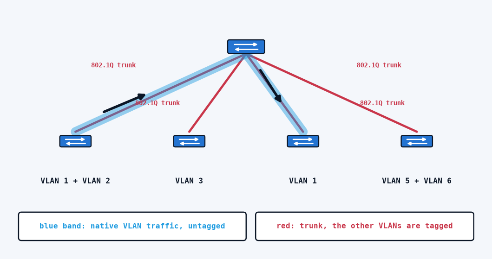

## Why the native VLAN exists: the story
- Before 802.1Q, the switches and hubs did not know the tags. Imagine **two switches that understand 802.1Q, connected through a hub**
- The hub does not read anything: it only **repeats** the signal on all its ports. A **PC plugged into the hub** sends normal frames, **without a tag**
- The two switches receive these untagged frames on their trunk ports. Which VLAN do they belong to? A frame without a tag has **no VLAN ID**
- The solution: the **native VLAN**. Every untagged frame received on a trunk is **put in the native VLAN**, and the frames of the native VLAN are **sent untagged**, so the old devices still understand them
- That is why the native VLAN must be the **same on the two ends**: the hub (and the old PC) live in that VLAN

## The story: the picture
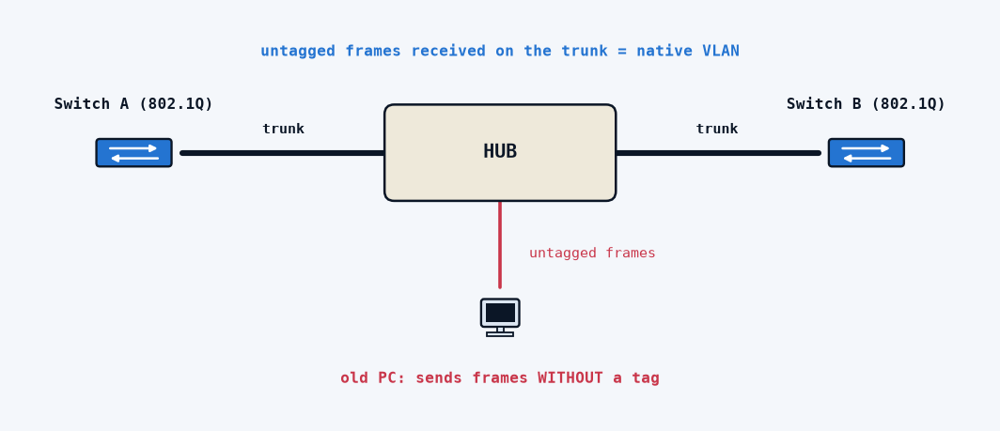

## Changing the native VLAN
- Enter the interface, set the trunk, and change the native VLAN from 1 to 99
```ios
SwitchX#configure terminal
SwitchX(config)#interface FastEthernet 0/11
SwitchX(config-if)#switchport mode trunk
SwitchX(config-if)#switchport trunk native vlan 99
```
```ios
Switch#show interfaces gigabitEthernet 0/1 trunk
Port        Mode   Encapsulation  Status     Native vlan
Gi0/1       on     802.1q         trunking   99
```

## Native VLAN mismatch
- It happens when the two ends of a trunk have **different native VLANs** (for example switch A = VLAN 1 and switch B = VLAN 99)
- The untagged traffic of one side is understood as another VLAN on the other side: **traffic leaks between VLANs**, a security risk
- **CDP** gives a warning: `%CDP-4-NATIVE_VLAN_MISMATCH`
- It can also break the control protocols (STP) carried on the native VLAN
- **Fix**: the **same native VLAN on both ends**, ideally a dedicated, unused VLAN (not VLAN 1)

## VLAN design considerations
- The maximum number of VLANs **depends on the switch**
- **VLAN 1** is the factory-default Ethernet VLAN
- Use a **dedicated VLAN** for the **management IP address** of the Cisco switches: keep the management traffic in a **separate VLAN**
- **Change the native VLAN** to something other than VLAN 1
- When configuring a trunk link: make sure that the native VLAN is **the same on both ends**
- **DTP** manages the trunk negotiation between the Cisco switches

# Inter-VLAN routing
How the VLANs talk to each other.

## Purpose of inter-VLAN routing
- A VLAN creates a **separate switching segment**
- The traffic **cannot be switched between VLANs**: VLAN 10 cannot communicate with VLAN 20 (the VLANs are separate networks), and the switch forwards the traffic **inside the same network**
- The VLANs have **different IP subnets**
- **Routing** is necessary to forward the traffic between VLANs: for VLAN 10 to talk to VLAN 20, a **router** is needed
- The VLANs also need their **gateway** to go to the Internet

## Options for inter-VLAN routing
- These solutions can provide inter-VLAN routing:
  1. A router with a **separate interface** in each VLAN
  2. A router with a **trunk link** (router-on-a-stick)
  3. A **layer 3 switch**

## Option 1: a router interface per VLAN
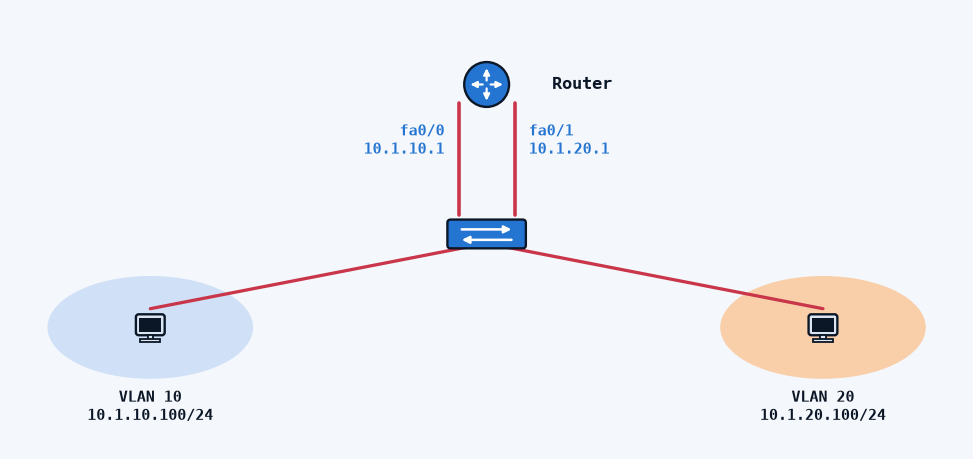
- Each VLAN has its own physical link to the router: `fa0/0` is 10.1.10.1 (the gateway of VLAN 10) and `fa0/1` is 10.1.20.1 (the gateway of VLAN 20)
- It does not scale: one router port and one switch port per VLAN

## Option 2: router with a trunk link
- **Router-on-a-stick**: a **single physical link** (a trunk) between the switch and the router
- The physical interface is divided into **logical sub-interfaces**: one per VLAN
  - `fa0/0.10` is 10.1.10.1 and `fa0/0.20` is 10.1.20.1
- I divide Gi0/0 into 2 **logical sub-interfaces**: one for VLAN 10 and one for VLAN 20
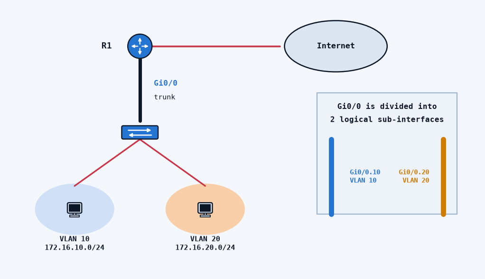

## Router on a stick: the router configuration
- The physical interface Gi0/0 is only **turned on** (no IP address on it)
- For each VLAN, a sub-interface with the VLAN tag (`encapsulation dot1Q`) and an IP address: the **gateway** of the VLAN, generally the address ending with **.1**
```ios
Router(config)#interface gigabitEthernet 0/0
Router(config-if)#no shutdown
Router(config-if)#exit
Router(config)#interface gigabitEthernet 0/0.10
Router(config-subif)#encapsulation dot1Q 10
Router(config-subif)#ip address 172.16.10.1 255.255.255.0
Router(config-subif)#exit
```

## Router on a stick: the other VLAN
```ios
Router(config)#interface gigabitEthernet 0/0.20
Router(config-subif)#encapsulation dot1Q 20
Router(config-subif)#ip address 172.16.20.1 255.255.255.0
Router(config-subif)#exit
```
- The same for VLAN 20, and the same again if there is a VLAN 30
- `dot1Q` is the 802.1Q: the tag of the VLAN
- The physical interface Gi0/0 **cannot have an address** here: you can only turn it on

## Router on a stick: the switch configuration
- The port toward the router is a **trunk**
```ios
Switch(config)#interface gigabitEthernet 0/1
Switch(config-if)#switchport mode trunk
Switch(config-if)#end
```

## Router on a stick: verification
```ios
Router#show ip interface brief
Interface              IP-Address      Status   Protocol
GigabitEthernet0/0     unassigned      up       up
GigabitEthernet0/0.10  172.16.10.1     up       up
GigabitEthernet0/0.20  172.16.20.1     up       up
```
```ios
Router#show vlans
Virtual LAN ID:  10 (IEEE 802.1Q Encapsulation)
   vLAN Trunk Interface:   GigabitEthernet0/0.10
Virtual LAN ID:  20 (IEEE 802.1Q Encapsulation)
   vLAN Trunk Interface:   GigabitEthernet0/0.20
```

## The Cisco example: the router
- The lab: the router Gi0/0 is connected to the switch Fa0/13. Fa0/1 is in VLAN 10 and Fa0/3 is in VLAN 20
- It configures the **sub-interfaces** and the **trunking** on the router
```ios
Router(config)#interface GigabitEthernet 0/0.10
Router(config-if)#encapsulation dot1Q 10
Router(config-if)#ip address 10.1.10.1 255.255.255.0
Router(config-if)#interface GigabitEthernet 0/0.20
Router(config-if)#encapsulation dot1Q 20
Router(config-if)#ip address 10.1.20.1 255.255.255.0
```

## The Cisco example: the switch
- It assigns the ports to the VLANs and configures the port toward the router as a trunk
```ios
Switch(config)#interface FastEthernet 0/13
Switch(config-if)#switchport mode trunk
Switch(config-if)#interface FastEthernet 0/1
Switch(config-if)#switchport access vlan 10
Switch(config-if)#interface FastEthernet 0/3
Switch(config-if)#switchport access vlan 20
```

## The Cisco example: verification
```ios
Router#show vlans
<output omitted>
Virtual LAN ID:  10 (IEEE 802.1Q Encapsulation)
   vLAN Trunk Interface:   GigabitEthernet0/0.10
   Protocols Configured:   Address:        Received:  Transmitted:
           IP              10.1.10.1       11         18
<output omitted>
Virtual LAN ID:  20 (IEEE 802.1Q Encapsulation)
   vLAN Trunk Interface:   GigabitEthernet0/0.20
   Protocols Configured:   Address:        Received:  Transmitted:
           IP              10.1.20.1       11         8
<output omitted>
```

## The Cisco example: the routing table
- Verifies the IP routing table for the VLAN sub-interfaces
```ios
Router#show ip route
Codes: L - local, C - connected, S - static, R - RIP, M - mobile, B - BGP
<output omitted>
Gateway of last resort is not set

      10.0.0.0/8 is variably subnetted, 4 subnets, 2 masks
C        10.1.10.0/24 is directly connected, GigabitEthernet0/0.10
L        10.1.10.1/32 is directly connected, GigabitEthernet0/0.10
C        10.1.20.0/24 is directly connected, GigabitEthernet0/0.20
L        10.1.20.1/32 is directly connected, GigabitEthernet0/0.20
```

## Option 3: a layer 3 switch (SVI)
- On a **multilayer** (layer 3) switch, the routing is done **directly**, without an external router, with **SVIs** (Switch Virtual Interfaces)
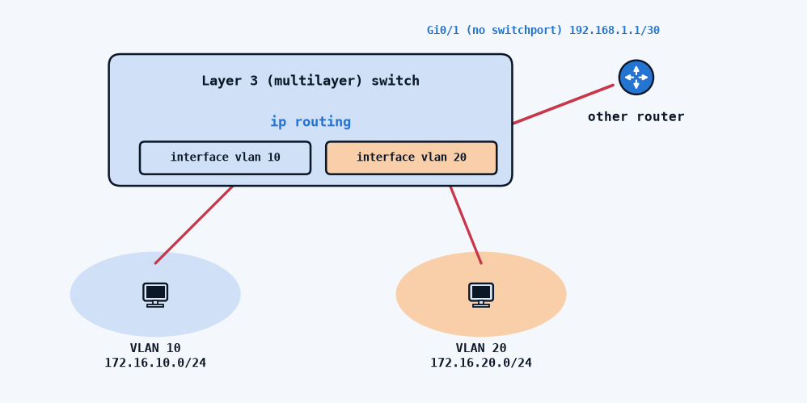

## SVI: the configuration
- Step 1: enable the IP routing. Step 2: create one SVI per VLAN
```ios
Switch(config)#ip routing
Switch(config)#interface vlan 10
Switch(config-if)#ip address 172.16.10.1 255.255.255.0
Switch(config-if)#no shutdown
Switch(config-if)#exit
Switch(config)#interface vlan 20
Switch(config-if)#ip address 172.16.20.1 255.255.255.0
Switch(config-if)#no shutdown
```

## SVI: a routed port
- Step 3 (optional): a **routed port** for a link to another router
```ios
Switch(config)#interface gigabitEthernet 0/1
Switch(config-if)#no switchport
Switch(config-if)#ip address 192.168.1.1 255.255.255.252
```

## SVI: verification
```ios
Switch#show ip interface brief
Interface    IP-Address     Status  Protocol
Vlan10       172.16.10.1    up      up
Vlan20       172.16.20.1    up      up

Switch#show ip route connected
C    172.16.10.0/24 is directly connected, Vlan10
C    172.16.20.0/24 is directly connected, Vlan20
```
> Advantage of a multilayer switch over router-on-a-stick: **no bottleneck** on a single physical link, a **faster routing** (hardware ASIC), and no dependency on an external router.

# Best practices and troubleshooting

## Best practices
- **Change the native VLAN** away from VLAN 1, to a dedicated unused VLAN, on all the trunks: it prevents the native VLAN mismatch and the VLAN hopping
- Use the **same native VLAN on both ends** of every trunk, in the whole network
- **Do not use VLAN 1** for user traffic: leave it unused, or use it for management only (better, a dedicated management VLAN)
- Put the **unused ports** in a "parking lot" VLAN (for example VLAN 999 "unused"), `shutdown` them, and do not leave them in VLAN 1: it reduces the attack surface
- **Specify the allowed VLANs** on each trunk (`switchport trunk allowed vlan ...`) instead of "all": less broadcast propagation, more security
- **Disable DTP** on the trunks with `switchport nonegotiate`
- **Document** the VLAN plan: VLAN ID, name and subnet

## Troubleshooting commands
| Command | What it shows |
|---|---|
| `show vlan brief` | the list of VLANs and their ports |
| `show vlan id 10` | the details of one VLAN |
| `show interfaces trunk` | the trunk state, the native VLAN, the allowed VLANs |
| `show interfaces fa0/1 switchport` | the mode (access or trunk) and the assigned VLAN |
| `show interfaces status` | a quick view of all the ports (VLAN, duplex, speed) |
| `show spanning-tree vlan 10` | the STP of a VLAN (loops, root bridge) |

## Troubleshooting commands (2)
| Command | What it shows |
|---|---|
| `show cdp neighbors detail` | detects the mismatches (native VLAN, duplex) |
| `show ip interface brief` | the SVIs and sub-interfaces: up / up |
| `show ip route` | verifies the inter-VLAN routing |
| `show mac address-table vlan 10` | the MAC table of a VLAN |
| `ping` / `traceroute` | tests the inter-VLAN connectivity |

# Challenge: two VLANs without a router
A layer 2 trick, to understand the native VLAN and the access mode.

## The challenge
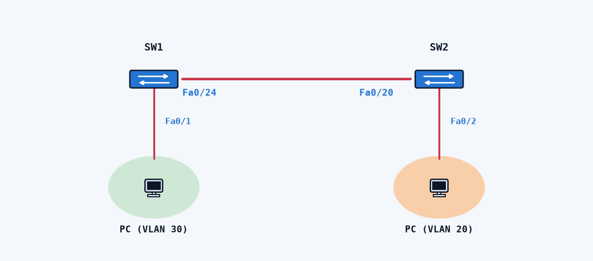
- A PC on SW1 Fa0/1 is in **VLAN 30**. A PC on SW2 Fa0/2 is in **VLAN 20**. The link between the switches: SW1 Fa0/24 and SW2 Fa0/20
- **Goal**: make these two PCs (different VLANs) communicate **without a router**, only with the two switches
> This is a layer 2 "trick": it works in this setup of two switches, but it does not scale and it is **not** a real inter-VLAN routing solution. It only shows how the native VLAN and the access mode can be (mis)used to bridge VLANs at layer 2.

## Solution 1: native VLAN mismatch
- On SW1, set the native VLAN of the link port Fa0/24 to **30**. On SW2, set the native VLAN of Fa0/20 to **20**
- The native VLAN traffic is sent **untagged**: each switch puts the frame directly in **its own native VLAN** on the other side. VLAN 30 and VLAN 20 are bridged through the mismatch, without a router
```ios
SW1(config)#interface fa0/24
SW1(config-if)#switchport trunk native vlan 30

SW2(config)#interface fa0/20
SW2(config-if)#switchport trunk native vlan 20
```
> This is the **native VLAN mismatch** problem, exploited on purpose to leak traffic between VLANs. In production it is a **security flaw**, not a feature.

## Solution 2: access ports on the link
- Instead of a trunk, configure the link as **two access ports**, each in the VLAN of the PC it must reach
```ios
SW1(config)#interface fa0/24
SW1(config-if)#switchport mode access
SW1(config-if)#switchport access vlan 30

SW2(config)#interface fa0/20
SW2(config-if)#switchport mode access
SW2(config-if)#switchport access vlan 20
```

## Solution 2: how it works
- Fa0/24 of SW1 is in VLAN 30 and is connected to Fa0/20 of SW2, which is in VLAN 20: the frames cross the link **untagged**, and each switch treats them as local to its own VLAN
> Both solutions abuse the VLAN mechanics instead of routing between the VLANs: use them only as a conceptual exercise, **never** in a real network design.
