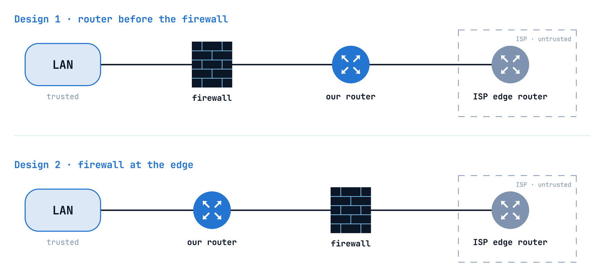
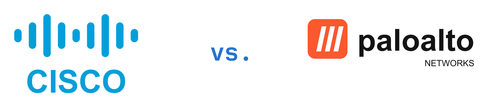

# Our role

## Our role
- We are **network security engineers**, not cyber security or SOC analysts
- Cyber security has lots of branches (web, cloud…), each with its own role in the company
- Our job: secure **only the network**
- That means network devices and anything connected to our network

## How can we do this?
- First, divide the network into 2 parts:
  - **Trusted network** (also known as security domain)
  - **Untrusted network**
- Secure everyone in the trusted network
  - from untrusted ones
  - and from themselves (internal issues)

## How can we do this?
- The data we deal with the most is **moving data** (not resting, like backups)
- Every device that gets into our security domain must be secured
- Including the data it sends to another secured device or to the internet
- So the **path** must be secure, as well as the **data**

## How can we do this?
- Some say the path and where data moves is a routing and infrastructure topic
- But for each protocol to work and be secured, it must follow **best practices**
- In reality it's not always as perfect as when we study the protocol
- Obstacles may force infrastructure engineers to do it differently:
  - can't update because it would stop the service
  - poor hardware, etc.

# Key responsibilities

## Key responsibilities
So every network security person should know that their role is:
1. To prepare ways to protect.
2. Secondly and most importantly, to think: what if an attack happens?

## Key responsibilities
- Theory (what's an attack, what's a vulnerability) is not enough — it's always there
- No matter how much you secure the infrastructure, there will **always be a weakness**
- So plan for when an attack happens:
  - detailed, step by step
  - with conditions and multiple use cases

## Key responsibilities
- New in a company? **Ask about their attack plan**
- So you don't get stuck with angry non-IT board members during an attack
- When the risk is there, follow the **validated steps** — don't improvise

## Example response plan
1. Isolate every VLAN so no VLAN can talk with another.
2. Isolate compromised VMs and servers.
3. Security domain does not reach internet, etc.

## Careful
- Don't get **knocked out (KO)** by the attacker
- KO = you no longer have access to the devices
  - or you lose access by accident, like shutting down the SSH interface
- So the plan must list the **do's and don'ts**

## So … what's the device that is most likely to secure our network security domain?
- It's the **firewall**
- We put it between the trusted and untrusted network
- It protects from the untrusted network, and even from the trusted ones themselves

# Firewall Overview
First, we must clarify some things:

## One
- The network security engineer must know **all details** of the network infrastructure
- Every company has the same basic architecture:
  - internal network
  - external network
  - the layer between them
- Companies differ in some details, but the concept is the same

## Two
- You must know what the **untrusted network** is
- It's the WAN, but not just the internet
- It can be another LAN in another country, linked by a WAN interface (liaison WAN avec service provider), not going to the internet
- So the whole service provider infrastructure linking my two sites is an **untrusted network**

## Now a very important question
- The ISP has its router (edge router), connected to you as a client
- Is it better to connect the **firewall** to it, or your **router** to it, then the firewall after the router?
- A very known debate: **network edge design** / perimeter network architecture

## The solution
It depends on the case.
| Scenario | Better design | Why |
|---|---|---|
| If I do lots of routing and BGP | Router before the firewall | The firewall isn't meant for routing — it does it, but not in the same performant way as the router. |
| If a company wants in its LAN for security there is no full connectivity | Firewall at the end where it blocks and allows what I want | This can be done if a router is at the edge (with ACLs), but same case — it's not as performant as the firewall. |

## The solution
- Every system has weaknesses, and some are not easy to solve (hardware issues or others)
- We must know most of them, if not all, and prepare something for them
- Like a house: the owner must know where a thief could get in (a loose door, a window)

## The solution
- Sometimes you see a problem you can solve, but the company doesn't accept the fix
- Because they know your change will affect another weak side you may not know about

## Note
- You will also find firewalls in **spine and leaf** architectures and **SDNs**
- You may find a weird architecture — very weird
- Don't criticize directly. **Ask why**
- They may explain their weakness and why they do it — and you learn something new

## Note
- A firewall can be an **appliance** (hardware) or **software** (Windows firewall, Red Hat Linux…)
- In this course, we study the **hardware** one
- We study **Cisco** firewalls
  - Palo Alto and Fortinet are better vendors in firewalling
  - but Cisco is the best for learning
  - learn Cisco well, and other firewalls are simple to migrate to

## Basic IDEA
- From **IN TO OUT** without allowing the entire world to peak in.
- To erect a barrier between an untrusted network, your organization's public web server, and the sensitive information on your private network.

## So not everyone should get out to the internet. Be careful.
- A firewall is like a company's **guard house**
- People going out aren't searched like people getting in
- But not everyone can get out (important sensitive data)
- So inside → out rules are less strict (for speed and resource reasons)
- Some companies invest a lot here (e.g. 4 guard houses with 6 guards each: fast and secure)

## Important distinction
- There is a difference between:
  - someone who is ours, got out, and returned in
  - someone who is not ours and is getting in
- We can "teach the guards that Mr. X is ours, so don't search him too much when he gets in."

## Important distinction
- If my company needs people from outside (e.g. a bank's cashier window):
  - you can't search them that much — or close it
  - we let them in because it's our business
- But be aware: he must not **sneak in**! Unless you verify it's from the staff

## Another method
- Make a "waiting room" for suspicious people
- Give them a service in that room, like the one we offer
- Test if they will try to intrude or not
- This is called a **honey pot**

## Firewall
- A network Firewall is a system or group of systems used to control access between two networks (**Trusted** and **Untrusted**) using preconfigured rules or filters.

# The Story of Cisco and Palo Alto Firewalls
This is a very famous story in network security between Cisco and palo alto

## Adaptive Security Appliance

## Early Cisco Firewalls: PIX and ASA
- Before 2005, Cisco's firewall was called **PIX**.
- After 2005, Cisco replaced PIX with **ASA** (Adaptive Security Appliance).

## Cisco ASA
- ASA mainly worked at:
  - Layer 3 → IP addresses
  - Layer 4 → Ports and protocols
- This means it inspected:
  - Source IP
  - Destination IP
  - TCP/UDP ports
- At that time, ASA was considered one of the best enterprise firewalls.

## Palo Alto Changes the Firewall Market
- A former engineer from **Check Point Software Technologies** helped create Palo Alto Networks firewalls
- Palo Alto introduced one of the first popular **Next-Generation Firewalls (NGFW)**

## Palo Alto Networks NGFW
- Unlike traditional firewalls, Palo Alto inspected traffic up to **Layer 7 (Application Layer)**
- This allowed the firewall to identify applications directly, even if:
  - ports changed,
  - headers changed,
  - or applications tried to hide traffic.

## Example
- Old firewalls saw only TCP/443
- Palo Alto could recognize:
  - YouTube
  - Facebook
  - BitTorrent
  - SSH tunneling
  - etc.

## Palo Alto Networks NGFW
- In 2007, Gartner reports started placing Palo Alto above Cisco in firewall innovation
- Cisco became less competitive: ASA was still mainly focused on Layer 3 and Layer 4 inspection

## Cisco Responds: Sourcefire and Snort
- In 2013, Cisco made a major acquisition and bought **Sourcefire**
- Sourcefire created **Snort**
- Snort is a powerful Layer 7 inspection engine

## Cisco Responds: Sourcefire and Snort
- Cisco integrated Snort into ASA firewalls and created **ASA with FirePOWER**
- Often written as:
  - 5506-X
  - 5516-X
  - 5525-X
  - etc.
- The X models meant NGFW features were included

## Architecture example
- ASA engine → routing + classic firewall
- Snort engine → Layer 7 inspection
- Cisco also introduced **LINA** (Linux running over ASA components)

## The Problem with ASA FirePOWER
- Cisco's solution worked, but it had a disadvantage
- The device had:
  - two engines,
  - two management systems,
  - and sometimes separate interfaces.
- This made management more complex

## The Problem with ASA FirePOWER
- Meanwhile, Palo Alto used:
  - one operating system,
  - one interface,
  - one integrated architecture.
- This kept Palo Alto simpler and more attractive for many companies

## Cisco Firepower Threat Defense (FTD)
- In 2017, Cisco improved the design with **Cisco Firepower Threat Defense**
- Cisco introduced **FXOS** (Firepower Extensible Operating System)
- Now Cisco had:
  - one box,
  - one management interface,
  - unified NGFW behavior.

## Cisco Firepower Threat Defense (FTD)
- However:
  - old ASA hardware could not fully use the new architecture,
  - many companies needed new hardware appliances.
- So this was not just a software update

## Centralized Management
- Palo Alto already had **Panorama**
  - managing multiple firewalls from one interface
- Cisco later used **Cisco Firepower Management Center**
- Fortinet uses **FortiManager**

## Small Cisco Firewall Naming Guide
| Model Example | Meaning |
|---|---|
| ASA 5505 | Small office / SMB firewall |
| ASA 5506-X | NGFW version with FirePOWER |
| ASA 5508-X | More powerful NGFW appliance |
| ASA 5516-X | Enterprise NGFW |
| Firepower 1010 | Modern Cisco FTD appliance |
| Firepower 2100 | Datacenter / enterprise series |

## Important Notes
- ASA = classic Cisco firewall
- X models = NGFW capable with FirePOWER/Snort
- FTD = modern unified Cisco NGFW software
- SMB/SOHO = small business / small office use

# Q & A

## Q & A
- **Q:** Cisco isn't the leader in security right now, but stayed leader in networking.
- So should I:
  - make everything **Cisco**, and risk security performance?
  - or make everything **Palo Alto / Fortinet**, and risk networking performance?

## Q & A
- **A — first:** compatibility within the same vendor matters a lot
  - mixing Fortinet with Cisco or others: 99% of the time there will be problems
  - everything from the same vendor: simpler integration, maximum performance
- **Second:** with a contract, the client may force a vendor:
  - one with great support (like Fortinet)
  - one that is cheap
  - or one that is powerful
- It all depends on the case

## Q & A
- Big enterprises and the edge: you will find **Palo Alto or Cisco**, just that
- Small businesses prefer **Fortinet**: support and cheap price
- Fortinet hasn't yet reached the very strong phase
