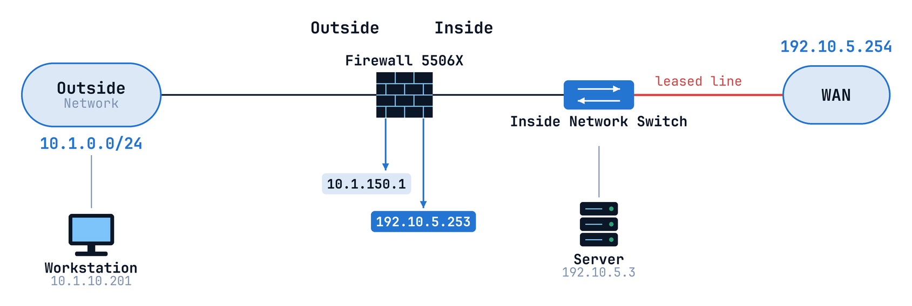
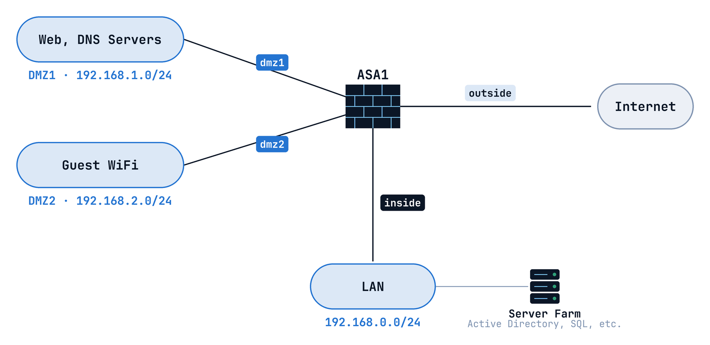
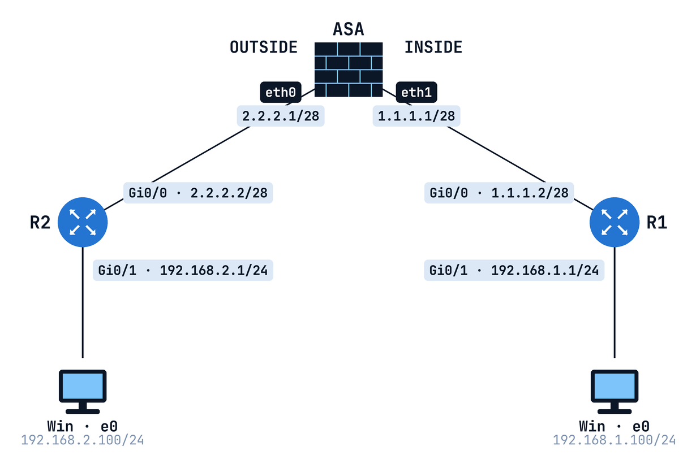

## To and through the firewall
> "The firewall is the best tool we use to do our job as network security professionals: dividing our network into **security domains** (internal network) and the **outside** (untrustworthy)."

# Cisco Security Levels & Default Rules

## Security Levels
- To apply trust segmentation in practice, Cisco uses **Security Levels** (priorities of trust level)
- The security level is an integer from **0 to 100**
- The higher the value, the more trustworthy the network

## Security Levels
- **Security Level 100 (Inside)**
  - reserved for the most trustworthy internal network
  - name an interface `inside` → Cisco ASA automatically sets level 100
- **Security Level 0 (Outside)**
  - used for untrustworthy outside networks, like the Internet
  - any interface named other than `inside` (unless customized) gets level 0
- You can have more than two security levels
  - a **DMZ** (Demilitarized Zone) usually sits at level **50**: a buffer zone for public-facing servers

## Security Levels


## The Default Flow Rules
- **High to Low (Permit)**: traffic from a higher security level to a lower one is permitted by default
- **Low to High (Deny)**: traffic from a lower security level to a higher one is denied by default
> You can override these defaults with custom **Access Control Lists (ACLs)** or traffic classes, which are checked **before** the default level rules.

## CLI Interface Setup Example
```cisco
ciscoasa(config)# interface gigabitethernet 0/0/1
ciscoasa(config-if)# security-level 100
ciscoasa(config-if)# exit
```

## nameif and security levels
- With the `nameif` command, the ASA checks if the name is `inside` (case-insensitive)
- If it matches → security level **100** is assigned automatically
- Any other name, like `outside` or `dmz` → default security level **0**
```cisco
ciscoasa(config)# interface gigabitethernet 0/0/1
ciscoasa(config-if)# nameif inside
INFO: Security level for "inside" set to 100 by default.
ciscoasa(config-if)# show interface ip brief
... gigabitethernet 0/0/1 [Securitylevel-100] ...
```

## nameif and security levels
- Two ASA interfaces **cannot** use the same `nameif`: interface names must be unique
- But multiple interfaces with different `nameif` values **can** share the same security level
- Example: a DMZ with servers for different purposes:
  - `web-dmz` for web servers
  - `email-dmz` for email servers
  - both can use the same security level, such as **50**

# The DMZ & Same-Security Traffic Rules

## The DMZ
- A **DMZ** (Demilitarized Zone) is a separate part of the network
- It sits between the internet and the company's private internal network
- It acts like a **buffer zone**:
  - public services (websites, email) are accessible from the internet
  - internal systems stay safe

## The DMZ
> "If a server in the DMZ gets compromised, the attacker still cannot easily reach sensitive internal corporate databases because strict firewall rules enforce isolation, requiring traffic to pass through the firewall again (enforcing the SL 50 to SL 100 Deny default rule)."

## The DMZ


## Example
- A company puts its **public website** in the DMZ
- People online can visit the site
- But they can't access the company's **employee database**, protected behind another firewall

## Example
- The DMZ gets security level **50**
- ACLs allow the outside (level **0**) to reach the web server on ports **80** and **443**
  - the ACL is applied first
- If someone gains access to the web server (in the DMZ):
  - they can't access the internal network
  - they must pass through the firewall again
  - the default rule denies traffic from level **50** to level **100**

## Equal Security Levels & the "Same-Security" Rule
- What happens when traffic flows between two interfaces with the **same** security level?
  - for example, from Security Level 50 to Security Level 50
- **Outcome**: the traffic is **denied by default** on the ASA
- There are two distinct same-security scenarios in Cisco ASA

## Case 1: Intra-Interface — Same Interface, Same nameif
- Traffic **enters and exits** through the same ASA interface
- Example: traffic from one host reaches the firewall, then is sent back through the same interface to another destination
- This is commonly called **hairpinning**
```cisco
ciscoasa(config)# same-security-traffic permit intra-interface
```

## Case 2: Inter-Interface — Different Interfaces, Same Security Level
- Traffic flows between two **different** physical or logical interfaces with the same security level
- Example:
  - `web-dmz` → Security Level 50
  - `email-dmz` → Security Level 50
- By default, this traffic is also **denied**
```cisco
ciscoasa(config)# same-security-traffic permit inter-interface
```

## The ASA treats these two scenarios separately
- Enabling `same-security-traffic permit inter-interface`:
  - allows traffic between **different** interfaces with the same security level
  - does **not** allow traffic to enter and exit through the same interface
- Hairpinning still requires `same-security-traffic permit intra-interface`

## Scenario 1: NAT & DNS Loopback
- A **database server** sits in a DMZ
- It's reachable from the Internet through a **public IP** on the firewall (NAT or port forwarding)
- An **application server** in the same DMZ needs to talk to the database server
- But its backend configuration uses the database server's **public domain name**, not its private IP

## Scenario 1: NAT & DNS Loopback
1. The application server performs a DNS lookup.
2. DNS returns the database server's public IP address.
3. The application server sends the traffic to its default gateway—the ASA's DMZ interface.
4. The ASA receives the traffic on the DMZ interface.
5. NAT translates the destination from the public IP to the database server's private IP.
6. The ASA sends the traffic back out through the same DMZ interface.

## Scenario 1: NAT & DNS Loopback
- The traffic enters and exits through the **same interface**, so this requires:
```cisco
ciscoasa(config)# same-security-traffic permit intra-interface
```
> This is a common **DNS loopback** or **NAT hairpinning** scenario.

## Scenario 2: Leased-Line Branch Backup QoS Safeguard
- A company has two branches, **A** and **B**, linked by an expensive **leased line** from a Service Provider
- The bandwidth is shared among clients; each client should get the bandwidth in their agreement
- The company needs a large initial **backup** from Branch A to Branch B
- This backup could saturate the leased line:
  - affecting other traffic
  - violating service-level expectations

## Scenario 2: Leased-Line Branch Backup QoS Safeguard
- The network engineer redirects the backup traffic to the firewall with a highly specific **/32 static route**
- The firewall can then:
  1. Receive the backup traffic.
  2. Inspect and classify the traffic.
  3. Apply the appropriate security or QoS policies, such as rate limiting.
  4. Route the traffic back toward Branch B.

## Scenario 2: Leased-Line Branch Backup QoS Safeguard
- The traffic is sent to the firewall and forwarded back through the same interface or path
- So, depending on the topology, it may require intra-interface traffic:
```cisco
ciscoasa(config)# same-security-traffic permit intra-interface
```
> The firewall acts as a **policy enforcement point** for traffic that would otherwise bypass it.

# ASA Management Interfaces (In-Band vs OOB)

## Management access
- Securing administrative control of the ASA is critical
- Cisco ASA supports two primary methods for management access:
| In-Band (IB) | Out-of-Band (OOB) |
|---|---|
| Management traffic shares the **same interfaces as production data** | Uses a **dedicated, physically separate** management interface |
| Simple to set up and configure | Physically isolated dedicated network (e.g. `Management0/0`) |
| Shared physical connection risks | Locked down from standard data routing table plane |
| Vulnerable: if the production network goes down or suffers a DDoS attack, you lose management access too | Secure access via SSH through a **jump/bastion host**, authenticated through TACACS+/RADIUS |

## Dedicated OOB Configuration Example
- A Cisco ASA can use its dedicated **Management** interface for Out-of-Band (OOB) management
- It gives administrative access **separate** from normal production traffic
- `management-only` dedicates the interface to management traffic, keeping it out of the data plane
```cisco
ciscoasa(config)# interface Management0/0
ciscoasa(config-if)# ip address 192.168.100.1 255.255.255.0
ciscoasa(config-if)# management-only
ciscoasa(config-if)# no shutdown
```

## Why OOB Is Critical During Incidents
- During a major incident (DDoS attack, network outage, security breach), the production network may be **unavailable or compromised**
- With only in-band management, admins may **lose access** to the very devices they need to control
- A dedicated OOB path is an **independent management channel**

## Why OOB Is Critical During Incidents
- With OOB, engineers can keep:
  - Pushing ACL or policy changes.
  - Investigating the device and checking logs.
  - Running packet captures.
  - Disabling or shutting down problematic interfaces.
  - Restoring connectivity without relying on the affected production network.
- In critical environments, a **console server** may also give last-resort serial access when IP connectivity is gone
> OOB is the trusted management path that helps keep engineers in control when the production network is unavailable or compromised.

# Hands-on Packet Flow Lab

## Lab topology


## ? Q1: Traffic Going To the Firewall
Can R1 (Outside, SL 0) ping the firewall's external interface (`eth0`, 2.2.2.1) directly?
- [x] Yes, because pings going TO the firewall do not use security-level rules.
- [ ] No, because the firewall operates with security level 0 on `eth0`, which denies everything by default.
- [ ] No, because stateless rules block the return packet.

## Q1 · Explanation
- When traffic goes **to** the firewall itself (it terminates on one of the firewall's interfaces):
  - the normal security-level rules used for transit traffic **do not apply**
- The packet is handled by the ASA's **control plane**, not forwarded through the firewall

## ? Q2: High-to-Low Traffic
Can R2 (Inside, SL 100) Telnet through the firewall to R1 (Outside, SL 0)?
- [ ] No, because Telnet is an insecure protocol and the firewall drops it.
- [x] Yes, because traffic going from a high security level (100) to a low security level (0) is permitted by default.
- [ ] No, because the return SYN-ACK packet will be blocked from low-to-high.

## Q2 · Explanation
- Traffic passing through the ASA from a **higher** security level to a **lower** one is permitted by default
- The ASA is **stateful**: it tracks the connection
- Once R2 starts the Telnet session, the **return traffic** for that connection is automatically allowed

## ? Q3: Low-to-High Traffic
Can R1 (Outside, SL 0) Telnet through the firewall to R2 (Inside, SL 100)?
- [ ] Yes, because Telnet automatically sets up temporary routing tunnels.
- [ ] Yes, because the ASA is stateful and remembers connections.
- [x] No, because traffic going from a low security level (0) to a high security level (100) is denied by default.

## Q3 · Explanation
- Traffic trying to pass through the ASA from a **lower** security level to a **higher** one is denied by default
- `R1 → Outside (SL 0) → ASA → Inside (SL 100) → R2`
- An explicit **ACL** or other appropriate policy is required to permit this connection

## ? Q4: ICMP and Stateful Inspection
By default, if R2 (Inside, SL 100) pings R1 (Outside, SL 0) in a clean ASA setup, does the ping succeed?
- [ ] Yes, because Inside-to-Outside traffic is permitted.
- [x] No, because the ASA does not inspect ICMP by default, so the return echo reply is not automatically treated as part of an established connection.
- [ ] Yes, because ICMP does not use ports.

## Q4 · Explanation
- The initial ICMP **echo request** is allowed: it goes from Inside (SL 100) to Outside (SL 0)
- Without ICMP inspection, the ASA doesn't treat the returning **echo reply** as part of an established stateful connection
- The reply travels from the lower-security interface back toward the higher-security one, and **can be blocked**

## Q4 · Explanation
- To enable stateful ICMP inspection:
```cisco
ciscoasa(config)# policy-map global_policy
ciscoasa(config-pmap)# class inspection_default
ciscoasa(config-pmap-c)# inspect icmp
```
> With ICMP inspection enabled, the ASA tracks the ICMP exchange and automatically permits the reply traffic.

## Stateful Inspection in Cisco ASA
- Why can traffic started from a high security level to a low one get a response?
  - the return traffic goes the opposite way: from **low to high**
- The answer is **Stateful Inspection**
- Cisco ASA is a **stateful firewall**
- For supported protocols (TCP, UDP), it tracks connections and keeps information about active flows

## Stateful Inspection in Cisco ASA
- An Inside client starts a TCP connection to an Outside server:
  - `Inside Client (SL 100) → ASA → Outside Server (SL 0)`
- The ASA inspects the first TCP packet (the **SYN**) and decides if the connection is allowed
- If permitted, it creates an entry in its dynamic **Connection Table** (the **conn table**)

## Stateful Inspection in Cisco ASA
- When the return packet arrives:
  - `Outside Server (SL 0) → ASA → Inside Client (SL 100)`
- The ASA checks its connection table: the packet belongs to an **existing, valid** connection from the Inside
- So the return traffic is automatically permitted, not treated as a new low-to-high connection
- This is what makes the firewall **stateful**
> The security-level rule controls whether a **new** connection can be initiated, while the connection table allows **return** traffic belonging to an already established flow.

## Analogy
- Imagine a company building
- A staff member leaves to buy lunch: security records that they left and expects them back
- When the same employee comes back, security recognizes a known activity
- An **unknown** person trying to enter without being expected: security stops and checks them

## Analogy
- **Inside → Outside**: a new connection can be initiated by default
- **Outside → Inside**: a new connection is denied by default
- **Outside → Inside as a response** to an existing connection: allowed, because the ASA recognizes it in its conn table

## ICMP Statefulness Warning
- By default, ASA does **not** do stateful ICMP inspection the way it tracks TCP and UDP
- So an ICMP **echo request** may travel from a higher security level to a lower one
- While the returning **echo reply** is evaluated independently, and can be **blocked** going from low to high
- To enable stateful ICMP inspection, add `inspect icmp` to the inspection policy:
```cisco
ciscoasa(config)# policy-map global_policy
ciscoasa(config-pmap)# class inspection_default
ciscoasa(config-pmap-c)# inspect icmp
```

## ICMP Statefulness Warning
- Verify the inspection policy with:
```cisco
ciscoasa# show running-config policy-map
```
- The output should include `inspect icmp` under the relevant inspection class:
```cisco
policy-map global_policy
 class inspection_default
  inspect icmp
```

# Deciphering the Connection Table & TCP Flags

## The Connection Table
- The Connection Table (`show conn`) is the single most valuable **troubleshooting tool** on a Cisco ASA
- To use it well, you must learn to read **connection flags** during handshakes

## TCP Connection Flag Values
| Flag | Meaning | |
|---|---|---|
| S | Awaiting Inside SYN | Removed upon receipt of packet |
| s | Awaiting Outside SYN | Removed upon receipt of packet |
| A | Awaiting Inside ACK to SYN | Removed upon receipt of packet |
| a | Awaiting Outside ACK to SYN | Removed upon receipt of packet |
| B | Initial SYN from Outside (Inbound Conn) | Added upon receipt of packet |
| U | 3-way Handshake Complete | Added upon receipt of packet |
| I | Received Inbound Data | Added upon receipt of packet |
| O | Received Outbound Data | Added upon receipt of packet |
| F | Received Outside FIN | Added upon receipt of packet |
| f | Received Inside FIN | Added upon receipt of packet |
| R | Received Inside ACK to FIN | Added upon receipt of packet |
| r | Received Outside ACK to FIN | Added upon receipt of packet |
| X | Inspected by Service Module | Added upon receipt of packet |

## Core TCP Handshake Flags
Recall the standard TCP 3-way handshake:
1. **SYN** (Synchronize): Initiates a connection (Flag: `S`).
2. **SYN-ACK**: Acknowledges the SYN and requests connection (Flag: `SA`).
3. **ACK** (Acknowledge): Completes handshake (Flag: `A`).

## Reading ASA Flag Priorities
ASA uses distinct cases (uppercase vs lowercase) to signify which side initiated a connection:
| Flag | State / Meaning |
|---|---|
| S | Firewall sent a SYN to the outside — connection initiated from Inside → Outside. |
| s | Firewall is waiting for a SYN from the outside — connection initiated from Outside → Inside. |
| A | ACK seen on the Inside interface. |
| a | ACK seen on the Outside interface. |
| U | Connection is UP (3-way handshake fully completed). |
| B | Connection is built — embryonic state, handshake not yet complete. This usually happens in Low → High connections. |
| I | Inbound data seen (Outside → Inside). |
| O | Outbound data seen (Inside → Outside). |

## Example output of the show conn command
```text
ASA# show conn protocol tcp
101 in use, 5589 most used
TCP outside 10.23.232.59:5223 inside 192.168.1.3:52419, idle 0:00:11, bytes 0, flags saA
TCP outside 192.168.3.5:80 dmz 172.16.103.221:57646, idle 0:00:29, bytes 2176, flags UIO
TCP outside 10.23.232.217:5223 inside 192.168.1.3:52425, idle 0:00:10, bytes 0, flags saA
TCP outside 10.23.232.217:443 inside 192.168.1.3:52427, idle 0:01:02, bytes 4504, flags UIO
TCP outside 10.23.232.57:5223 inside 192.168.1.3:52412, idle 0:00:23, bytes 0, flags saA
TCP outside 10.23.232.116:5223 inside 192.168.1.3:52408, idle 0:00:23, bytes 0, flags saA
TCP outside 10.23.232.60:5223 inside 192.168.1.3:52413, idle 0:00:23, bytes 567, flags UIOB
TCP outside 10.23.232.96:5223 inside 192.168.1.3:52421, idle 0:00:11, bytes 0, flags saAB
TCP outside 10.23.232.190:5223 inside 192.168.1.3:52424, idle 0:00:10, bytes 0, flags A
```

## Timeout & Table Cleanses
- Connections cannot stay in the state table forever
- By default, the ASA purges **idle TCP connections** after **1 hour** (`1:00:00`)
- You can flush the table or decrease this timeout value
```cisco
# WARNING: Force-clears the active connection table (DO NOT run in production!)
clear conn
# Decrease TCP connection idle timeout to 60 seconds (1 minute)
sysctl conn timeout tcp 60
```

## Debugging & Logging Activation
- When packets are getting blocked mysteriously, turning on **debugging logs** is highly effective
- Make sure your console logs are properly directed:
```cisco
# Enable logging console output specifically at the debugging level
logging console debugging
# Globally turn on the logging daemon
logging on
```
