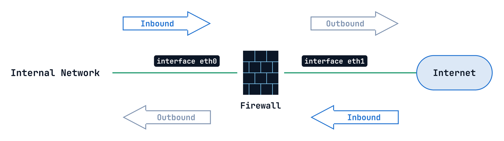
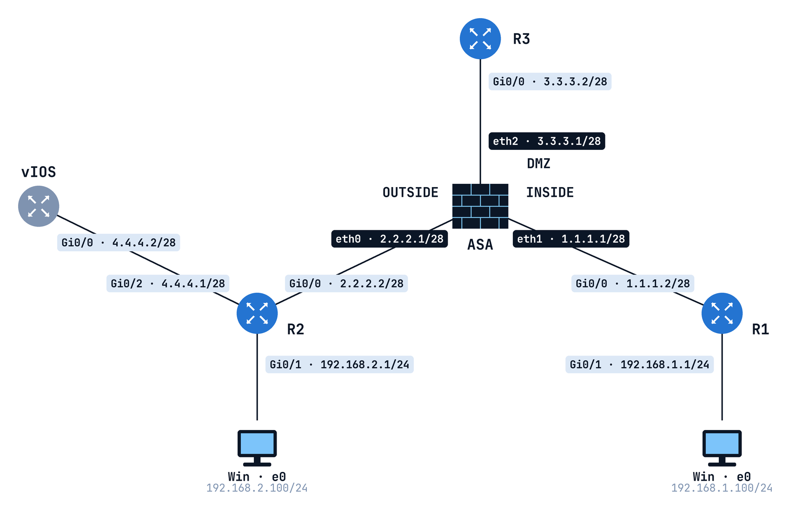

# Intro and definition

## Why ACLs?
- By default, firewall traffic is allowed from a **higher** security level to a **lower** one
- Traffic from a **lower** security level to a **higher** one is denied
- This behavior can be changed with **Access Control Lists (ACLs)**, for example to:
  - allow specific traffic from an external network to reach our internal network
  - prevent certain internal networks from communicating with external networks
- ACLs control these exceptions: which traffic is allowed or denied

## What is an ACL?
- An **Access Control List (ACL)** is a set of rules that tells a device which traffic is allowed and which is not
- Like a **security guard** at a building's entrance:
  - he checks who is trying to enter
  - he lets them in or stops them, based on specific rules
- An ACL does the same with network traffic:
  - it checks the **source**, the **destination**, and sometimes the **type** of traffic
  - then it decides to **permit** or **deny** it
- Some protocols use ACLs to identify traffic (for example **NAT**)

## ACE classify the packets
- **ACE** = Access Control Entry: a single line in an ACL
- ACEs classify packets using:
  - Layer 2 protocol information (EtherTypes)
  - Layer 3 protocol information (ICMP, TCP or UDP)
  - Layer 3 header information (SIP, DIP)
  - Layer 4 header information (S/D TCP/UDP Ports)

## EtherType ACL
- An ACL can filter traffic based on its **EtherType**
- Every Layer 2 protocol has an EtherType value that acts as an identifier
- ARP uses EtherType `0x0806`
- On a Cisco ASA, an EtherType ACL that denies ARP traffic:
```cisco
access-list ETHERTYPE_ACL ethertype deny arp
access-group ETHERTYPE_ACL in interface inside
```
> This ACL matches ARP frames by their EtherType (`0x0806`) and denies them on the specified interface.

# Implicit deny

## Implicit deny
- At the end of every ACL there is an invisible rule: the **implicit deny**
- If traffic doesn't match any rule you configured, it is **automatically denied**
- Example: this allows traffic from `192.168.1.10`...
```cisco
access-list 100 permit ip host 192.168.1.10 any
```

## Implicit deny
- ...but all other traffic is denied, because of the implicit:
```cisco
deny ip any any
```

## Implicit deny
- This rule is added **automatically**, even though it doesn't appear in the ACL configuration
- Be careful when creating an ACL: with poor handling, the implicit deny may **block your own traffic**
- A new entry is always added **at the end**, before the implicit deny

## Specific Rules Before General Rules
- Place **specific** rules before **general** rules
- An ACL checks its rules from **top to bottom**
- As soon as a packet matches a rule, the ACL **stops checking** and applies that action
```cisco
access-list 100 deny tcp host 192.168.1.10 host 10.10.10.10 eq 80
access-list 100 permit ip 192.168.1.0 0.0.0.255 any
```
- Rule 1 is very specific: it denies HTTP traffic from `192.168.1.10` to `10.10.10.10`
- Rule 2 is more general: it allows all traffic from the `192.168.1.0/24` network

## Specific Rules Before General Rules
- If we placed the general rule first:
```cisco
access-list 100 permit ip 192.168.1.0 0.0.0.255 any
access-list 100 deny tcp host 192.168.1.10 host 10.10.10.10 eq 80
```
- The specific deny rule would **never be reached**: the traffic already matches the first rule

## Inserting a New Rule
- Sometimes we have specific rules followed by a general rule, and need to add a rule **between** them
- Example, the ACL already exists:
```cisco
ip access-list extended ACL_NAME
 10 deny ip host 192.168.1.10 any
 20 permit ip any any
```

## Inserting a New Rule
- To add a rule between `10` and `20`, no need to rewrite the whole ACL
- Enter the ACL configuration mode and add the new ACE with a **sequence number**:
```cisco
configure terminal
ip access-list extended ACL_NAME
 15 deny ip host 192.168.1.20 any
```
- The new rule is automatically inserted between sequence numbers `10` and `20`

## Implicit Deny Logging on Cisco ASA
- On a Cisco ASA, traffic that reaches the implicit deny is logged with message ID **106023**:
```text
%ASA-4-106023: Deny ... by access-group "..."
```
- It means the traffic was denied because it matched no permit rule, so it reached the implicit deny
- Helps a lot in **production** environments and in **network automation**

## Implicit Deny Logging on FortiGate
- On FortiGate, forwarded traffic that reaches the implicit deny is **not logged** by default
- You can enable logging with:
```text
config log setting
    set fwpolicy-implicit-log enable
end
```
- Implicit deny logs can also be used to **investigate an attack**

## Be Careful !


# ACLs on the ASA

## Important note
- By default, Cisco ASA allows traffic from a higher security level to a lower one
- But once you apply an ACL to an interface, the **ACL takes control** of the traffic entering it
- The default security-level behavior no longer automatically permits the traffic (**only on that interface!**)
- Example: with an ACL on the `inside` interface, even high → low traffic must be **explicitly permitted** by that ACL, or it is denied

## Lab topology


## Lab: ACL on R2
- We create an ACL that allows **only EIGRP** (and `deny any any`, to test the deny)
- We apply it on **R2 g0/0**, direction **out**

## ? Telnet from R1 to R2 (to 2.2.2.2 or 192.168.2.1): will it work?
- **Yes**, it will work, even though the ACL doesn't let the traffic go there
- Why? Traffic **generated from the router itself** isn't checked by the ACL
- So a telnet from R1 to **vIOS** will be blocked, as expected
- Note: with the ACL on **in** instead of out, telnet from R1 to R2 **won't** be allowed

## ? New ACL denying all, applied on the ASA INSIDE interface, direction out: will traffic pass?
- It **won't** work, but only once the **conn table** is emptied, so be careful
- With stateful traffic, the returning ping or telnet isn't checked by the ACL
  - like a low → high ping return passing, because the ASA is stateful for ICMP
- If you apply it on **in**, the traffic won't pass

## Applying an ACL on Cisco ASA
- On Cisco ASA, an ACL is created with `access-list` and applied to an interface with:
```cisco
access-group ACL_NAME in interface INTERFACE_NAME
access-group ACL_NAME out interface INTERFACE_NAME
```

## Applying an ACL on Cisco ASA
- Example:
```cisco
access-list MY_ACL extended permit ip any any
access-group MY_ACL in interface inside
```
> The key difference from routers: on ASA, ACLs are generally applied **inbound**, on the interface where the traffic **enters** the firewall.

# Types of ACLs

## Standard ACL
- The simplest type of ACL
- It filters traffic **only** on the **source IPv4 address**
```cisco
access-list STANDARD_ACL standard permit 192.168.1.0 255.255.255.0
```

## Extended ACL
- Much more control than a standard ACL. It can filter on:
  - Protocol
  - Source IP address
  - Destination IP address
  - Source port
  - Destination port
```cisco
access-list EXTENDED_ACL extended permit tcp 192.168.1.0 255.255.255.0 host 10.10.10.10 eq 443
```

## Extended ACL
- The example permits:
  - **Protocol**: TCP
  - **Source**: 192.168.1.0/24
  - **Destination**: 10.10.10.10
  - **Destination Port**: HTTPS (443)
- You can also specify a **source port**:
```cisco
access-list EXTENDED_ACL extended permit tcp host 192.168.1.10 eq 1024 host 10.10.10.10 eq 443
```

## Standard IPv6 ACL
- Filters traffic based primarily on the **source IPv6 address**
```cisco
ipv6 access-list IPV6_STANDARD
 permit ipv6 2001:DB8:1::/64 any
```

## Extended IPv6 ACL
- More granular filtering. It can match:
  - Protocol
  - Source IPv6 address
  - Destination IPv6 address
  - TCP/UDP ports
```cisco
ipv6 access-list IPV6_EXTENDED
 permit tcp 2001:DB8:1::/64 2001:DB8:2::/64 eq 443
```
- This permits HTTPS traffic from `2001:DB8:1::/64` → `2001:DB8:2::/64`

## Web ACL
- Controls access to **web resources**, typically in **remote-access VPN** scenarios
- Instead of only allowing or denying an IP or port, it controls which **web destinations or URLs** a user can access
```cisco
access-list WEB_ACL webtype permit url https://example.com/*
access-list WEB_ACL webtype deny url https://facebook.com/*
```
- The ACL is then associated with the appropriate VPN or web access policy
> The unique characteristic: filtering is based on **URLs and web resources**, not only Layer 3/Layer 4 information.

## Dynamic ACL
- A **Dynamic ACL (dACL)** is not permanently configured as a static ACL for a user or session
- It is **dynamically assigned** by an AAA server, such as **Cisco ISE**, after authentication
- Example: in an open workspace, a user can connect their device to any available network connection

## Dynamic ACL
1. User connects
2. Authentication with ISE
3. ISE identifies the user/group
4. A Dynamic ACL is assigned
5. The user's traffic is filtered according to their permissions

## Dynamic ACL
| Group | Access |
|---|---|
| IT Group | Full network access |
| HR Group | Access only to HR servers |
| Guest Group | Internet only |
> The ACL is delivered dynamically based on the authenticated **identity or group**.

## Dynamic ACL
- In a wired **802.1X** environment, Cisco ISE can push a dACL to the device controlling the port
- The user can connect to a port such as `Fa0/3`, authenticate, and get the permissions of their identity or group
- No need for one static ACL manually configured for every user
- A simplified dACL sent by ISE could look like:
```cisco
permit ip any host 10.10.10.10
deny ip any 10.0.0.0 255.0.0.0
permit ip any any
```
> The important difference: the ACL is assigned **dynamically after authentication**.

## Time-Based ACL
- Allows or denies traffic depending on a configured **time range**
- Example: Internet access blocked during working hours, **08:00 → 16:00**
- First, define the time range:
```cisco
time-range WORK_HOURS
 periodic weekdays 8:00 to 16:00
```

## Time-Based ACL
- Then use it inside the ACL:
```cisco
access-list INTERNET_ACL extended deny ip any any time-range WORK_HOURS
access-list INTERNET_ACL extended permit ip any any
```

## Time-Based ACL
- During the configured period:
  - **Monday–Friday, 08:00 → 16:00**
  - Internet traffic → **Denied**
- Outside that period, the first rule doesn't match, so the next rule **permits** the traffic

## Why NTP is important
- Time-based ACLs depend on the device having the **correct time**
- If the firewall's clock is wrong, the ACL may be enforced at the wrong time
- So the device should synchronize its clock using **NTP**:
```cisco
ntp server 192.168.1.10
```

## Why NTP is important
1. NTP
2. Correct device time
3. Correct time-range evaluation
4. Correct ACL behavior

## Group-Based ACL
- Applies permissions based on a **user or group identity**, not just an IP address
| Group | Access |
|---|---|
| Administrators | Full access |
| Developers | Access to development servers |
| Guests | Internet only |

## Group-Based ACL
- In an ASA VPN environment, this is done by associating policies with a **group**:
```cisco
group-policy DEVELOPERS internal
group-policy DEVELOPERS attributes
 vpn-filter value DEVELOPERS_ACL
```

## Group-Based ACL
- Then define the ACL:
```cisco
access-list DEVELOPERS_ACL extended permit ip any 10.10.20.0 255.255.255.0
access-list DEVELOPERS_ACL extended deny ip any any
```

## Group-Based ACL
- The access policy is associated with a **group of users**: different groups get different network permissions
- Users → Login → their group's ACL:
| Group | ACL |
|---|---|
| Administrators | ADMIN_ACL |
| Developers | DEV_ACL |
| Guests | GUEST_ACL |
> More **scalable** than manually assigning a separate ACL configuration for every individual user.
