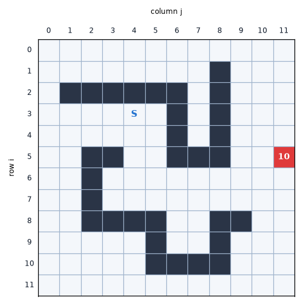

# The subject

## The problem
- A **maze game**: a robot learns to find the exit starting from a random position
- A **reinforcement learning** algorithm simulates the environment (the maze) and the learning steps of the robot
- Each position is a **row `i`** and a **column `j`**

| Element | Role |
|---|---|
| `Env` | the maze: rewards of the cells and a learning table |
| `Agent` | the robot: choice of a start, of an action and the move |
| `Train` | inherits from `Agent`: learns, then is tested |
| `Déco` | a decorator that repeats `Learn` and lowers epsilon |
| `Unique` | the singleton from which `Env` inherits |

## The maze

- `S` is the position (3, 4) used in the test of question 6

# Question 1 · Env

## Question 1: statement
- Define a class `Env` with a **single attribute** describing the maze: a numpy matrix `Récompense` of size **12 × 12**
  - the exit (red cell) has a reward of **10**
  - the white cells have a reward of **1**
  - the obstacles (grey cells) have a reward of **−5**; their positions are in a list `Lis` (use `Lis` without rewriting its content)
- A second attribute `table`: a **12 × 12 × 4** matrix of random values in [0, 50] (use **3 `for` loops**)
- Three methods:
  - `Award(i, j)`: returns the values at this position in `Récompense` and in `table` (`table[i, j]` is a list of 4 elements)
  - `Verify(i, j)`: returns `False` if the reward at this position is 1, otherwise `True`
  - `display`: displays `Récompense` or `table` according to the choice of the user

## Question 1: solution, the constructor
```python
import numpy as np

Lis = [(1,8), (2,1), (2,2), (2,3), (2,4), (2,5), (2,6), (2,8), (3,6), (3,8),
       (4,6), (4,8), (5,2), (5,3), (5,6), (5,7), (5,8), (6,2), (7,2), (8,2),
       (8,3), (8,4), (8,5), (8,8), (8,9), (9,5), (9,8), (10,5), (10,6), (10,7), (10,8)]

class Env:
    def __init__(self):
        self.Récompense = np.ones((12, 12))          # white cells: 1
        self.Récompense[5, 11] = 10                  # the exit
        for cc in Lis:
            self.Récompense[cc[0], cc[1]] = -5       # the obstacles
        self.table = np.zeros((12, 12, 4))
        for i in range(12):
            for j in range(12):
                for k in range(4):
                    self.table[i, j, k] = np.random.randint(0, 50)
```
- The matrix starts with ones: only the exit and the obstacles have to be changed
- `for cc in Lis` walks over the tuples: `cc[0]` is the row, `cc[1]` the column

## Question 1: solution, the methods
```python
    def Award(self, a, b):
        return self.Récompense[a, b], self.table[a, b]

    def Verify(self, i, j):
        return self.Récompense[i, j] != 1            # False on a white cell

    def Display(self):
        S = int(input("0: Récompense, another number: table\n"))
        print(self.Récompense if S == 0 else self.table)
```
- These methods are written inside the class `Env`, at the same indentation as `__init__`

## Question 1: remarks
- `table[i, j]` has **4 values**, one per action (0 right, 1 left, 2 up, 3 down): it says how interesting each action is in the cell
- `Verify` is `True` on the **exit** and on an **obstacle**: in both cases the robot must stop. It is `False` on a white cell
- `np.random.randint(0, 50)` gives 0 to 49: the upper bound is excluded (`50` can be written to get 0 to 50 included, with `randint(0, 51)`)
- The three nested `for` loops are required by the statement: the same result is obtained with `np.random.randint(0, 50, (12, 12, 4))`

# Question 2 · Agent

## Question 2: statement
- The learning of the robot: choose a random position in the maze and make moves (right, left, up, down) to find the exit
- Define a class `Agent` with an attribute `ob`: an object of the class `Env`
  - an attribute `epsilon` = 0.8 and a list `L` of 4 integers (0 to 3) for the actions (0 right, 1 left, 2 up, 3 down)
  - **`Start`**: chooses a random position (`i` and `j` in [0, 11]). While the cell is not a white cell, a new position is generated: `while Verify(i, j)`. It returns the position `i, j`
  - **`Action`**: for a position `i, j`, generates `p = np.random.random()`. If `p < epsilon`, it chooses a random action among the 4 (`np.random.randint`). Otherwise it chooses the action with the **largest value** in `table[i, j]`. It returns the **index** of the action
  - **`Move`**: receives `i, j` and the index of the action: 0 → `j + 1` if it is not the last column; 1 → `j − 1` if it is not the first column; 2 → `i − 1` if it is not the first row; 3 → `i + 1` if it is not the last row. It returns the new position

## Question 2: solution
```python
class Agent:
    def __init__(self):
        self.ob = Env()                       # the environment
        self.L = [0, 1, 2, 3]                 # right, left, up, down
        self.ep = 0.8                         # epsilon

    def Start(self):
        i = np.random.randint(12)
        j = np.random.randint(12)
        while self.ob.Verify(i, j):           # not a white cell: draw again
            i = np.random.randint(12)
            j = np.random.randint(12)
        return i, j

    def Action(self, i, j):
        p = np.random.random()
        if p < self.ep:
            return np.random.randint(4)               # explore: a random action
        return np.argmax(self.ob.table[i, j])         # exploit: the best action

    def Move(self, i, j, indice):
        if indice == 0 and j < 11:
            j += 1
        elif indice == 1 and j > 0:
            j -= 1
        elif indice == 2 and i > 0:
            i -= 1
        elif indice == 3 and i < 11:
            i += 1
        return i, j
```
- The attribute is called `ep` in the rest of the exam (`Test` and `Déco` use `self.ep`): it is `epsilon`

## Question 2: remarks
- **`epsilon = 0.8`**: with a probability of 80 % the robot **explores** (random action), with 20 % it **exploits** what it learned (`np.argmax` of the 4 values). `Déco` lowers it with time
- `np.argmax(table[i, j])` returns the **index** of the largest value, which is the number of the action
- `Move` does nothing when the robot is against a wall: the position stays the same
- `Start` is a loop that draws again until the cell is white: this is why `Verify(i, j)` is used as the condition of the `while`

# Question 3 · Train

## Question 3: statement
- Create a class `Train` that **inherits from `Agent`**, with an attribute `dic` (empty dictionary) and an attribute `total` set to 0
- **`Learn`** (no parameters): calls `Start` and adds the position `i, j` to `dic` (key = the tuple `(i, j)`, value = `K`, an integer created at the beginning and equal to 1, incremented after each added position). Then, `while not verify`: calls `Action` (which returns the index `c`) and `Move` (which returns the new `i, j`, overwriting the old position). After each `Move` the new position is added to `dic` with the value `K`, and `table[i, j, c]` is increased by **2**
- **`Test`** (position `i, j`): creates an empty list `Liste`. If the position is a terminal state, it returns the empty list. Otherwise it stores the position as a tuple, sets `ep` to 0 and, `while not Verify`, calls `Action` and `Move` and stores each position. It returns `Liste`

## Question 3: solution, Learn
```python
class Train(Agent):
    def __init__(self):
        super().__init__()
        self.dic = {}
        self.total = 0

    def Learn(self):
        k = 1
        i, j = self.Start()                      # a random white cell
        self.dic[(i, j)] = k
        k += 1
        while not self.ob.Verify(i, j):          # until the exit or an obstacle
            c = self.Action(i, j)                # the index of the action
            i, j = self.Move(i, j, c)            # the new position
            self.dic[(i, j)] = k
            k += 1
            self.total += self.ob.table[i, j, c]
            self.ob.table[i, j, c] += 2          # reinforcement
```
- `super().__init__()` creates `ob`, `L` and `ep` of `Agent`
- `i, j = ...` overwrites the old position, as the subject asks
- The reinforcement `+= 2` raises the value of the action in the table: the next `argmax` is more likely to choose it again

## Question 3: solution, Test
```python
    def Test(self, i, j):
        Liste = []
        if self.ob.Verify(i, j):                 # already a terminal state
            return Liste
        Liste.append((i, j))
        self.ep = 0                              # no more exploration
        while not self.ob.Verify(i, j):
            c = self.Action(i, j)                # always the best action
            i, j = self.Move(i, j, c)
            Liste.append((i, j))
        return Liste
```
- With `ep = 0`, `p < 0` is never true: `Action` always takes the **best** known action
- `Liste` is the path followed by the robot, as a list of tuples
- `Test` is a method of `Train` (it is written inside the class, with the same indentation as `Learn`)

# Question 4 · The decorator

## Question 4: statement
- To improve `Train`, create a decorator `Déco` that does this:
  - **all the code of the function** is put in a `for` loop whose number of iterations is given by a **value received as parameter**
  - at the end of each iteration, if epsilon is greater than 0.1, it is decreased by 0.01
- **What must be changed in `Train` to show that it is controlled by `Déco`?**

## Question 4: solution, the decorator
```python
def Déco(fct):
    def nouveau(self, a):                    # a: the number of iterations
        for i in range(0, a):
            fct(self)                        # the original method
            if self.ep > 0.1:
                self.ep -= 0.01              # less and less exploration
        print(self.dic)
    return nouveau
```
- `nouveau(self, a)` receives the object **and** the number of iterations
- The decorated method keeps its name: calling `Learn(1000)` calls `nouveau(self, 1000)`, which runs the original `Learn` **1000 times**
- After 1000 episodes `ep` is at its minimum, about 0.1: the robot explores less and exploits more

## Question 4: the answer
```python
class Train(Agent):
    ...
    @Déco                                    # the only change
    def Learn(self):
        ...
```
- **We write `@Déco` before the function** (`Learn`, the learning method of `Train`)
- It is the same as `Learn = Déco(Learn)`
- The decorator must be defined **before** the class `Train`
- Without the decorator, `Learn()` makes one episode. With it, `Learn(1000)` makes 1000

# Question 5 · The singleton

## Question 5: statement
- To use **one single environment** in the program, transform the class `Env` into a **singleton** with the inheritance approach
- Which changes must be applied to `Env` to create the singleton `Unique` by inheritance?

## Question 5: solution
```python
class Unique(object):
    _instance = None
    def __new__(class_, *args, **kwargs):
        if not isinstance(class_._instance, class_):
            class_._instance = object.__new__(class_, *args, **kwargs)
        return class_._instance


class Env(Unique):                           # the only change
    ...
```
- **We write `class Env(Unique)`**: the name of the singleton goes in the signature of `Env`
- `__new__` creates the object **only the first time**: the next calls return the object stored in `_instance`
- Here `Agent` and `Train` both call `Env()`: they get **the same maze**
- Careful: `__init__` runs again on the same object at every `Env()` call, so the maze and the random `table` are reinitialized

# Question 6 · The main program

## Question 6: statement
- In the main program: create a `Train` object and call `Display`, call `Learn`, then call `Test` for a position of your choice

## Question 6: solution
```python
robot = Train()
robot.ob.Display()          # 0: Récompense, another number: table  ->  0
robot.Learn(1000)           # the decorator: 1000 learning episodes
print(robot.Test(3, 4))
```
- `Display` is a method of `Env`: we reach it through the attribute `ob`: `robot.ob.Display()`
- `Learn(1000)`: the 1000 is the parameter `a` of the decorator
- `Test(3, 4)`: the robot starts on the white cell (3, 4)

## An example run
```text
0: Récompense, another number: table
0
[[ 1.  1.  1.  1.  1.  1.  1.  1.  1.  1.  1.  1.]
 [ 1.  1.  1.  1.  1.  1.  1.  1. -5.  1.  1.  1.]
 [ 1. -5. -5. -5. -5. -5. -5.  1. -5.  1.  1.  1.]
 ...
 [ 1.  1.  1.  1.  1.  1.  1.  1.  1.  1.  1.  1.]]
{(3, 9): 1, (2, 9): 1, (2, 10): 2, (1, 10): 1, (0, 10): 27, ...}
[(3, 4), (3, 5), (3, 6)]
```
- The decorator prints `dic` once at the end: the key is a cell and the value is the **last** `K` (step number) at which it was visited, so after 1000 episodes `dic` holds almost every cell of the maze
- `ep` went down to 0.1 during the 1000 episodes
- The test path ends on the obstacle (3, 6): the episode stops there because `Verify` is `True`

# Summary

## What to remember
- The **exit is not reached on purpose**: the subject's algorithm only adds 2 to the visited actions and never uses the rewards of `Récompense`. The robot ends on the exit **or on an obstacle**, since both are terminal states
- The attribute `total` is only a counter of the values met in `table`
- The decorator is the same pattern as in the 2023 exam: `def Déco(fct)` returns `nouveau`, and `@Déco` is written before the method
- The singleton is the same pattern too: `Unique` with `__new__`, and the name of the parent in the class signature
- **The exam checks**: attributes, **inheritance** (`Train(Agent)`, `super().__init__()`), an **object as attribute** (`ob`), **decorators** and **singleton** by inheritance
