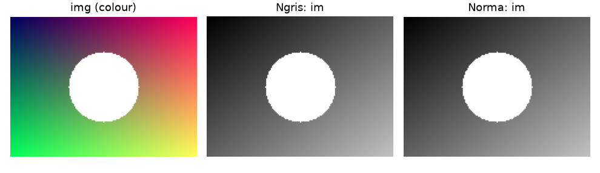

# Overview

## The three exercises
1. **`Student`**: a class with a numpy array of marks, and the comparison of two objects
2. **`signal`** and **`Processing`**: statistics of a signal and a `shift` normalization
3. **`image`** and **`processing`**: a colour image, its grey level and its normalization
- Each solution was run and the outputs shown are real

# Exercise 1 · Student

## Exercise 1: statement
- Define a class `Student` with the attributes: **last name**, **first name** and **exam marks** (a numpy array of 8 elements)
  1. The class has the methods:
     - `Input` and `Display`: enter and display the student's marks
     - `Average`: returns the average and displays whether he is **admitted** or **deferred**
  2. Instantiate the class with **two objects**, enter the marks and compare their averages. Display which one is ranked higher

## Exercise 1: solution, the class
```python
import numpy as np

class Student:
    def __init__(self, last_name, first_name):
        self.last_name = last_name
        self.first_name = first_name
        self.marks = np.zeros(8)                            # 8 exam marks

    def Input(self):
        for i in range(8):
            self.marks[i] = float(input(f"Mark {i + 1}: "))

    def Display(self):
        print(self.last_name, self.first_name, self.marks)

    def Average(self):
        avg = self.marks.mean()
        print("average =", avg, "->", "admitted" if avg >= 10 else "deferred")
        return avg
```
- The marks start as zeros and are filled by `Input`
- `Average` both **displays** the status and **returns** the average

## Exercise 1: solution, the two objects
```python
s1 = Student("Haddad", "Sara")
s1.Input()                       # 14 9 12 16 11 13 15 10
s1.Display()                     # Haddad Sara [14.  9. 12. 16. 11. 13. 15. 10.]
a1 = s1.Average()                # average = 12.5 -> admitted

s2 = Student("Benali", "Omar")
s2.Input()                       # 8 7 10 9 12 6 11 9
s2.Display()                     # Benali Omar [ 8.  7. 10.  9. 12.  6. 11.  9.]
a2 = s2.Average()                # average = 9.0 -> deferred

if a1 > a2:
    print(s1.first_name, "is ranked higher")        # Sara is ranked higher
elif a2 > a1:
    print(s2.first_name, "is ranked higher")
else:
    print("same average")
```
- `s1.marks` and `s2.marks` are two different arrays: each object has **its own** attributes

# Exercise 2 · Signal

## Exercise 2: statement
- Define a class `signal` with 4 attributes: `n` (number of samples), `m` (mean), `st` (standard deviation) and a numpy vector `data`
  - the **constructor** asks the user for `n`, sets `m` and `st` to 0 and creates `data` of size `n` filled with 0
  - `values` fills `data` with random values in [0, 50]
  - `stat` calculates the mean and the standard deviation (with your own program, then compare with numpy)
  - `display` displays all the attributes
- A class `Processing` with a function `shift` that normalizes a `signal` object: `data[i] = (data[i] − m)² / std`
- Test: create a signal, call `values` and `stat`, apply `shift` and put the result in a **new `signal` object**, then `display` it

## Exercise 2: solution, the classes
```python
import numpy as np

class signal:
    def __init__(self, n=None):
        self.n = int(input("Number of samples: ")) if n is None else n
        self.m = 0                                     # mean
        self.st = 0                                    # standard deviation
        self.data = np.zeros(self.n)                   # the samples

    def values(self):
        self.data = np.random.uniform(0, 50, self.n)   # random values in [0, 50]

    def stat(self):
        total = 0
        for x in self.data:                            # our own calculation
            total += x
        self.m = total / self.n
        ss = 0
        for x in self.data:
            ss += (x - self.m) ** 2
        self.st = (ss / self.n) ** 0.5
        print("own program :", round(self.m, 4), round(self.st, 4))
        print("numpy       :", round(np.mean(self.data), 4), round(np.std(self.data), 4))

    def display(self):
        print("n =", self.n, " m =", round(self.m, 3), " st =", round(self.st, 3))
        print("data =", self.data.round(1))


class Processing:
    def shift(self, s):                                # s is a signal object
        new = signal(s.n)                              # a new signal object
        new.data = (s.data - s.m) ** 2 / s.st
        new.m = np.mean(new.data)
        new.st = np.std(new.data)
        return new
```
- `signal(6)` gives `n` directly; `signal()` asks it with `input`

## Exercise 2: solution, the main program
```python
S = signal(6)
S.values()
S.stat()
# own program : 18.3134 8.2491
# numpy       : 18.3134 8.2491
S.display()
# n = 6  m = 18.313  st = 8.249
# data = [21.8  1.3 27.5 21.8 21.  16.5]

new = Processing().shift(S)
new.display()
# n = 6  m = 8.249  st = 12.471
# data = [ 1.5 35.1 10.2  1.4  0.9  0.4]
```
- Our loops compute the **population** standard deviation, like `np.std`: both lines print the same values
- `shift` doesn't change `S`: it returns a **new** `signal` object
- The mean of the new data equals the old standard deviation: the mean of `(x − m)²` is the variance, divided by `std`

# Exercise 3 · Image

## Exercise 3: statement
1. Define an **`image` class** with two attributes `l` and `c` (rows and columns), both set to 0, and:
   - **`read`**: adds an attribute `img` (a colour image read from a file) and an attribute `im`, an empty 2-dimensional matrix with the same number of rows and columns as `img` (use `np.shape`)
   - **`display`**: has a parameter. It displays `img` if the parameter is null, otherwise `im` (use `plt.imshow`)
2. Define a **`processing` class** with two functions that handle `image` objects:
   - **`Ngris`**: returns the same object after putting the average of the three RGB planes of `img` into `im`
   - **`Norma`**: first calls `Ngris`, then divides `im` by its maximum value, and returns the object
3. Test: create an image object, call `read` and `display`; create a processing object, call `Ngris` and `Norma` and put the results in two new image objects, then display their `im`

## Exercise 3: solution, the image class
```python
import numpy as np
import matplotlib.pyplot as plt

class image:
    def __init__(self):
        self.l = 0
        self.c = 0

    def read(self, path):
        self.img = plt.imread(path)[:, :, :3].astype(float)   # colour image, 3 planes
        self.l, self.c = np.shape(self.img)[:2]               # rows, columns
        self.im = np.empty((self.l, self.c))                  # empty 2D matrix, same size

    def display(self, param=0):
        plt.figure()
        if param == 0:
            plt.imshow(self.img / self.img.max())             # the colour image
        else:
            plt.imshow(self.im, cmap="gray")                  # the 2D matrix im
        plt.show()
```
- `[:, :, :3]` keeps the 3 colour planes (a PNG file may also contain a 4th one, the transparency)
- `.astype(float)`: the sums of the next slide must not overflow when the pixels are 8-bit integers (a sum of three `uint8` values wraps around at 255)
- `np.shape(self.img)[:2]` gives rows and columns; `np.empty` creates the matrix without filling it

## Exercise 3: solution, the processing class
```python
class processing:
    def Ngris(self, obj):
        obj.im = (obj.img[:, :, 0] + obj.img[:, :, 1] + obj.img[:, :, 2]) / 3
        return obj                                   # the same object

    def Norma(self, obj):
        self.Ngris(obj)                              # first the grey level
        obj.im = obj.im / obj.im.max()               # then divide by the maximum
        return obj
```
- `Ngris`: the grey level of a pixel is the **average** of its R, G and B values
- `Norma`: after the division the biggest value of `im` is 1

## Exercise 3: solution, the test
```python
I = image()
I.read("sample.png")
I.display()                        # the colour image
print(I.l, I.c, I.img.shape, I.im.shape)     # 120 160 (120, 160, 3) (120, 160)

P = processing()
I1 = image(); I1.read("sample.png")
G = P.Ngris(I1)                    # grey level
I2 = image(); I2.read("sample.png")
N = P.Norma(I2)                    # normalized grey level

G.display(1)                       # displays G.im
N.display(1)                       # displays N.im
print(G.im.max(), N.im.max())      # 1.0 1.0
```
- `sample.png` stands for the image file of your choice
- The results go in **two new image objects** (`I1`, `I2`) because `Ngris` and `Norma` modify and return the object they receive

## Exercise 3: the result

- Left: `img`. Middle: `im` after `Ngris`. Right: `im` after `Norma`
- For an image stored in 8 bits (a `.jpg`) `Ngris` gives values up to 255: `Norma` brings them to the range [0, 1]
